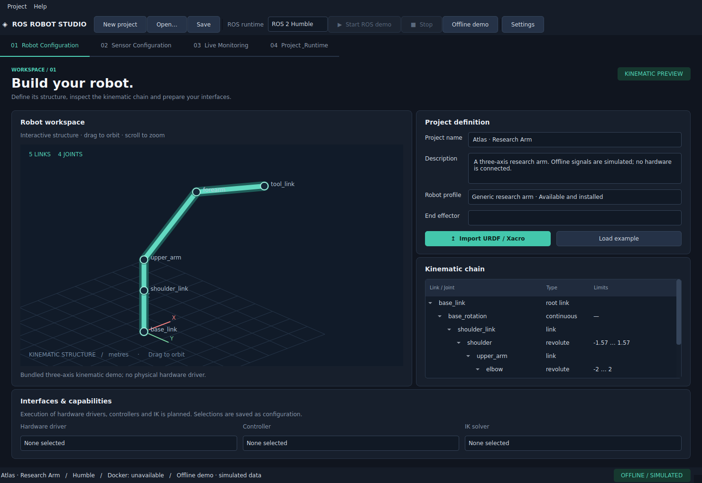

# ROS Robot Studio

Eine startbare Desktop-Werkbank für ROS-2-Roboterprojekte. Der MVP bietet vier Tabs,
URDF-Strukturansicht, Sensor- und TF-Konfiguration, portable YAML-Projekte und Live-Plots.
Er funktioniert ohne Docker, ROS-Installation oder Roboterhardware.




## Start unter Ubuntu 22.04

Im Projektverzeichnis:

```bash
./start.sh
```

Beim ersten Start erscheint der grafische Einrichtungsassistent. Für die sofortige
Offline-Demo ohne Assistenten:

```bash
./start.sh --demo
```

Python 3.10+, Git und eine grafische Desktop-Sitzung werden vorausgesetzt. Der Bootstrap
installiert die festgelegten Python-Abhängigkeiten ausschließlich in `.venv`; Internet ist
beim ersten Start erforderlich. Er funktioniert auch ohne pip und `python3-venv`/ensurepip.
Auf Ubuntu 22.04 amd64 wird eine gegebenenfalls fehlende kleine Qt-Cursorbibliothek aus
dem offiziellen Ubuntu-Archiv mit fester SHA-256-Prüfung lokal entpackt. Keine Systempakete,
Docker-Daemons oder ROS-Installationen werden beim Start automatisch verändert.

Die virtuelle Umgebung ist hier bereits vorbereitet. Auf einem frischen Rechner benötigt
sie ungefähr 800 MB. Docker und große ROS-Images werden nur nach ausdrücklicher Auswahl
im Assistenten beziehungsweise Runtime-Tab installiert.

## Erste Schritte

1. **Robot Configuration:** Projektname ändern, Beispiel laden oder URDF importieren.
   Links, Gelenke, Typen, Limits und Parent-/Child-Beziehungen im Baum untersuchen.
   In der Strukturansicht ziehen zum Drehen, Mausrad zum Zoomen, Doppelklick zum Zurücksetzen.
2. **Sensor Configuration:** Sensor hinzufügen oder doppelklicken. Topic, Einheit,
   Parent-Frame, Translation, RPY, statischen/dynamischen TF-Typ und Grenzwerte eingeben.
3. **Live Monitoring:** `/studio/sine`, `/joint_states` oder `/studio/temperature` auswählen.
   Numerische Felder ankreuzen, Zeitfenster einstellen, pausieren und zurücksetzen.
   Offline-Daten sind deutlich als simuliert gekennzeichnet.
4. **Speichern:** Über die Werkzeugleiste eine `.yaml`-Datei auswählen. Die URDF wird in
   einen benachbarten `.assets`-Ordner kopiert. Datei und Ordner zusammen weitergeben.
   Mit **Open…** erneut laden; ein vollständiges Beispiel liegt unter
   `examples/generic_robot/demo.studio.yaml`.
5. **Project & Runtime:** Humble auswählen, Studio-Runtime installieren, **Start ROS demo**
   drücken und **Verify ROS demo** ausführen. Danach zeigt Monitoring echte ROS-Nachrichten
   aus Demo-Nodes im Container. Mit **Stop** wird nur der eigene Container entfernt.

Das ROS-Dropdown steuert die aktuelle Sitzung. Es überschreibt den gespeicherten
Projektstandard nicht. **Save selected ROS as project default** übernimmt die Auswahl
bewusst in das Projekt. Bei laufender Containerdemo wird die alte Runtime vor einem
Versionswechsel gestoppt. Das Projekt bleibt erhalten.

## Stand und Grenzen

Die Offline-GUI wurde unter Ubuntu 22.04 sowohl offscreen als auch in einer sichtbaren
X11-Sitzung gestartet und visuell geprüft. 42 automatisierte Tests bestanden in der
abschließenden Prüfung mit erlaubten lokalen Sockets; drei echte ROS-Container-Tests
wurden mangels Docker-Daemon übersprungen. Details: [Prüfbericht](docs/VERIFICATION.md).

Humble, Jazzy und Lyrical besitzen live geprüfte offizielle amd64-Basisimages. Die
Erweiterungsimages, Demo-Nodes und rosbridge-Anbindung sind implementiert; tatsächliche
Docker-Builds und ROS-Läufe konnten hier nicht ausgeführt werden. Der Assistent besitzt
hierfür einen echten Ende-zu-Ende-Test mit temporärem Testcontainer.

Meshes, Hardwareansteuerung, Controller-/IK-Ausführung, TF-Publishing und Kalibrierung
sind noch nicht implementiert. SO-101 ist ein ausdrücklich unverifiziertes Planungsprofil;
die generische Vorschau ist kein SO-101-Modell. Sensorgrenzen sind **keine zertifizierten
Sicherheitsfunktionen**. Weitere Grenzen stehen in [ROADMAP.md](ROADMAP.md).

## Dokumentation

- [Installation und Fehlerbehebung](INSTALLATION.md)
- [Architektur und Schnittstellen](ARCHITECTURE.md)
- [Entwicklung, Tests und Docker-Builds](DEVELOPMENT.md)
- [Projektformat](docs/PROJECT_FORMAT.md)
- [Umsetzungsstand und nächste Schritte](ROADMAP.md)
- [Abschlussbericht](docs/FINAL_REPORT.md)
- [Drittanbieter-Lizenzen](THIRD_PARTY_LICENSES.md)

Studio-Quellcode und der generische Beispielroboter stehen unter Apache-2.0. Qt und
andere Abhängigkeiten behalten ihre jeweiligen Open-Source-Lizenzen.
