# ROS Robot Studio

ROS Robot Studio ist eine modulare Desktop-Anwendung für Roboterkonfiguration, Kinematik, Aufgabenplanung und ROS-2-Simulation. Ein Projekt verbindet URDF, Gelenkstellungen, gespeicherte Positionen, Tasks, ROS-Backends und Kameraprofile. Der SO-101 Follower ist das Referenzmodell für die Offline- und Isaac-Sim-Workflows.

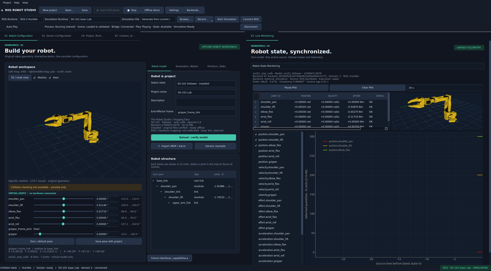

*Der SO-101 Follower in Robot Configuration neben dem Live Monitoring. Beide Ansichten verwenden denselben aktiven Roboterzustand.*

- [ROS Robot Studio – Overview & Features](#ros-robot-studio--overview--features)
- [Tutorial – SO-101 in ROS Robot Studio und Isaac Sim](#tutorial--so-101-in-ros-robot-studio-und-isaac-sim)
  - [Installieren und den SO-101 konfigurieren](#1-installation)
  - [Humble, Isaac Sim und eine eigene USD](#6-ros-2-humble-einrichten)
  - [Gelenkbewegung, Positionen und Tasks](#11-gelenkbewegung-und-live-monitoring)
  - [RGB-Kamera und Objekterkennung](#14-rgb-kamera-zur-usd-hinzufügen)
  - [Eigene Roboter und Szenen](#eigene-roboter-und-szenen)

## ROS Robot Studio – Overview & Features

| Bereich | Status | Funktionsumfang |
| --- | --- | --- |
| Robot Configuration | Supported | URDF-Import, native OpenGL-Meshes, Link- und Gelenkbaum, URDF-Limits, virtuelle Gelenkregler und aktuelle Werkzeugpose |
| Kinematics & Motion | Supported | Universelle FK, validierte Ketten, SciPy-IK mit Gelenkgrenzen, Zielvorschau und Poseanwendung offline |
| Positions & Tasks | Supported | Teach-in, Joint- und Cartesian-Positionen, Taskeditor, relative Endpunkte, Greiferaktionen und Pick-and-Place-Wizard |
| ROS Runtime | Supported | Verwaltete Humble-, Jazzy- und Lyrical-Container, rosbridge/rosapi, DDS-Domains und Wechsel des aktiven Backends |
| Simulation | Supported | Isaac Sim 5.1 mit Humble, USD-Aufbau aus URDF, native JointStates, Zeitbasis und Trajektorienausführung über den Isaac-Adapter |
| Live Monitoring | Supported | Positionen, Geschwindigkeiten, Roboterzustand, ROS-Graph, Taskstatus und Zeitreihen |
| Dockable Workspace | Supported | Haupttabs ziehen, horizontal oder vertikal teilen, Layout speichern und wiederherstellen |
| Camera & Vision | Supported | ROS-RGB-Kameras, feste Isaac-Kamera, HSV, ArUco, YOLOv5n v7 ONNX, CameraInfo/TF2 und planare Positionen |
| Vision PoseProvider | Supported | Gültigen Punkt in einen manuellen Zielentwurf mit expliziter Werkzeugorientierung und Versatz übernehmen |
| Real Robot | Read Only | ROS-Zustand empfangen und überwachen |
| Physischer Objektkontakt, bewegte Kamera-Montagen, Homographie | Planned | Greif- und Kontaktvalidierung sowie zusätzliche Kalibrierungs- und Montageverfahren |
| MuJoCo und Gazebo | Planned | Profilverwaltung und lokale Dateizuordnung sind vorbereitet. Adapter und Start fehlen. |

### Funktionsansichten

| Robot Configuration | Kinematics & Motion |
| --- | --- |
| 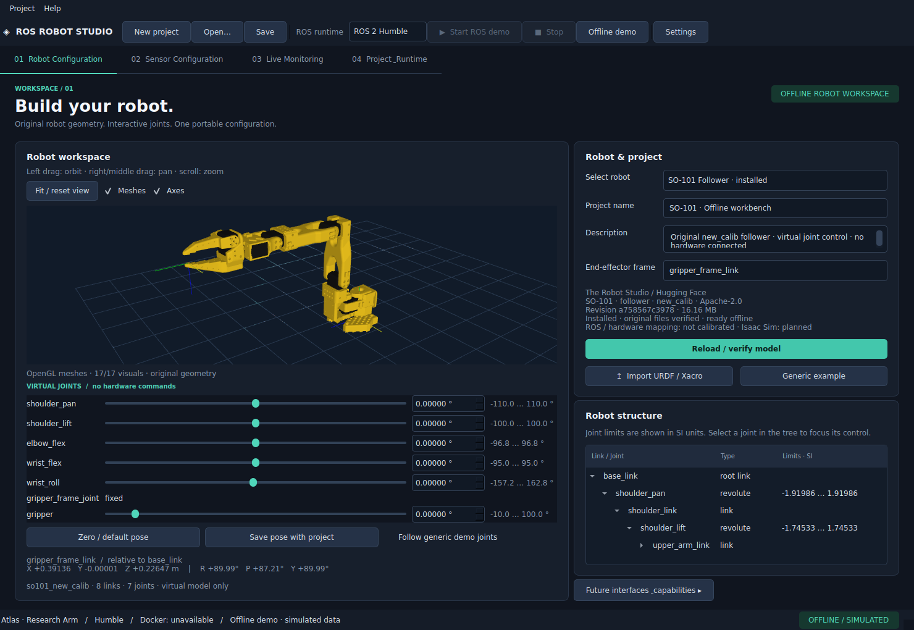 | 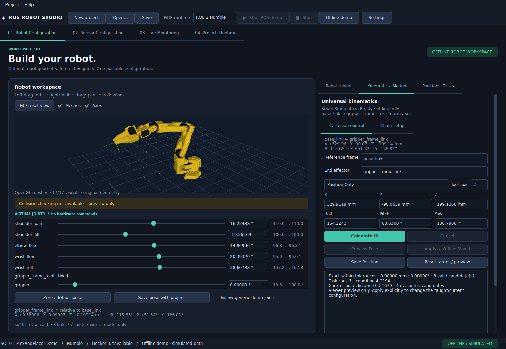 |
| *Originalgeometrie, aktuelle Gelenkstellung und Modellstruktur.* | *Kettenkonfiguration für den fünf Freiheitsgrade umfassenden Arm.* |

| Positions & Tasks | ROS Runtime und Simulation Runtime |
| --- | --- |
| 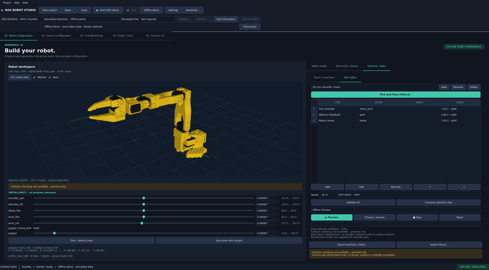 |  |
| *Taskschritte und ihre Validierung in einem Projekt.* | *Runtime, Szenenauswahl und Live-Status im Banner.* |

| Live Monitoring | Dockable Workspace |
| --- | --- |
| 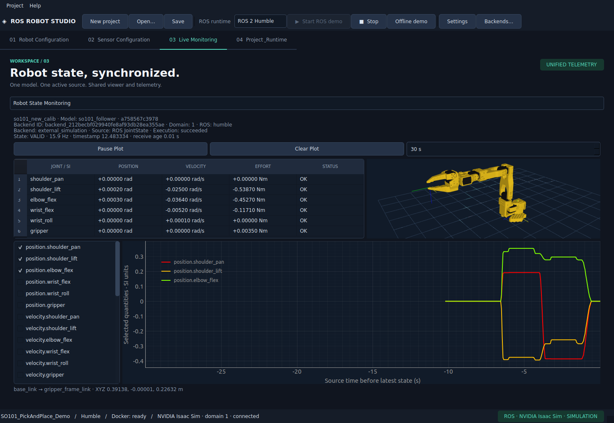 |  |
| *Live-Zustand und Bewegungsfortschritt aus Isaac Sim.* | *Zwei Hauptansichten in einer gespeicherten Fensteranordnung.* |

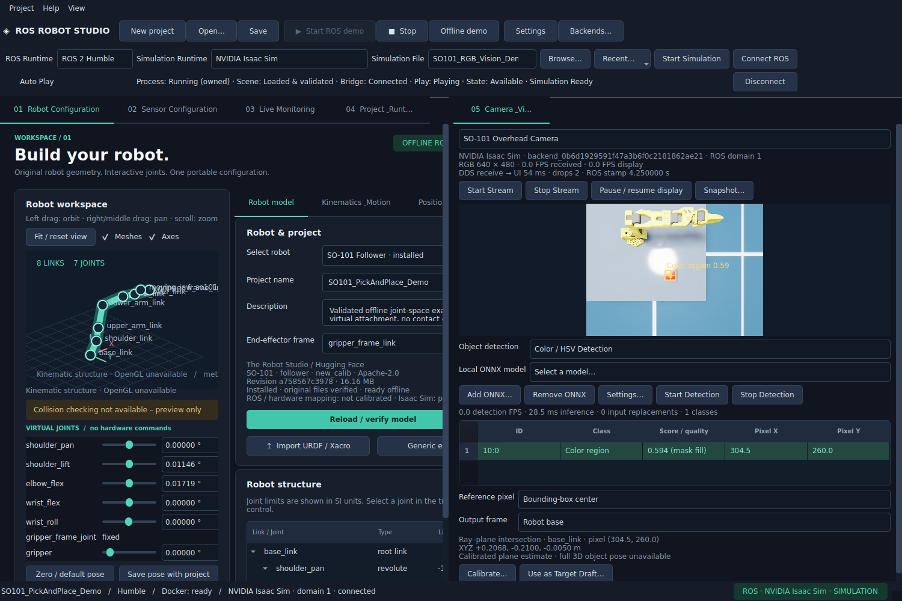

*Camera & Vision zeigt das Isaac-RGB-Bild, den HSV-Fund und seine Position auf der bekannten Tischfläche.*

### Getestete Umgebung

| Software | Getesteter Stand und Einsatz |
| --- | --- |
| Ubuntu | 22.04 LTS, x86-64, X11 für native OpenGL-Abnahme |
| Python | 3.10 für die Desktop-Anwendung |
| PySide6 / Qt | 6.9.3 aus dem lokalen Python-Environment |
| Docker Engine | 29.9.3 bei der Systemabnahme. Benötigt für die verwalteten ROS-Laufzeiten. |
| ROS 2 Humble | Eigener Container, ROS-Demo und getestete Isaac-Sim-/Vision-Kombination |
| ROS 2 Jazzy | Eigener Container und ROS-Demo geprüft. Der Isaac-Manager prüft die lokal vorhandene Jazzy-Bridge. |
| ROS 2 Lyrical | Eigener Container und ROS-Demo geprüft. Isaac-Adapter unterstützt Humble/Jazzy. |
| NVIDIA Isaac Sim | 5.1, optionaler eigener Prozess. Abnahme mit Humble und NVIDIA-GPU. |
| MuJoCo / Gazebo | Profile vorbereitet, Ausführung geplant |

Für eigene URDFs sind Import, FK, Kettenanalyse und der modellabhängige IK-Workflow verfügbar. Modellgrenzen, Controller, Gelenkmapping und erreichbare Ziele werden für den jeweiligen Roboter geprüft.

### Architektur

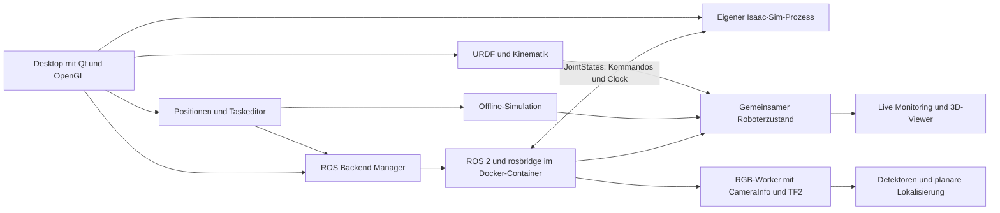

[Architektur](ARCHITECTURE.md) · [Backend-Profile](docs/BACKEND_CONNECTION_MANAGER.md) · [Kinematik](docs/KINEMATICS.md) · [Vision-Abnahme](docs/VISION_VERIFICATION.md)

## Tutorial – SO-101 in ROS Robot Studio und Isaac Sim

Die Schritte 1–5 funktionieren offline. Ab Schritt 6 verwendet das Beispiel einen verwalteten Humble-Container. Für Isaac Sim wird der originale SO-101 Follower aus dem Studio-Katalog geladen.

### 1. Installation

1. Im lokalen Checkout ein Terminal öffnen. Auf Ubuntu 22.04 werden Git, Python 3.10, das passende `venv`-Modul und eine native Qt/OpenGL-Umgebung benötigt.
2. `./start.sh` im Projektordner ausführen. Der Launcher erstellt `.venv`, installiert die gesperrten Python-Abhängigkeiten und öffnet den Setup-Assistenten.
3. Für den Offline-Einstieg **Open offline demo** wählen. Über **Help → Setup assistant** lässt sich der Assistent später erneut öffnen.
4. Für den Simulationsabschnitt Docker Engine installieren und starten. Bei einem vorhandenen systemweiten Dienst zeigt `systemctl is-active docker` den Zustand. `docker info` muss aus derselben Benutzersitzung wie Studio funktionieren. Die Mitgliedschaft in der Docker-Gruppe gewährt weitreichende Hostrechte und wird erst nach einer neuen Anmeldung wirksam. Die Anwendung als normaler Benutzer starten.
5. In **Setup assistant → Components** über **Install Universal Kinematics Support** den SciPy-Solver installieren. **Install optional RGB detector support** ergänzt OpenCV und ONNX Runtime für Schritt 16.

```bash
./start.sh
```

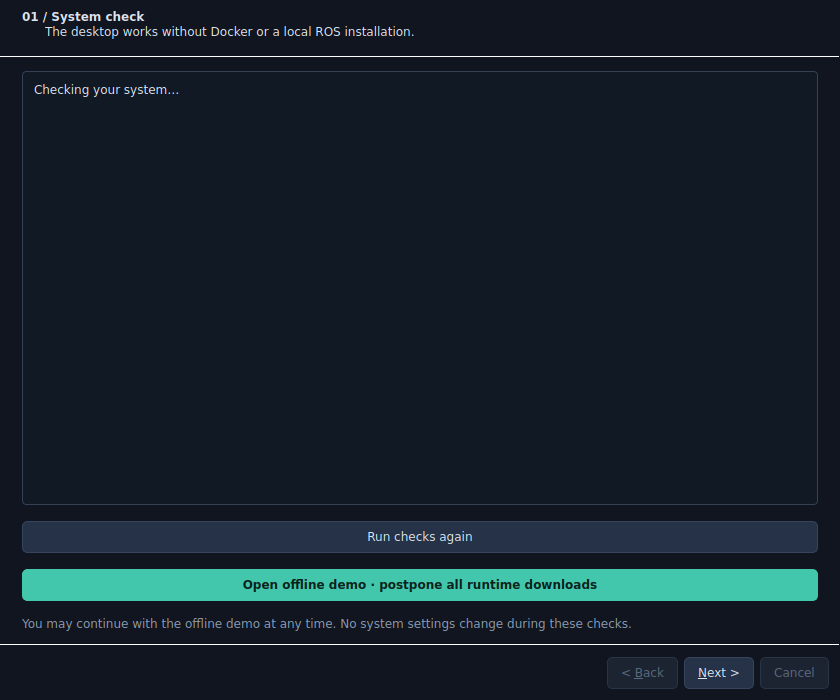

*Der Setup-Assistent prüft die Umgebung. Offline-Arbeit kann direkt gestartet werden.*

[Installationsanleitung](INSTALLATION.md) · [Docker-Diagnose](docs/DOCKER_DIAGNOSTICS.md) · [Isaac Sim 5.1 herunterladen](https://docs.isaacsim.omniverse.nvidia.com/5.1.0/installation/download.html) · [NVIDIA-Systemanforderungen](https://docs.isaacsim.omniverse.nvidia.com/5.1.0/installation/requirements.html)

### 2. Projekt anlegen

1. Oben **New project** klicken. Studio öffnet den Arbeitsbereich **Robot Configuration**.
2. Im Reiter **Robot model** unter **Project name** den Namen `SO-101 Lab` eingeben.
3. **Save** klicken und beispielsweise `SO101-Lab.studio.yaml` in einem eigenen Projektordner speichern.

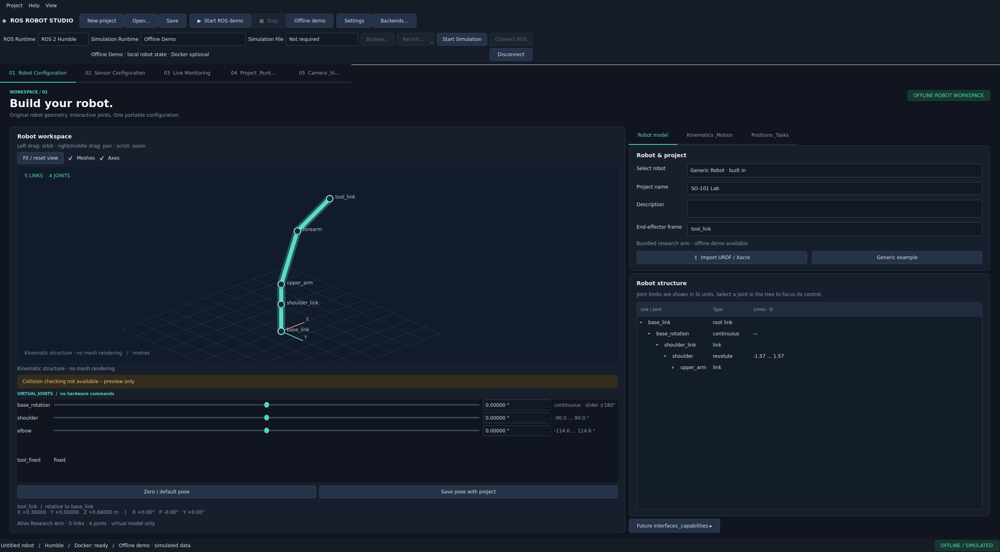

*Der Projektname wird im Modellreiter eingegeben. Save öffnet beim ersten Speichern den Dateidialog.*

### 3. Originalen SO-101 laden oder eine URDF importieren

1. **Robot Configuration → Robot model → Select robot → SO-101 Follower** wählen.
2. Falls das Modell fehlt, **Install Robot Model** anklicken und den Download bestätigen. Studio holt die fixierte Follower-Revision einschließlich der originalen STL-Dateien und prüft die Prüfsummen.
3. **Meshes** aktivieren. Der Viewer sollte **17/17 visuals** anzeigen. Unter **Robot structure** stehen acht Links und sieben Joints, darunter das feste Gelenk zum Werkzeugframe.
4. Für eine manuelle URDF-Variante **Import URDF / Xacro** klicken und `Simulation/SO101/so101_new_calib.urdf` mit dem zugehörigen `assets/`-Ordner wählen. Der Katalogweg übernimmt zusätzlich die Modellrevision und die mitgelieferte Greiferkonfiguration. Für die folgenden Schritte wieder **SO-101 Follower** auswählen.

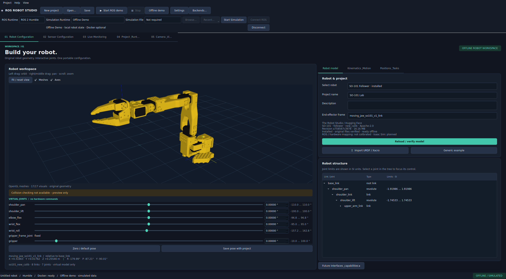

*Der Modellreiter zeigt die Quellenrevision, die visualisierten Geometrien und den Gelenkbaum.*

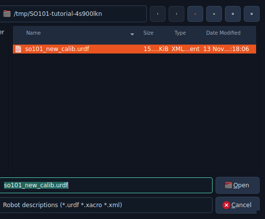

*Die Auswahl zeigt die Datei so101_new_calib.urdf.*

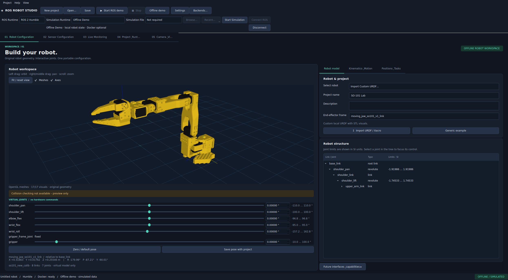

*Der direkte Import zeigt die Geometrie als benutzerdefiniertes URDF-Modell.*

[Fixierte Originalquelle und Lizenz](docs/SO101.md)

### 4. Gelenke und Limits prüfen

Im Offline-Modus unter **Virtual joints** den Regler für `shoulder_pan` bewegen oder im Zahlenfeld `5.73°` eingeben. Die Basis dreht sich und die Werkzeugpose ändert sich. Revolute-Werte werden in Grad angezeigt und intern in Radiant gespeichert. Die sechs beweglichen Achsen sind `shoulder_pan`, `shoulder_lift`, `elbow_flex`, `wrist_flex`, `wrist_roll` und `gripper`. Mit **Zero / default pose** zur URDF-Startkonfiguration zurückkehren.

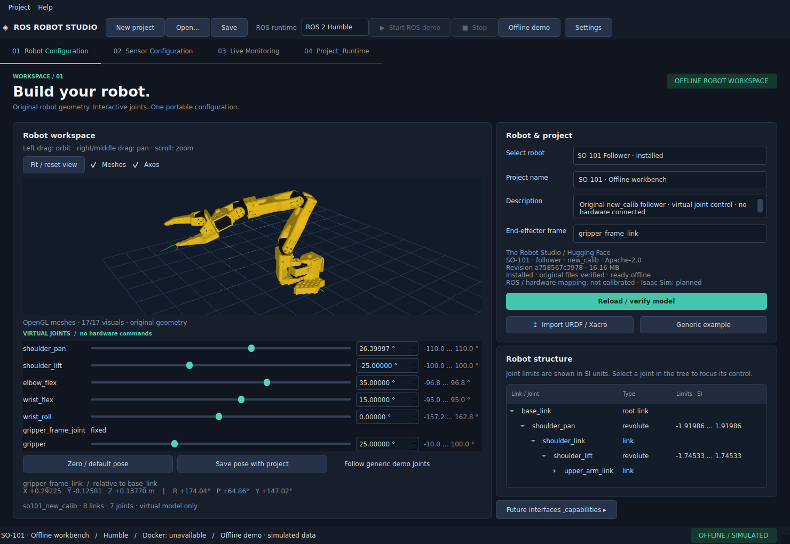

*Eine Gelenkänderung aktualisiert die Original-Meshes und die angezeigte Endeffektorpose.*

### 5. Kinematik einrichten

1. **Robot Configuration → Kinematics & Motion → Chain setup** öffnen.
2. **Base frame** auf `base_link`, **End-effector frame** auf `gripper_frame_link` und **Gripper joint** auf `gripper` setzen.
3. **Offline solver → Automatic · SciPy bounded IK** auswählen und **Confirm chain & run FK / IK checks** klicken. Die Liste **Active arm joints** enthält fünf Armachsen.
4. Unter **Cartesian control** zunächst die aktuelle Position als Ziel verwenden, **Position Only** wählen und **Calculate IK** klicken. **Preview Pose** zeigt die Lösung im Viewer. **Apply to Offline Model** übernimmt sie in den virtuellen Zustand.
5. Für einen ersten Test die Zielposition nur wenige Millimeter verändern und das Resultat samt Restfehler prüfen. Eine frei wählbare volle 6D-Pose erfordert zusätzliche Freiheitsgrade. Der SO-101 bietet eine separate Greiferachse.

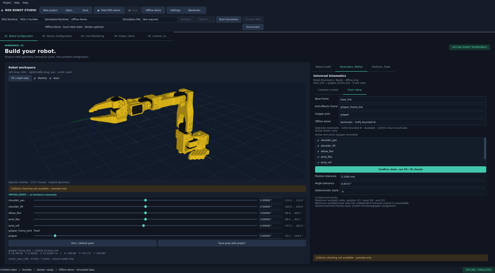

*Die bestätigte SO-101-Kette trennt den Greifer von den fünf Armachsen.*

[Solver-Auswahl im nativen Studio](docs/images/tutorial/07-solver-selection.png)

### 6. ROS 2 Humble einrichten

1. Im **Setup assistant** auf der Seite **ROS runtimes** Humble auswählen und **Install selected runtimes** ausführen. Vorhandene Images werden im Laufzeitstatus angezeigt.
2. Oben **ROS Runtime → ROS 2 Humble** und für den ersten Test **Start ROS demo** wählen. **Project & Runtime** zeigt Container und Verbindungszustand. **Live Monitoring** zeigt den aktiven Zustand. **Stop** beendet die Studio-Demo vor dem Wechsel zu Isaac.
3. Bei Zugriffsfehlern die eingeblendete Docker-Diagnose öffnen. Sie unterscheidet fehlenden Daemon, Socketzugriff und Gruppen im tatsächlich laufenden Studioprozess.

Die Distribution bestimmt ROS-Pakete und Containerbasis. **ROS_DOMAIN_ID** trennt DDS-Teilnehmer. Ein Backendprofil speichert Domain, Distribution, Topics und Modellbindung. Für dieses Tutorial verwendet Isaac **Domain 1**, die ROS-Demo ein separates Profil.

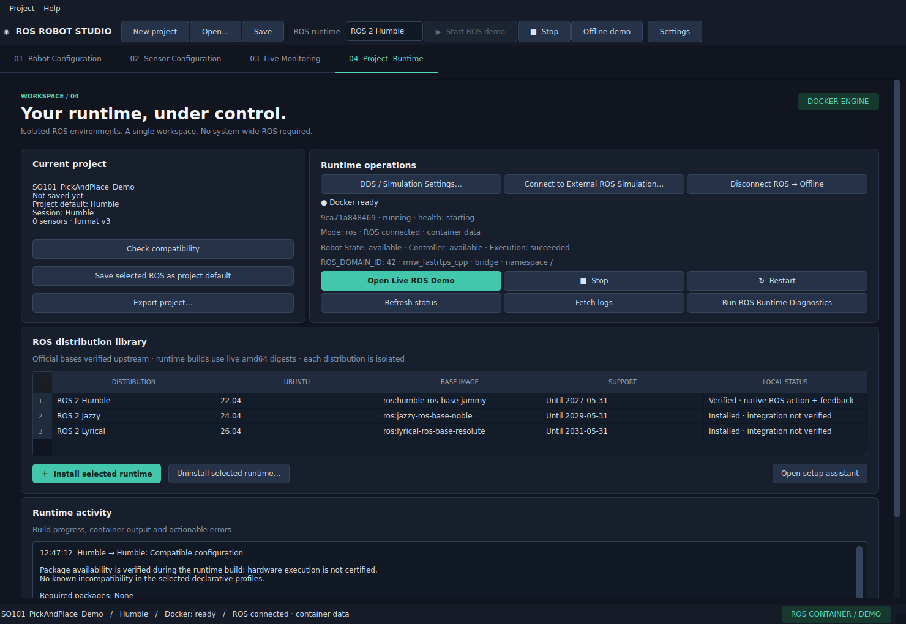

*Project & Runtime zeigt die installierte Distribution und den Zustand der Studio-Verbindung.*

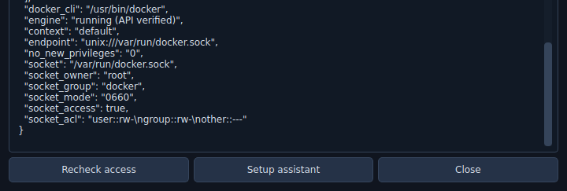

*Der Ausschnitt zeigt den tatsächlich verwendeten Docker-Endpoint und Socketzugriff.*

### 7. Isaac-Sim-Profil konfigurieren

1. In der Toolbar **Backends… → Add** öffnen.
2. Im Reiter **Connection** `isaac_sim`, `local_installation`, `humble`, **ROS_DOMAIN_ID** `1`, **Network profile** `host` und **Discovery** `localhost` wählen. **Local Isaac installation** auf den entpackten Isaac-Sim-5.1-Ordner mit `isaac-sim.sh` und `python.sh` setzen. **Detect Isaac Sim 5.1** kann einen bekannten Installationspfad übernehmen.
3. Für die eigene Simulation **Allow host DDS networking for this connection**, **I confirm this endpoint is a simulation with no robot hardware** und **Request simulation execution** aktivieren. **Read only · no motion commands** für diese reine Simulationsverbindung abwählen.
4. In **Robot / interfaces** `joint_state_command` und **Use simulation time** prüfen. Das Mapping bleibt für den SO-101 identisch. **Bind this profile and mapping to the currently loaded robot** aktivieren und **Save** klicken. Für sichtbare Tests **Run owned Isaac process headless** abgewählt lassen.

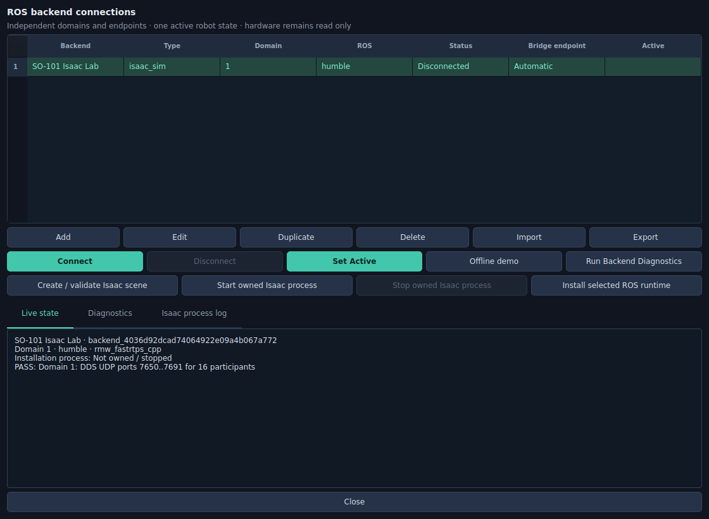

*Die Tabelle zeigt die Profilart, DDS-Domain und ROS-Distribution.*

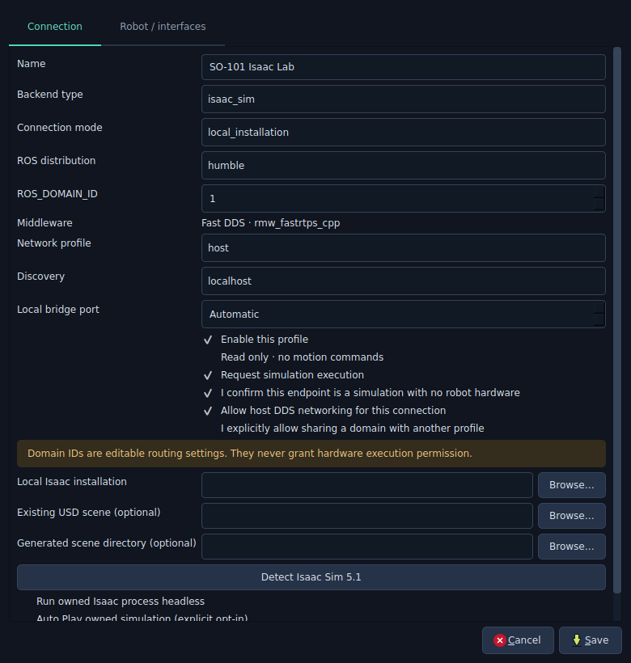

*Connection enthält die lokalen Pfade. Robot / interfaces enthält das Modellmapping und die Topics.*

### 8. Eigene USD aus der URDF erzeugen und bearbeiten

1. Optional im Profil unter **Generated scene directory (optional)** einen Ordner für lokale Szenen angeben. **Existing USD scene (optional)** für den Neuaufbau leer lassen.
2. Im Runtime-Banner unter **Simulation Runtime** das Isaac-Profil und unter **Simulation File → Generate from current robot** wählen. Auf **Start Simulation** klicken, um den Isaac-Import zu starten. Das Programm erzeugt eine neue Stage in einem eigenen Ausgabeordner und importiert die aktuell gebundene URDF samt Meshes.
3. Im geöffneten Isaac-Fenster im **Stage**-Baum **World** aufklappen. Dort liegen der Roboter unter `/World/Robot`, der kollidierbare `MountingTable`, der Boden, das Licht und der ROS-Graph. Die neue Stage verwendet Meter und Z-up. Der feste Roboterfuß bleibt im Beispiel am Ursprung auf dem Tisch.
4. Den Robot-Unterbaum aufklappen und im **Property**-Bereich die Articulation und Joint-Drives prüfen. Der Import übernimmt Gelenknamen, Achsen, Limits und Antriebskraftgrenzen aus der URDF. Studio setzt Kraftantriebe mit effektiver Steifigkeit 5000 und Dämpfung 50 in SI-Einheiten. Rotations-Drives werden für USD-Gradwerte umgerechnet. Die Simulation verwendet normale Schwerkraft. Die erzeugte Szene enthält Physikszene, Robotercollider und Tischcollision.
5. Für eine eigene Anordnung beispielsweise den vorhandenen **Light**-Prim auswählen und seine Intensität im **Property**-Bereich von 800 auf 900 ändern. Umgebung und Beleuchtung können auch nach dem Import bearbeitet werden. Für dieses Beispiel Articulation, Roboterbasis, Joint-Drives und Tischhöhe beibehalten. In Isaac über **File → Save As…** beispielsweise `SO101-Lab.usda` im Ausgabeordner speichern oder die erzeugte `scene.usd` als Basis wählen. Den vollständigen generierten Pfad zeigt Studio unter **Project & Runtime** im Protokoll als `Generated Isaac USD`.

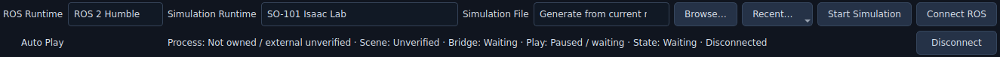

*Generate from current robot erzeugt eine neue Stage aus dem gebundenen SO-101.*

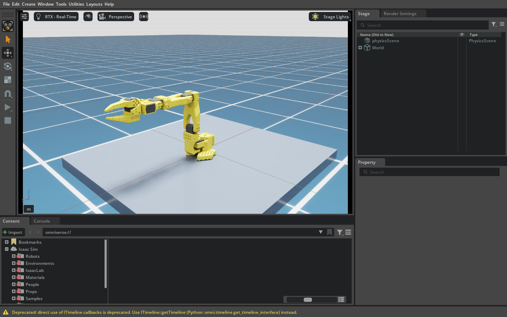

*Der von Studio erzeugte Stage-Tree im tatsächlichen Isaac-Sim-Fenster.*

| Articulation | Schultergelenk |
| --- | --- |
| 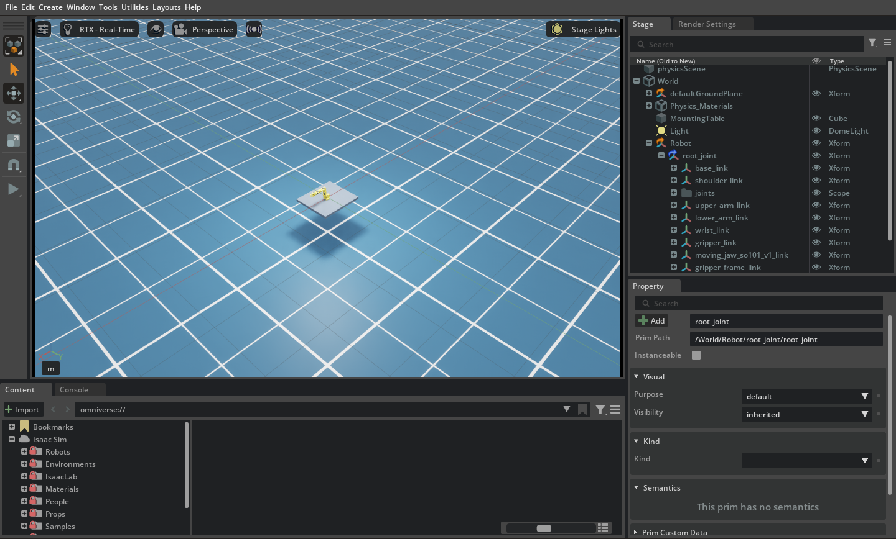 | 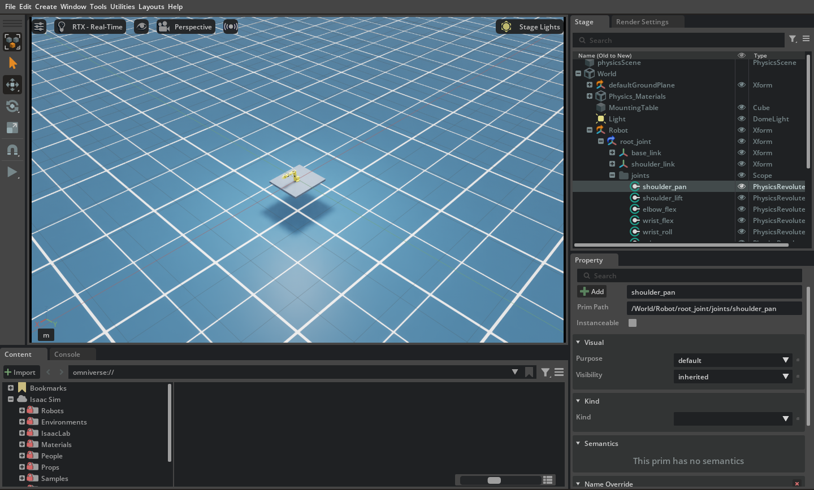 |
| *Die Auswahl zeigt den importierten Robot-Unterbaum.* | *Das Gelenk liegt unter dem Joint-Scope der SO-101-Articulation.* |

[Bearbeitete und erneut geöffnete Szenenvariante](docs/images/tutorial/17-isaac-scene-edited.png)

`.usda` speichert lesbaren USD-Text. `.usdc` speichert das binäre Crate-Format. `.usd` kann eines dieser Formate enthalten. Die Stage referenziert `robot.usd` und weitere Robot-Layer. Für einen Umzug den ganzen Szenenordner samt Referenzen übernehmen, bei absoluten USD-Referenzen die Pfade in Isaac neu zuordnen und den neuen Stand erneut in Studio laden.

[Isaac-Sim-Adapter und Physik](docs/ISAAC_SIM_INTEGRATION.md) · [NVIDIA URDF-Importer](https://docs.isaacsim.omniverse.nvidia.com/5.1.0/importer_exporter/import_urdf.html)

### 9. ROS-Bridge und Action Graph prüfen

Der SDK-Prozess erstellt unter `/World/ROS2` den Graphen mit der Domain und den Topics des gewählten Profils. In der Standardkonfiguration veröffentlicht er `/joint_states` und `/clock`, empfängt `/joint_command` und übergibt Namen, Positionen und Geschwindigkeiten an den Articulation Controller. ROS-2-JointStates verwenden Radiant bzw. Meter. Der Studio-Adapter setzt den Trajektorienplan in diese Kommandos um und prüft das Ziel anhand tatsächlicher Rückmeldungen.

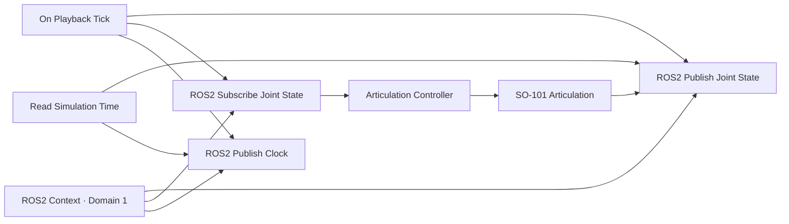

*Schema des erzeugten Action Graphs.*

In Isaac **Window → Visual Scripting → Action Graph** öffnen und den Graphen **ROS2** laden. Im Stage Tree `/World/ROS2/Context` auswählen, um die Domain unter **Property** zu kontrollieren.

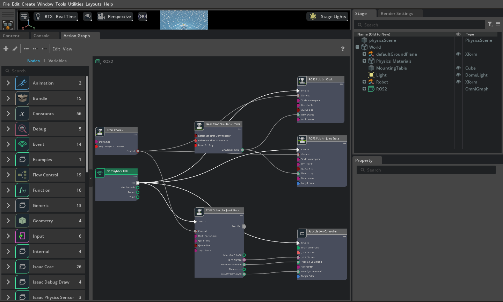

*Die Publisher, der Subscriber und der Articulation Controller verwenden die im Graph sichtbaren Verbindungen.*

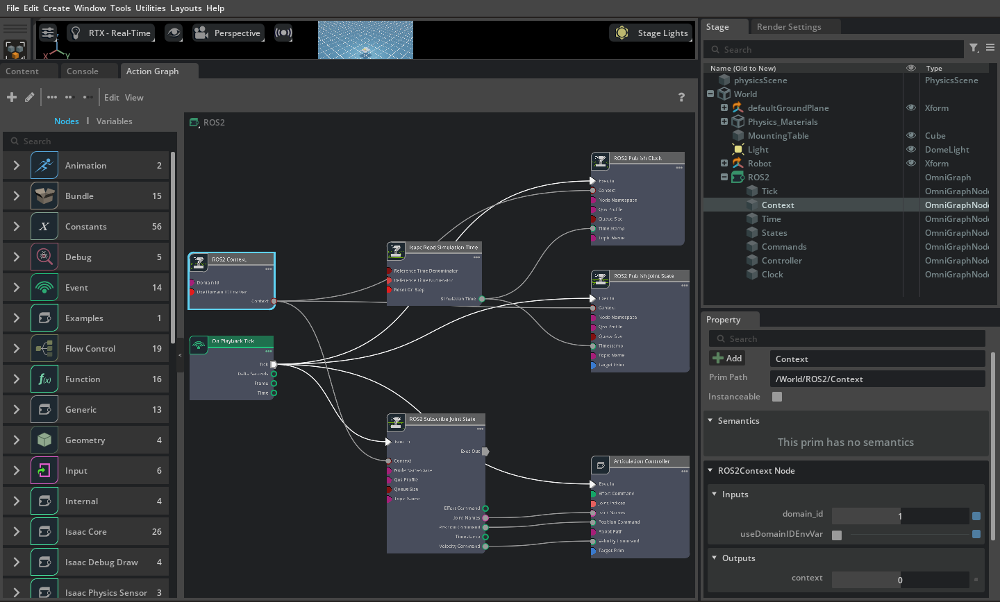

*Die Domain kommt aus dem Studio-Profil. Use Domain ID Env Var ist für diesen Graph abgewählt.*

Der Workflow erzeugt den Graphen für eine neue Szene und richtet ihn beim Start einer kompatiblen eigenen USD in einer Arbeitskopie erneut ein. Für externe Simulatoren mit eigener Bridge die vorhandenen Topics, Domain und Controller im Backendprofil zuordnen.

[Isaac-Sim ROS Joint Control](https://docs.isaacsim.omniverse.nvidia.com/5.1.0/ros2_tutorials/tutorial_ros2_manipulation.html) · [Studio ROS-Ausführung](docs/ROS_EXECUTION.md)

### 10. Gespeicherte Szene erneut starten

1. Laufende Studio-Simulation mit **Disconnect** vom ROS-Backend trennen und unter **Backends… → Stop owned Isaac process** den von Studio gestarteten Prozess beenden.
2. Im Runtime-Banner das Isaac-Profil auswählen und über **Browse…** neben **Simulation File** die eigene USD öffnen. Der Dateiname erscheint danach in der Auswahl und unter **Recent…**.
3. **Start Simulation** klicken. Im Banner auf **Loaded & validated** und **Bridge: Connected** warten. Bei manueller Steuerung bleibt Isaac zunächst pausiert. Im Isaac-Fenster **Play** klicken.
4. **Simulation Ready** bestätigt nutzbare Simulationszeit und Gelenkfeedback. **Auto Play** ist die explizite Alternative, um den eigenen Prozess direkt in die Wiedergabe zu versetzen.


*Vor Play zeigt der Banner den pausierten Zustand.*

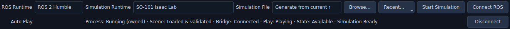

*Nach Play meldet das Banner Gelenkzustand und Ausführungsbereitschaft.*

### 11. Gelenkbewegung und Live Monitoring

Bei einer aktiven ROS-Quelle dienen die virtuellen Gelenkregler dem Offline-Workflow. Für Isaac unter **Robot Configuration → Positions & Tasks → Task editor** einen Gelenkschritt anlegen und ausführen. Das Beispiel in Schritt 13 bewegt `shoulder_pan` um ungefähr `5.73°` aus der Nullpose.

**Live Monitoring** öffnen und die Position sowie Geschwindigkeit des Gelenks auswählen. Ein gesendetes Ziel und die zurückgemeldete Position sind separate Werte. Der Task meldet Erfolg, wenn die beobachtete Gelenkstellung das Ziel innerhalb der konfigurierten Toleranz erreicht. Den Tab an den rechten Fensterrand von **Robot Configuration** ziehen, um beide Panels zu sehen. **View → Save workspace layout** speichert das Layout. **Restore saved workspace layout** stellt es wieder her.

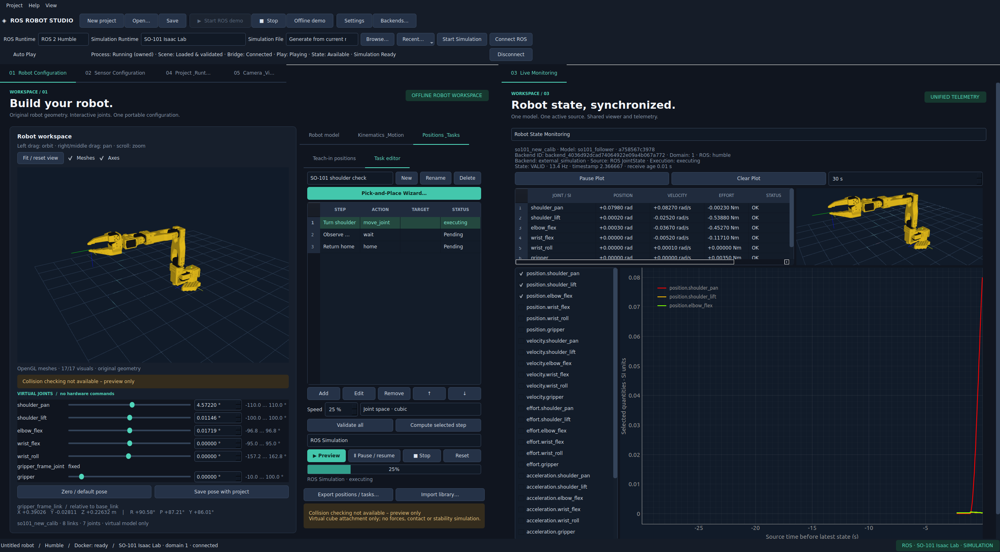

*Das Monitoring folgt der laufenden Simulationsbewegung. Hardware-Profile bleiben Read Only.*

### 12. Positionen speichern

1. Für die Offline-Übung **Offline demo** wählen und den Arm in eine gültige Pose bringen. Unter **Robot Configuration → Positions & Tasks → Teach-in positions** auf **Capture joints** klicken.
2. Den Namen `Home Lab` vergeben und **Save** wählen. Für eine Position mit XYZ und Werkzeugframe **Capture Cartesian** verwenden. Auf dem SO-101 für das erste Ziel den Modus **Position Only** wählen.
3. Einen Eintrag in der Tabelle auswählen. **Recall / apply offline** ruft ihn im virtuellen Modell ab. **Check reachability** prüft die Erreichbarkeit für die bestätigte Kette. Beim Wechsel zurück zu Isaac kann eine gespeicherte Position im Taskeditor als Ziel dienen.

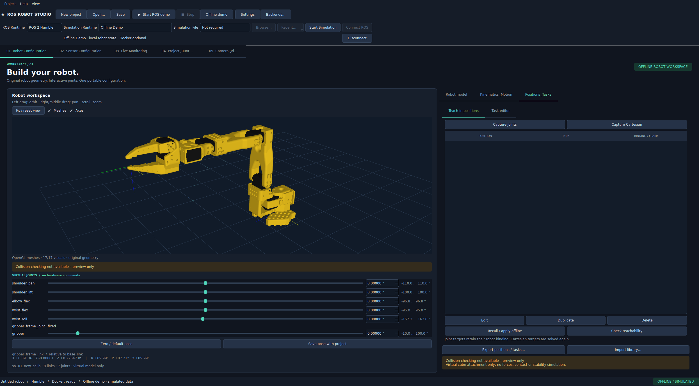

*Teach-in führt Gelenk- und kartesische Positionen in derselben Projektbibliothek.*

### 13. Eigenen Task erstellen und ausführen

1. **Positions & Tasks → Task editor → New** öffnen und den Namen `SO-101 shoulder check` eingeben.
2. **Add** klicken. Unter **Action → Move to Joint Position** und **Target source → Direct input** alle Achsen in Nullstellung lassen, `shoulder_pan` auf **5,73°** und **Minimum move time / wait** auf **1,5 s** setzen. **Save** klicken.
3. Einen zweiten Schritt über **Add → Wait** mit **1 s** speichern.
4. Einen dritten Schritt über **Add → Home**, **Target source → Default virtual home** und **1,5 s** speichern. Alternativ die passende gespeicherte Gelenkposition wählen.
5. **Validate all** klicken. In der Offline-Ansicht **Preview** wählen. Mit aktivem und bereitem Isaac-Backend sendet derselbe **Preview**-Knopf den validierten Task an die Simulation. **Live Monitoring** zeigt Gelenkrückmeldung und Abschluss. Über **Save** das Projekt sichern und über **Open…** erneut öffnen.

| Weitere Aktion | Eingabe im Schrittdialog |
| --- | --- |
| **Move to Cartesian Pose** | Unter **Target source** eine gespeicherte Cartesian-Position oder **Direct input** wählen. Bei Direkteingabe XYZ in mm, den Zielrahmen und den IK-Modus setzen. |
| **Move Relative · endpoint IK** | **Relative reference frame** auf `base_link` setzen und einen kleinen Versatz wie `dZ = 5 mm` bei unveränderter Orientierung prüfen. Die Bewegung fährt eine Gelenkraumkurve zum gelösten Endpunkt. |
| **Open Gripper / Close Gripper** | Den modellgültigen Greiferwinkel und die Mindestdauer setzen. Die virtuellen Attach-/Release-Optionen gehören zur Offline-Vorschau. |

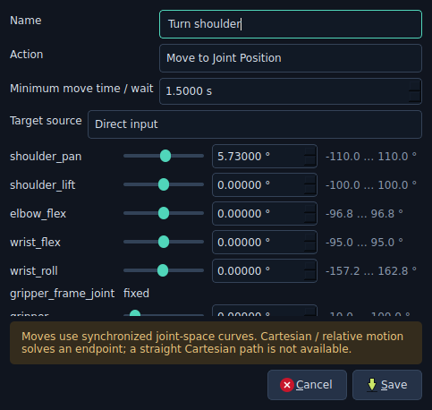

*Der Schrittdialog zeigt die direkte Gelenkeingabe für Turn shoulder. Save validiert das Ziel.*

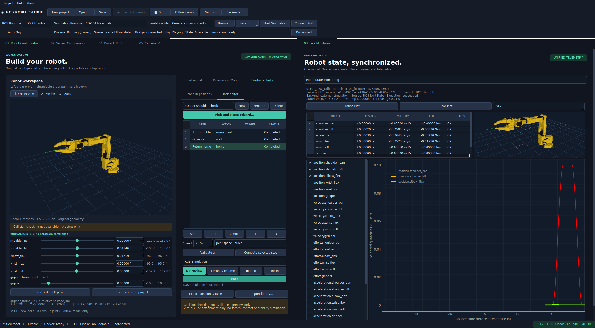

*Die dokumentierte Abfolge prüft Gelenkziel, Wartezeit und die Rückkehr zur Nullpose.*

`./start.sh --pick-place-demo` öffnet zusätzlich das Beispiel mit 13 Schritten und virtueller Objektzuordnung. Die Abnahme bestätigt Gelenk- und Greiferbewegungen. Physischer Objektkontakt ist ein eigener, noch ausstehender Test.

### 14. RGB-Kamera zur USD hinzufügen

1. Die eigene Szene auswählen und den laufenden eigenen Simulator stoppen.
2. **Sensor Configuration → Add Camera to Isaac Sim…** öffnen. Im Assistenten einen Kameranamen und das Isaac-Backend wählen. **Mounting → World fixed** verwenden.
3. Für das Beispiel die Position in Weltmetern `(0.23, -0.18, 0.68)` und **Look at world point (m)** `(0.23, -0.18, 0.0)` eintragen. **Apply look-at** klicken. **Render resolution** `640 × 480`, nominale **Render FPS** `20`, horizontales FOV `70°`.
4. RGB `/so101/camera/image_raw` und CameraInfo `/so101/camera/camera_info` prüfen. Für das Tutorial **Add red test cube to the Studio mounting table** aktivieren. **Create camera…** klicken und einen neuen USD-Dateinamen wählen.
5. Studio speichert eine abgeleitete USD mit Kamera-Prim, Render Product, Publishern und statischen Kamera-TFs. Diese Szene wird im Banner ausgewählt. Für das Projekt **Save** klicken.

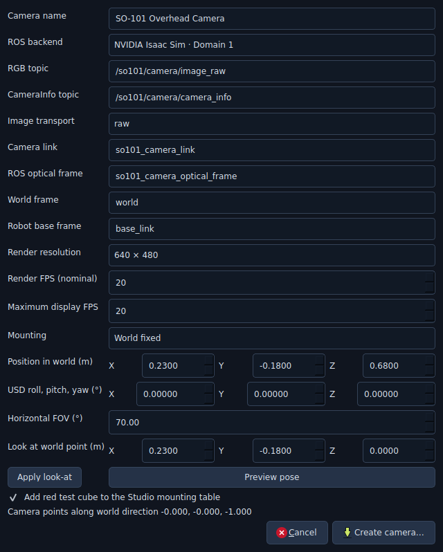

*Der Assistent zeigt die Kameraausrichtung und die ROS-Topics vor dem Erzeugen der abgeleiteten USD.*

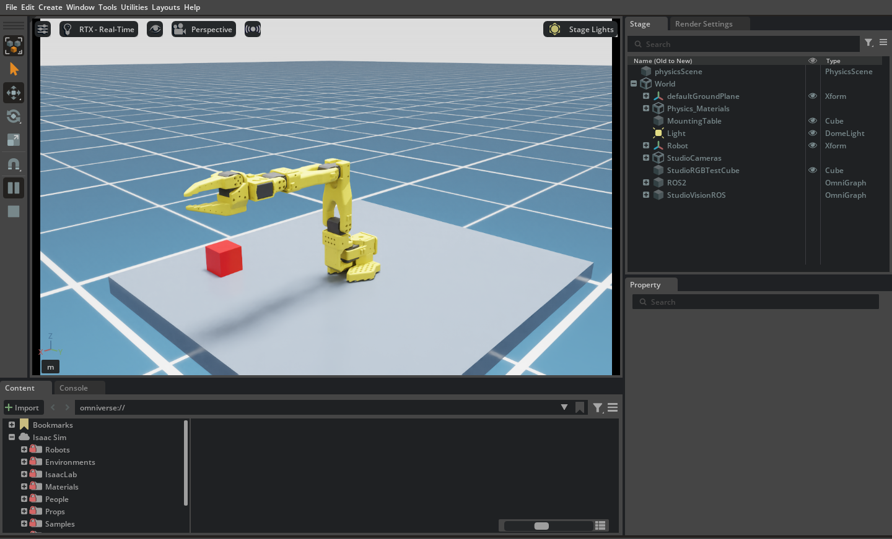

*Der Stage Tree enthält den Kamerazweig und den separaten ROS-Vision-Graph.*

### 15. RGB-Stream anzeigen

**Start Simulation** und in Isaac **Play** klicken. Unter **Camera & Vision** die Kamera auswählen und **Start Stream** drücken. Die Anzeige meldet Auflösung, Bildrate, ersetzte Frames und den letzten ROS-Zeitstempel. **Snapshot…** speichert den aktuellen RGB-Frame als PNG. Für eine externe ROS-Kamera in **Sensor Configuration → Add Camera…** das zugehörige Backend und den Bildtopic auswählen.

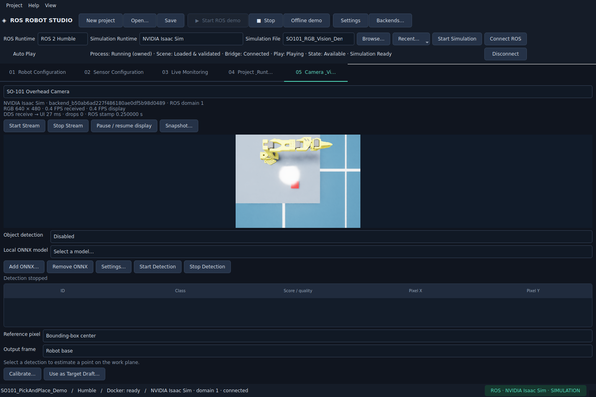

*Das Livebild stammt vom Render Product der platzierten Kamera.*

### 16. Detektor auswählen

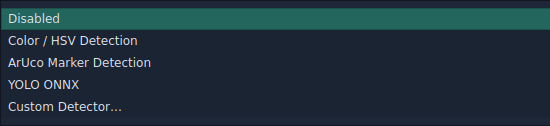

*Das Dropdown führt die implementierten Detektoren und den vorbereiteten Custom-Eintrag auf.*

- **Color / HSV Detection** wählen und **Settings…** öffnen. Die zwei Standardintervalle für Rot und die Mindestfläche von 100 Pixeln eignen sich für den Testwürfel. **Start Detection** klicken und einen Eintrag in der Objektliste wählen.
- **ArUco Marker Detection** verwendet standardmäßig `DICT_4X4_50`. Das Wörterbuch unter **Settings…** passend zum Marker wählen. Ein sichtbarer Marker liefert ID und vier Bildecken.
- **YOLO ONNX** verwendet ein separat bezogenes kompatibles Modell. **Add ONNX…** öffnen und ein lokales YOLOv5n-v7-COCO-Modell mit festem 640er-Eingang auswählen. Unter **Settings…** den Modellscore-Schwellwert setzen, beispielsweise `0.25`. **Start Detection** startet die CPU-Inferenz und prüft den Modellvertrag. Die Ergebnisliste zeigt Klassen, Scores und Boxen.
- **Disabled** zeigt weiter RGB. **Stop Detection** beendet den Detektor und **Stop Stream** den Kameraempfang.

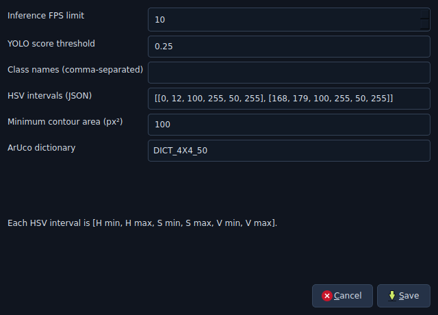

*Für Rot verwenden die Standardwerte zwei Hue-Intervalle an den Enden der Skala.*

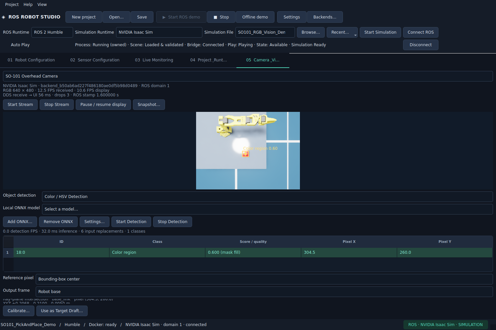

*Die HSV-Erkennung markiert den Würfel mit Box und Referenzpixel. Der angezeigte Wert ist der Maskenfüllgrad.*

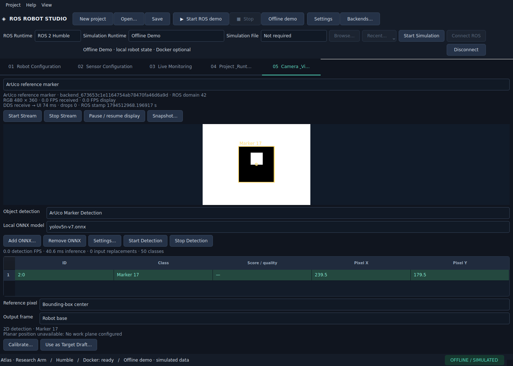

*ArUco zeigt die ID und die Bildecken eines für den Test erzeugten Markers.*

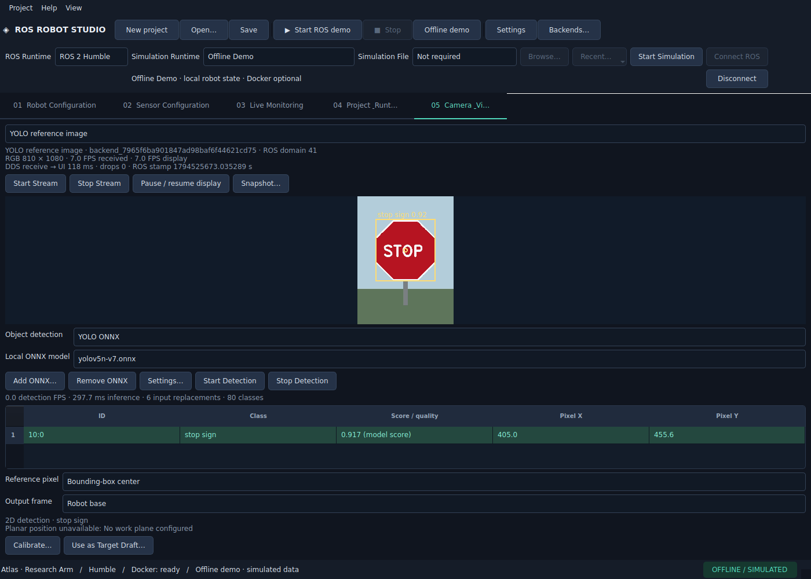

*YOLOv5n v7 erkennt die Klasse stop sign mit Score 0,917. Die eigens gezeichnete Tafel ist der Inhalt eines ROS-Teststreams.*

[Detektor-Einstellungen](docs/OBJECT_DETECTION.md) · [Geprüfter YOLO-Modellvertrag](docs/YOLO_ONNX_INTEGRATION.md) · [Vision-Messdaten](docs/VISION_VERIFICATION.md)

### 17. Objektposition bestimmen und Projekt erneut öffnen

1. Bei laufendem Stream **Calibrate…** öffnen. Die Live-CameraInfo enthält Brennweiten, Hauptpunkt und Verzerrung. TF2 liefert die Kamerapose zum Bildzeitpunkt. In der Demo stammt die Arbeitsebene aus dem Montagetisch mit Welt-`Z ≈ -0.005 m`.
2. Bei einer eigenen Szene Punkt und Normale der gemessenen Arbeitsebene eingeben und die Bestätigung aktivieren. Optional **Store the current CameraInfo and TF2 calibration record** wählen, speichern und den Stream neu starten.
3. In der Objektliste den Würfel auswählen. Unter **Reference pixel** **Bounding-box center** wählen und **Output frame → Robot base** setzen. Studio schneidet den Kamerastrahl mit der Ebene und transformiert den Schnittpunkt nach `base_link`.
4. **Use as Target Draft…** kann einen geprüften Punkt mit eingegebener Werkzeugorientierung und Versatz in einen manuellen Entwurf übernehmen. Das Ergebnis ist eine planare Positionsschätzung. Homographie und automatisches Greifen stehen aus.
5. **Save** speichert Aufgaben, Positionen, Backend und Kamera im Projekt. Die lokalen USD-/Installationspfade werden auf einem anderen Rechner über **Browse…** und **Backends… → Edit** neu zugeordnet.

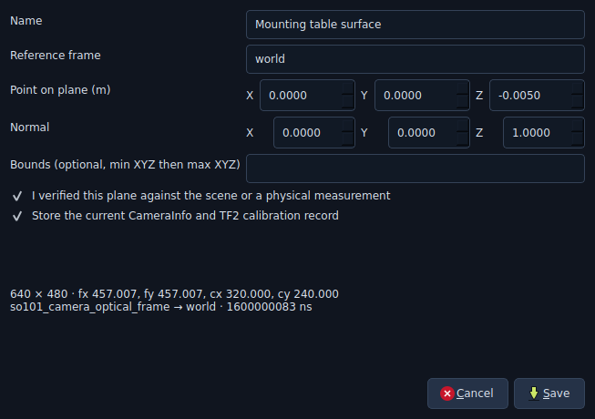

*Die gespeicherte Kalibrierungsaufnahme dokumentiert die gemessenen Daten. Live-Schätzungen verwenden die zum Bild passenden Laufzeitwerte.*

### Eigene Roboter und Szenen

1. **New project** wählen und über **Import URDF / Xacro** eine eigene URDF mit erreichbaren Mesh-Dateien laden. Linkbaum, Joint-Typen, Achsen und Grenzwerte im Viewer kontrollieren.
2. Unter **Chain setup** Basis, Werkzeug, optionale Greiferachse und Solver setzen. Die FK-/IK-Prüfung ausführen und erreichbare Ziele anhand der Freiheitsgrade des Modells bestimmen.
3. Für Isaac eine neue Stage aus dem gebundenen Modell erzeugen oder eine kompatible USD über **Browse…** zuordnen. Die automatische Validierung erwartet Meter, Z-up, eine Articulation unter `/World/Robot` und zur URDF passende Gelenke, Achsen und Limits. Eine externe ROS-Simulation kann ihre eigenen Controller und Topics bereitstellen.
4. Im Backendprofil Domain, Controller-Schnittstelle, Topics und Mapping prüfen. JointState-Feedback vor einer Taskausführung im Monitoring bestätigen. Einen kleinen Task validieren und das Projekt speichern.
5. Für die Offline-Einführung gibt es das [generische Beispiel](examples/generic_robot/demo.studio.yaml) und das [portable SO-101-Katalogprojekt](examples/so101/so101.studio.yaml). USD-Dateien werden über Schritt 8 lokal erzeugt.

[Installieren](INSTALLATION.md) · [Entwickeln und testen](DEVELOPMENT.md) · [Mitwirken](CONTRIBUTING.md) · [Projektformat](docs/PROJECT_FORMAT.md) · [Roadmap](ROADMAP.md) · [Prüfbericht](docs/PUBLICATION_VERIFICATION.md) · [Apache-2.0](LICENSE) · [Drittanbieter-Lizenzen](THIRD_PARTY_LICENSES.md)
