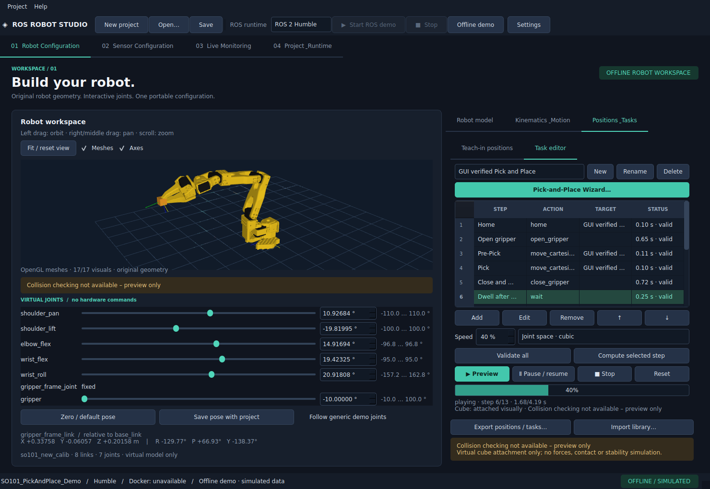
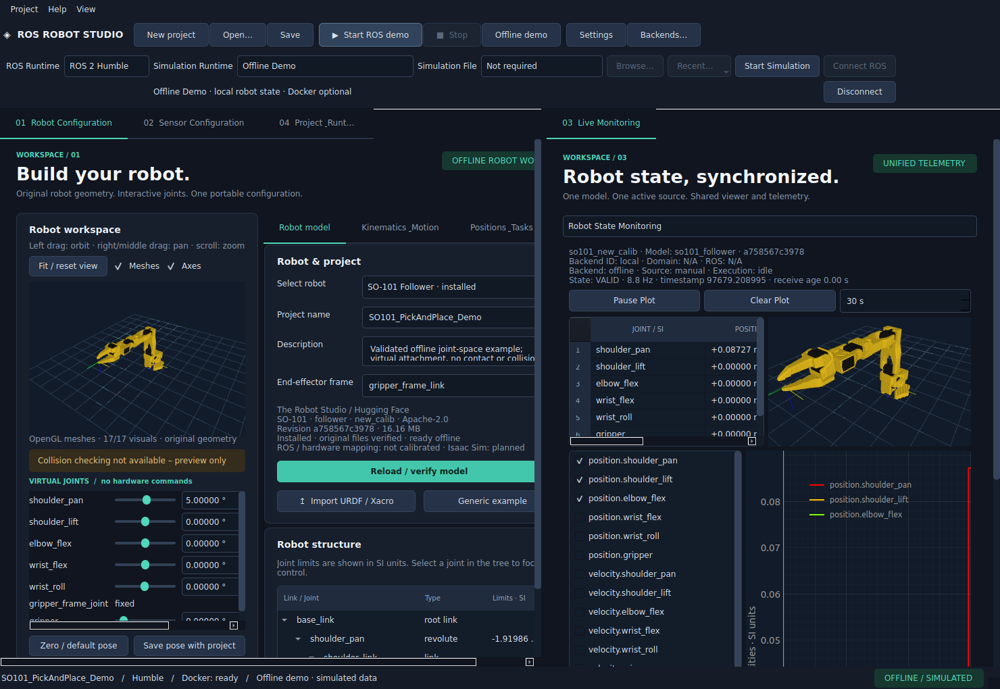

# ROS Robot Studio

Eine startbare Desktop-Werkbank für ROS-2-Roboterprojekte. Die Oberfläche bietet vier verschiebbare Panels,
URDF-Struktur- und Meshansicht, SO-101-Follower-Modellinstallation, virtuelle Gelenksteuerung,
universelle URDF-basierte FK/IK, Teach-in, Pick-and-Place-Wizard, Offline- und ROS-Simulation,
einen gemeinsamen Robot State Manager mit synchronisierten Gelenktabellen/Kurven,
Sensor- und TF-Konfiguration, portable YAML-Projekte und Live-Plots.
Er funktioniert ohne Docker, ROS-Installation oder Roboterhardware.




## Start unter Ubuntu 22.04

Im Projektverzeichnis:

```bash
./start.sh
```

Beim ersten Start erscheint der grafische Einrichtungsassistent. Für die sofortige
Offline-Demo ohne Assistenten:

```bash
./start.sh --demo
```

Python 3.10+, Git und eine grafische Desktop-Sitzung werden vorausgesetzt. Der Bootstrap
installiert die festgelegten Python-Abhängigkeiten ausschließlich in `.venv`; Internet ist
beim ersten Start erforderlich. Er funktioniert auch ohne pip und `python3-venv`/ensurepip.
Auf Ubuntu 22.04 amd64 wird eine gegebenenfalls fehlende kleine Qt-Cursorbibliothek aus
dem offiziellen Ubuntu-Archiv mit fester SHA-256-Prüfung lokal entpackt. Keine Systempakete,
Docker-Daemons oder ROS-Installationen werden beim Start automatisch verändert.

Die virtuelle Umgebung ist hier bereits vorbereitet. Auf einem frischen Rechner benötigt
sie ungefähr 800 MB. Docker und große ROS-Images werden nur nach ausdrücklicher Auswahl
im Assistenten beziehungsweise Runtime-Tab installiert.

## Erste Schritte

1. **Robot Configuration:** Projektname ändern, Beispiel laden oder URDF importieren.
   Links, Gelenke, Typen, Limits und Parent-/Child-Beziehungen im Baum untersuchen.
   In der Strukturansicht ziehen zum Drehen, Mausrad zum Zoomen, Doppelklick zum Zurücksetzen.
2. **Sensor Configuration:** Sensor hinzufügen oder doppelklicken. Topic, Einheit,
   Parent-Frame, Translation, RPY, statischen/dynamischen TF-Typ und Grenzwerte eingeben.
3. **Live Monitoring:** `/studio/sine`, `/joint_states` oder `/studio/temperature` auswählen.
   Numerische Felder ankreuzen, Zeitfenster einstellen, pausieren und zurücksetzen.
   Offline-Daten sind deutlich als simuliert gekennzeichnet.
4. **Speichern:** Über die Werkzeugleiste eine `.yaml`-Datei auswählen. Die URDF wird in
   einen benachbarten `.assets`-Ordner kopiert. Datei und Ordner zusammen weitergeben.
   Mit **Open…** erneut laden; ein vollständiges Beispiel liegt unter
   `examples/generic_robot/demo.studio.yaml`.
5. **Project & Runtime:** Humble auswählen, Studio-Runtime installieren, **Start ROS demo**
   drücken und **Verify ROS demo** ausführen. Danach zeigt Monitoring echte ROS-Nachrichten
   aus Demo-Nodes im Container. Mit **Stop** wird nur der eigene Container entfernt.

Das ROS-Dropdown steuert die aktuelle Sitzung. Es überschreibt den gespeicherten
Projektstandard nicht. **Save selected ROS as project default** übernimmt die Auswahl
bewusst in das Projekt. Bei laufender Containerdemo wird die alte Runtime vor einem
Versionswechsel gestoppt. Das Projekt bleibt erhalten.

## Mehrere ROS-Backends

**Backends…** öffnet den universellen Connection Manager: Profile hinzufügen, Distribution und Domain einstellen, mehrere Verbindungen herstellen und eine Quelle aktivieren. Vorgeschlagen sind Real Robot 0, Isaac 1, MuJoCo 2, Gazebo 3 und ROS Demo 10; alle Domainwerte sind änderbar. Viewer und Live Monitoring folgen ausschließlich dem aktiven Backend. Offline bleibt ohne Simulatorinstallation verfügbar.

Isaac 5.1 läuft als eigenständiger Prozess mit URDF→USD-Szenenprüfung und echter ROS-Rückmeldung. Installationspfade werden nur lokal gespeichert. Real Robot bleibt ausschließlich lesend; MuJoCo/Gazebo sind klar als vorbereitete Plugins gekennzeichnet.

[Bedienung](docs/BACKEND_CONNECTION_MANAGER.md) · [Isaac](docs/ISAAC_SIM_INTEGRATION.md) · [Architektur](docs/ROS_BACKEND_MANAGER.md) · [aktuelle Prüfergebnisse](docs/BACKEND_VERIFICATION.md).

## Workspace und Bedienung

Tabtitel an eine Kante ziehen, um Robot Configuration und Live Monitoring nebeneinander
oder übereinander zu sehen; in die Mitte ziehen, um Tabs wieder zusammenzuführen.
**View** speichert, restauriert oder setzt das lokale Layout zurück. Das Runtime-Banner
verknüpft ROS-Auswahl, Backendprofile und lokalen Szenenverlauf. Isaac startet standardmäßig
pausiert; Auto Play ist ein ausdrückliches Opt-in. Real Robot bleibt Read Only.
Der Taskdialog erlaubt direkte kartesische Ziele mit mm/Grad-Eingabe. Alle Solver-Kandidaten
sind auswählbar, ausführbar ist derzeit SciPy bounded IK nach erfolgreicher Prüfung.

[Docking](docs/GUI_DOCKING.md) · [Runtime und Dateien](docs/SIMULATION_RUNTIME_SELECTION.md) ·
[Taskeditor / Solver](docs/TASK_EDITOR_GUI.md) · [Docker-Diagnose](docs/DOCKER_DIAGNOSTICS.md).

Ist das Konto bereits in `docker`, der laufende Prozess aber noch nicht, hilft eine neue
Anmeldung beziehungsweise bewusst neue Gruppensitzung. Socketrechte werden dafür nicht
geöffnet. **Help → Docker diagnostics** zeigt die tatsächlichen Prozessrechte.



## SO-101 Follower

Unter **Robot Configuration → Select robot** den SO-101 Follower auswählen. Falls nötig,
**Install Robot Model** bestätigen. URDF, 13 Original-STLs und Quellhinweise werden aus
einer festen offiziellen GitHub-Revision geprüft installiert (16,16 MB). Danach lässt
sich der Roboter vollständig offline mit sechs Reglern und numerischen Gradwerten bewegen.
XYZ/RPY des auswählbaren Endeffektorframes werden live aktualisiert. Die Original-
Geometrie benötigt OpenGL; ohne Kontext wird die Strukturansicht eindeutig angezeigt.

```bash
./start.sh --demo --robot so101_follower
```

Gelenkwerte, Modellrevision und Endeffektor werden normal mit dem Projekt gespeichert.
Das Beispiel `examples/so101/so101.studio.yaml` enthält nur eine portable Modellreferenz.
Anleitung, Lizenz, Revision, Meshdetails und Abnahmetest: [SO101.md](docs/SO101.md).

## Kinematics, Teach-in und Pick-and-Place

```bash
./start.sh --pick-place-demo
```

Öffnet die neu validierte **SO101_PickAndPlace_Demo**, bei fehlendem Modell mit
Installationsangebot und generischer Offline-Alternative. Rechts im Robot-Tab:
**Kinematics & Motion** für Chain-Analyse und kartesische Ziele, **Positions & Tasks**
für Teach-in, Schritt-Editor, den siebenstufigen Pick-and-Place-Wizard und Wiedergabe.
Die optionale SciPy-Komponente ist hier installiert. Auf einem neuen Rechner unter
**Setup assistant → Component verification → Install Universal Kinematics Support**
installieren oder `.venv/bin/python -m pip install -r requirements-kinematics.lock.txt` verwenden.

Position Only, Toolachsenrichtung und Full Pose (bei geeignetem Kettenrang) verwenden
dieselbe universelle numerische IK. Beim SO-101 bleiben fünf Armachsen vom Greifer
getrennt; Full Pose ist deaktiviert. Joint- und kartesische Positionen sowie Tasks werden
im Projektformat v3 gespeichert; v1/v2 bleiben ladbar. Alle Bewegungen sind kubische
Gelenkraumtrajektorien; der Würfel folgt einer vereinfachten visuellen Greiferkopplung.

**Collision checking not available – preview only.** Es gibt keine Hardwareausführung,
Kollisionsprüfung, Kontaktphysik oder geradlinige kartesische Bahn. Isaac-Anbindung ist vorbereitet; ROS-Simulation ist inzwischen implementiert und geprüft. [Bedienung und Grenzen](docs/KINEMATICS.md),
[aktueller Abschlussbericht](docs/KINEMATICS_REPORT.md).

## Echte ROS-Simulation und gemeinsamer Roboterzustand

**Project & Runtime → Open Live ROS Demo** startet die ausgewählte Humble-, Jazzy- oder
Lyrical-Runtime. Fehlende Images werden nach Auswahl installiert. Der bestehende
**Offline demo**-Button führt kontrolliert zurück; im Taskeditor dieselbe Backendwahl
zwischen **Offline Preview** und **ROS Simulation** verwenden.

Der gemeinsame State Manager synchronisiert Regler, FK, beide Viewer und **Robot State
Monitoring**. Offline-Kurven zeigen die aktuelle Cubic-Position und analytische Geschwindigkeit;
manuelle Posen zeigen Geschwindigkeit N/A. ROS-Ausführung nutzt einen echten nativen
FollowJointTrajectory-Server im eigenen Docker-Container. Die Darstellung wird ausschließlich
aus den empfangenen JointStates aktualisiert. Die alte Sinusdemo ist eine explizite zweite Ansicht.

Alle drei Distributionen wurden mit originalem SO-101, 13 Taskschritten, Actionfeedback,
Greifer, Monitoring, Abbruch und wiederholten Moduswechseln getestet. Die Runtimes sind lokal
installiert. **Run ROS Runtime Diagnostics** prüft die aktive Simulation; Verified gilt nur für
wirklich getestete Images. [Aktueller Bericht](docs/ROS_RUNTIME_VERIFICATION.md).

Dockergruppenrechte erfordern nach Änderung eine neue Anmeldung. In dieser Entwicklung
hat der Benutzer außerdem eine temporäre Benutzer-ACL freigegeben; Schritte zur regulären
Einrichtung und Entfernung stehen in [ROS_RUNTIME.md](docs/ROS_RUNTIME.md).

DDS, Topics und Joint-Mapping sind für externe Simulationsprofile konfigurierbar.
Der JointState-Kommandopfad wurde mit der sichtbaren SO-101-Szene in Isaac Sim und
ROS 2 Humble geprüft. [Simulationsabnahme](docs/PRE_VISION_SYSTEM_VERIFICATION.md)

## RGB-Kamera und Objekterkennung

Unter **Sensor Configuration → Add Camera to Isaac Sim…** lässt sich eine feste
RGB-Kamera zur SO-101-Szene hinzufügen und als abgeleitete USD speichern. Für andere
ROS-Kameras verwendet **Add Camera…** Topics des jeweils verbundenen Backends.
**Camera & Vision** zeigt das RGB-Bild, HSV-, ArUco- oder YOLOv5n-v7-Detektionen und
planare Positionen aus CameraInfo und TF2. Das Panel lässt sich neben Robot
Configuration und Live Monitoring andocken. OpenCV und ONNX Runtime sind optional.
[Kamerabedienung](docs/CAMERA_MANAGER.md) · [RGB-Abnahme](docs/VISION_VERIFICATION.md)

## Stand und Grenzen

Der native OpenGL-Abnahmetest hat den echten SO-101 angezeigt, Qt-Regler und Kamera
betätigt, FK mit Meshtransformationen verglichen und die Pose nach Speichern/Laden
wiederhergestellt. **73 Tests bestanden (SO-101-Erweiterung vor Kinematik)**, drei ROS-Container-Tests wurden wegen fehlender
Docker-Zugriffsrechte übersprungen. [Aktueller SO-101-Bericht](docs/SO101_REPORT.md).
Der [Prüfbericht der Grundanwendung](docs/VERIFICATION.md) bleibt als historischer Stand erhalten.

Der historische SO-101-Bericht entstand vor der ROS-Ausführung. Inzwischen sind Humble,
Jazzy und Lyrical einschließlich echter nativer Actions und JointState-Rückkanal geprüft. Das SO-101-Modell
benötigt diese Runtimes nicht. Reale Roboteranbindung ist lesend ausgelegt. Physische
Greifvalidierung und Kalibrierung einer realen Kamera stehen aus.
Sensorgrenzen sind **keine zertifizierten Sicherheitsfunktionen**.

## Dokumentation

- [Aktuelle ROS-Runtime-Abnahme](docs/ROS_RUNTIME_VERIFICATION.md)
- [Robot State Manager](docs/ROBOT_STATE_MANAGER.md)
- [Synchronisiertes Monitoring](docs/LIVE_MONITORING.md)
- [ROS-Ausführung](docs/ROS_EXECUTION.md)
- [Isaac-Sim-ROS-Einrichtung](docs/ISAAC_SIM_ROS_SETUP.md)
- [Installation und Fehlerbehebung](INSTALLATION.md)
- [Architektur und Schnittstellen](ARCHITECTURE.md)
- [Entwicklung, Tests und Docker-Builds](DEVELOPMENT.md)
- [Projektformat](docs/PROJECT_FORMAT.md)
- [Umsetzungsstand und nächste Schritte](ROADMAP.md)
- [Kinematik und Pick-and-Place](docs/KINEMATICS.md)
- [Aktueller Kinematik-Abschlussbericht](docs/KINEMATICS_REPORT.md)
- [SO-101-Abschlussbericht](docs/SO101_REPORT.md)
- [Historischer MVP-Abschlussbericht](docs/FINAL_REPORT.md)
- [Drittanbieter-Lizenzen](THIRD_PARTY_LICENSES.md)

Studio-Quellcode und der generische Beispielroboter stehen unter Apache-2.0. Qt und
andere Abhängigkeiten behalten ihre jeweiligen Open-Source-Lizenzen.

Die Desktop-Abhängigkeiten sind auf PySide6 **6.9.3** und PyQtGraph **0.13.7** gepinnt.
Wiederholte Fenster-/OpenGL-/ROS-Callback-Freigabe wird mit eigenen Regressionstests geprüft:
[Stabilitätsbericht](docs/GUI_STABILITY_REPORT.md).


Die GUI-/Runtime-Abnahme vor der Vision-Erweiterung dokumentiert 231 bestandene Tests,
28 native Fensterzyklen und den sichtbaren Isaac-Banner- und Bewegungstest.
[GUI-/Runtime-Bericht](docs/GUI_RUNTIME_RELEASE.md) · [Aktuelle RGB-Abnahme](docs/VISION_VERIFICATION.md)
