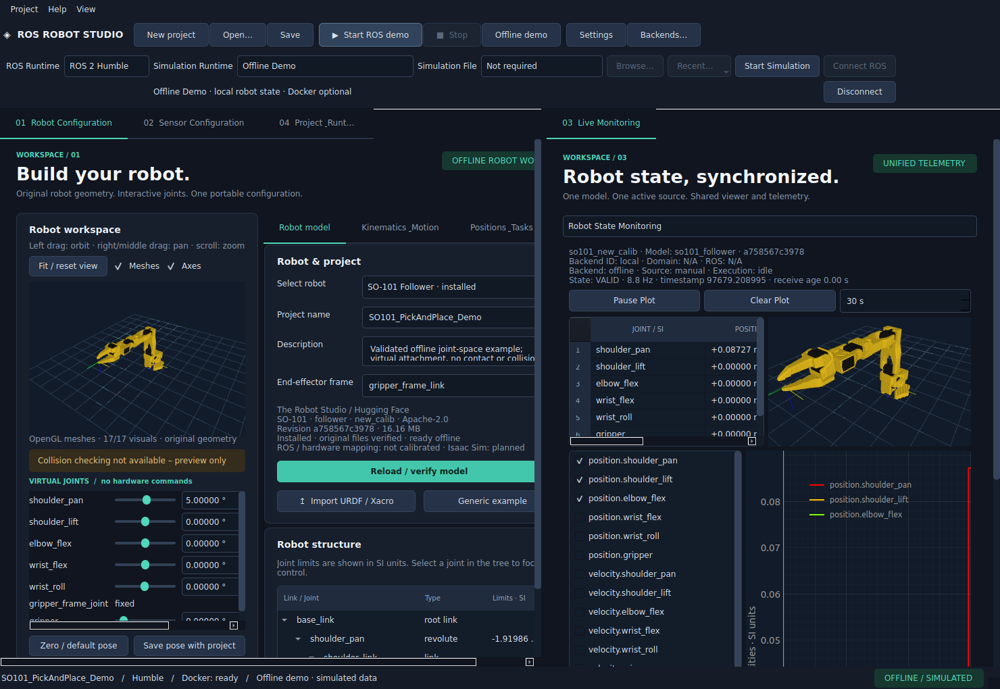
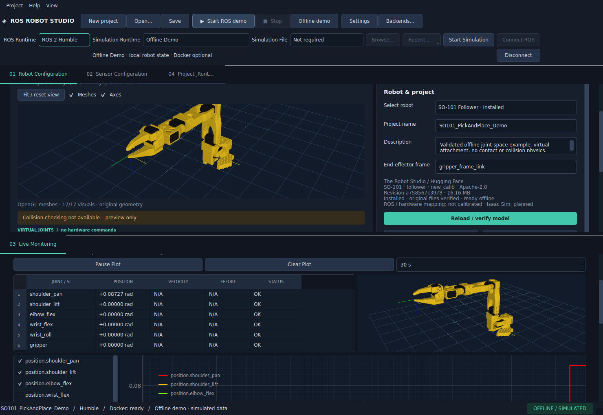

# Verschiebbarer Workspace

Die vier Hauptpanels bleiben dieselben Instanzen: Robot Configuration, Sensor
Configuration, Live Monitoring und Project & Runtime. Ihre sichtbaren Tabtitel lassen
sich per Maus ziehen:

- An eine linke/rechte Kante: horizontal aufteilen.
- An eine obere/untere Kante: vertikal aufteilen.
- In die Mitte einer anderen Gruppe: als Tab zusammenführen.
- Auf einen Tabtitel derselben Gruppe: Reihenfolge ändern.

Eine blaue Vorschau zeigt das Ziel während des Ziehens. Außerhalb des Workspace loslassen
bricht das Verschieben ab. Leere Gruppen und überflüssige Splitter verschwinden automatisch.
Die Trennleisten lassen sich mit der Maus verschieben. Für Robot links und Monitoring
rechts zunächst Robot anzeigen, dann **Live Monitoring** an den rechten Rand ziehen.
Weitere Gruppen und verschachtelte Teilungen sind möglich.

**View → Save workspace layout** speichert Gruppen, Tabreihenfolge, ausgewählte Tabs,
Splitrichtungen, Größen und Fenstergeometrie ausschließlich in lokalen Settings. Beim
regulär bestätigten Schließen wird ebenfalls gespeichert. **Restore saved workspace
layout** lädt diesen Stand; **Reset workspace layout** stellt eine gemeinsame Tabgruppe
wieder her. Eine abgebrochene Schließen-/Speichern-Entscheidung beendet keine laufenden
Verbindungen. Projektdateien enthalten dieses maschinenabhängige Layout nicht.

Das Layoutformat ist versioniert. Ungültige Versionen, unbekannte/doppelte Panels,
unvollständige Gruppen und zu tiefe Bäume werden verworfen; der Start fällt auf das
Standardlayout zurück. Kein Panel kann durch eine beschädigte Layoutdatei verschwinden.

## Umsetzung und Stabilität

`gui/workspace.py` verwendet Qt-QSplitter und QTabWidget. Ziehbewegungen werden am
sichtbaren QTabBar verarbeitet; es gibt kein zweites Panelregister mit kopierten Views.
Der zentrale RobotStateManager, die ROS-Verbindungen und ihre Listener bleiben unverändert.
Beim Ein-/Umhängen bleiben Widgets unter demselben Top-Level-Fenster; eine versteckte
Staging-Fläche verhindert vorübergehende Top-Level-Widgets. Das entspricht den
[Qt-Lebensdauerregeln für QOpenGLWidget](https://doc.qt.io/qt-6/qopenglwidget.html).
Floating-Fenster wurden nicht ergänzt; die geforderten geteilten Arbeitsflächen funktionieren
innerhalb eines Fensters.

Die Roboter-Modellseite scrollt bei schmalen Gruppen; Monitoring-Spalten bleiben mit
horizontalem Scrollen und anpassbaren Breiten lesbar. Native Prüfungen ziehen die Tabs,
verschieben Splitter, kombinieren drei Gruppen, führen sie wieder zusammen, ändern
Gelenkwerte und kontrollieren beide Viewer samt Framebuffer und Shaderprogramm. Sie prüfen
auch Fensterneustart, unveränderte Listener-/Subscriptionzahlen, gestoppte Timer und
Widgetfreigabe. Messdaten: [gui-usability-verification.json](gui-usability-verification.json).

Die native Widgetzählung unterscheidet das eine anwendungsweite `Qt::Desktop`-Hilfsobjekt
von Studio-Widgets. [Belegte Herkunft und Ownership](QT_WIDGET_INVESTIGATION.md).
Dateidialog-Abbrüche, MRU nach Fensterneustart sowie Kamera/Zoom nach dem Verschieben
gehören ebenfalls zur erweiterten Abnahme.

Jedes ursprüngliche Hauptpanel liegt in genau einer mitverschobenen Scrollfläche.
Die eigentlichen Qt-Layouts behalten ihre Mindestgeometrie; niedrige vertikale Gruppen
scrollen, statt Viewer, Labels und Gelenkregler übereinander zu schieben. Die bestehende
Panelindex-API und die ursprünglichen Panelinstanzen bleiben erhalten. Die Regression
prüft Mindestgrößen, Scrolltasten, überlappungsfreie Viewer/Regler und beide OpenGL-Views
auch nach der vertikalen Teilung.
