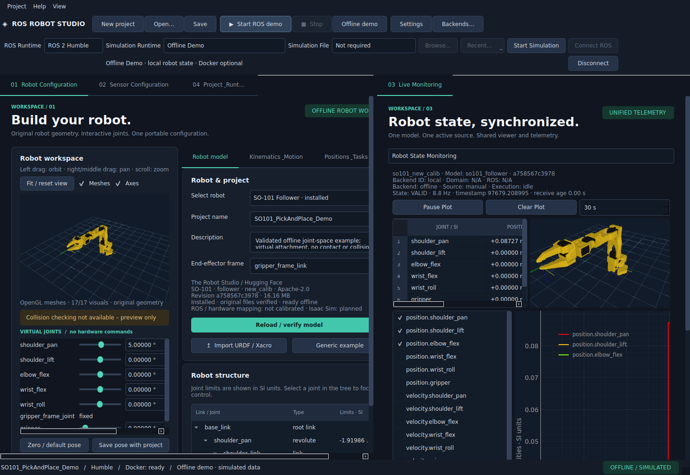
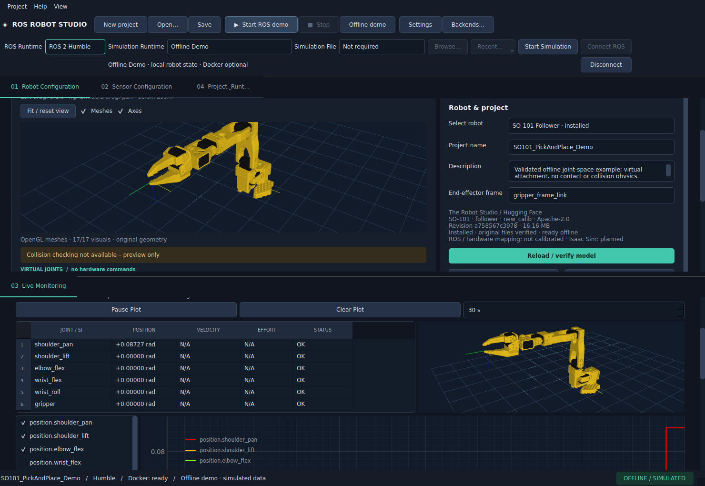
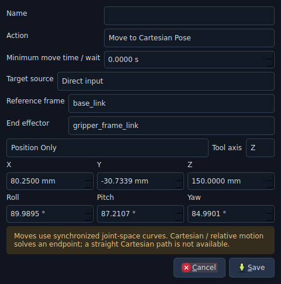
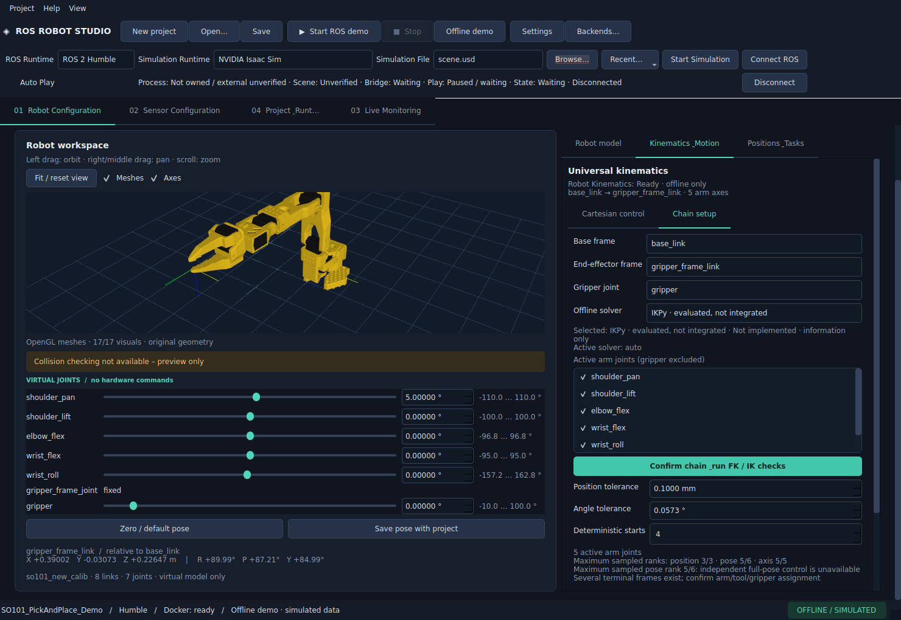
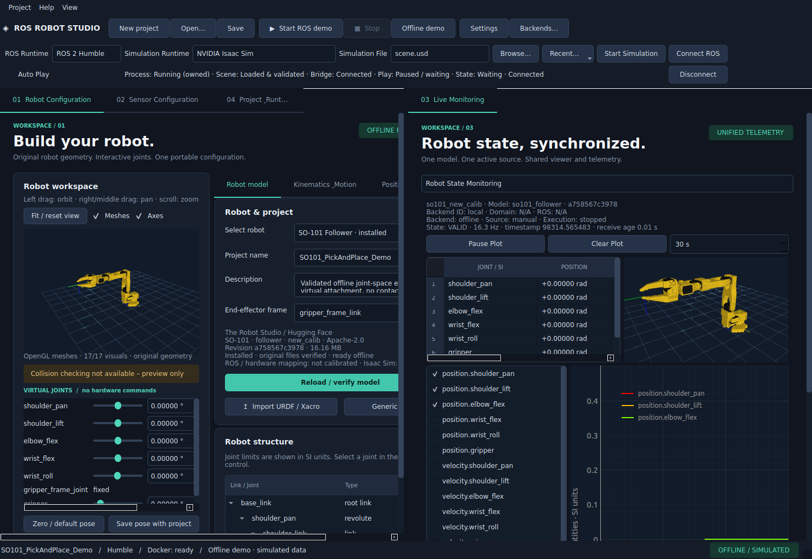
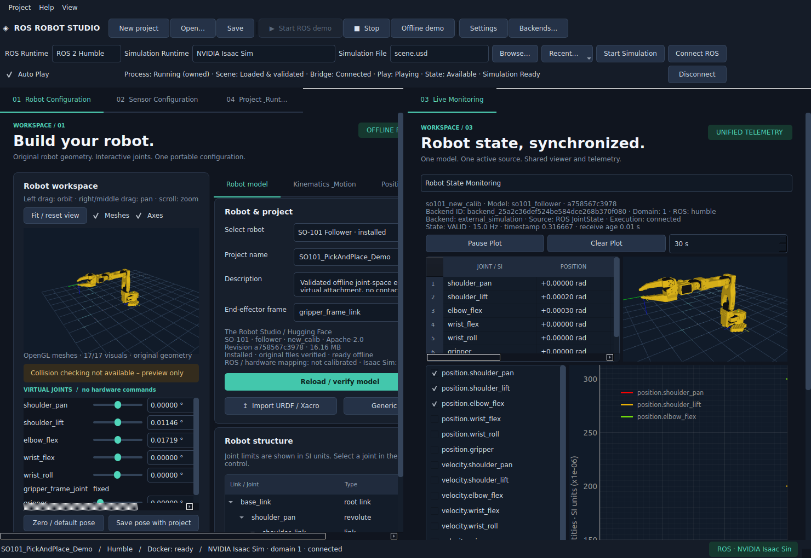
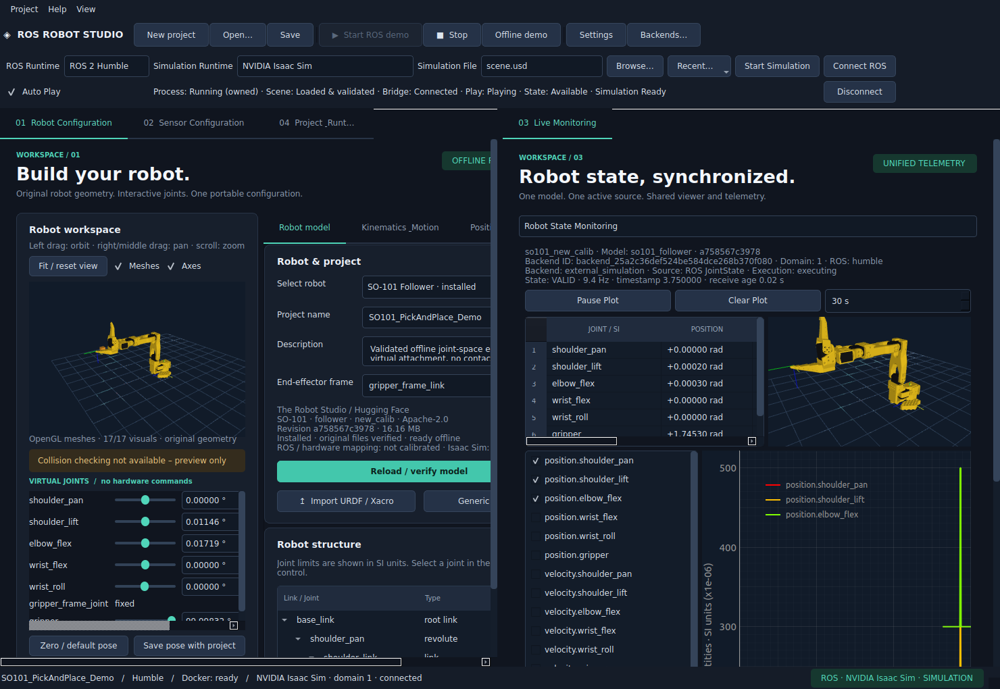

# ROS Robot Studio – GUI- und Runtime-Abschluss

Abnahme vom 09.11.2026. Geprüfter Quellstand: `1a07a48bf23d47a80ea96234748edf36fd239124`. Quellen, Tests, Skripte,
Laufzeitdaten und Abhängigkeitseingaben wurden vor/nach der gesamten Abnahme per SHA-256
verglichen: **160 Dateien unverändert**. Dokumentation und Messbilder wurden
anschließend vervollständigt. [Maschinenlesbarer Gesamtnachweis](gui-runtime-release-verification.json).

| Prüfung | Endergebnis |
|---|---|
| Vollständiges Pytest einschließlich Docker, Original-SO-101 und echtem Isaac | **231 bestanden, 0 fehlgeschlagen, 0 Fehler, 0 übersprungen** |
| Dauer der vollständigen Suite | 793.22 s |
| Native Bedien-/Dockingserie | 8 vollständige neue Fenster, X11/xcb, Original-STLs und OpenGL |
| Zusätzliche native Lebensdauerprüfung | 20 originale SO-101-Fenster |
| Qt-interne Desktop-Hilfe | Höchstens eine unveränderte `Qt::Desktop`-Instanz; kein Studio-Leck |
| Unerwartete Widgets / zusätzliche Listener oder Subscriptions / aktive Timer nach Close | jeweils 0 |
| Ruff, Format, Dependency Check und Git Diff Check | bestanden |

## Behobene Fehler und Qt-Ownership

Das zusätzliche namenlose QWidget wurde über Metaobjektklasse, Parent, Sichtbarkeit,
Kinder, Zeitverlauf und einen nativen Konstruktorstack untersucht. Es entsteht bei
`QApplicationPrivate::desktop()` während nativer Cursor-Leave-Verarbeitung bereits vor
dem Dateidialog. Qt 6.9.3 hält es bis zur QApplication-Zerstörung. Es wurde nicht pauschal
gelöscht oder als Studio-Leck kaschiert: die Tests erfassen exakt diesen Typ separat,
verlangen höchstens eine unveränderte Instanz und weisen jedes andere zusätzliche Widget
weiterhin ab. [Untersuchung](QT_WIDGET_INVESTIGATION.md), [Messdaten](qt-widget-investigation.json).

Die visuelle Prüfung fand daneben tatsächlich überlappende Inhalte in sehr niedrigen
vertikalen Gruppen. Jedes ursprüngliche Hauptpanel sitzt deshalb in einer einzigen
mitverschobenen Scrollfläche; seine Layout-Mindestgrößen bleiben erhalten. Native Tests
prüfen die Scrollbedienung, überlappungsfreie Viewer/Regler und beide Renderansichten.

Ein später Worker-Callback an einem gelöschten TaskRunner wurde ebenfalls korrigiert.
Worker-Ergebnis-, Fehler-, Progress- und Finished-Signale verwenden nun QObject-gebundene
`@Slot`-Empfänger mit QueuedConnection. Qt entfernt Aufrufe nach Empfängerzerstörung.
Ein gezielter Test löscht den Parent, nachdem Ergebnisse bereits gequeue-t wurden; ein
weiterer prüft normale Ergebnis-/Fehlerzustellung im GUI-Thread. Das Hauptfenster wartet
auch auf laufende Setup-Arbeit, bevor es Close akzeptiert.

Ein echter Jazzy-Start zeigte eine zulässige rosapi-Fehlerantwort während der Discovery.
Der Integrationstest verwechselt `result:false`/Fehlertext nicht mehr mit Graphdaten und
wiederholt innerhalb derselben begrenzten Frist. Erfolgreiche Topics, Nodes und tatsächlich
empfangene Subscriber-Nachrichten bleiben Pflicht. Der Desktop validiert außerdem das
Objektformat erfolgreicher Serviceantworten.

## Docker

Das Konto `local-user` gehört bereits zur Docker-Gruppe. Der alte laufende Prozess hatte diese
Gruppe nicht effektiv; Socket `root:docker`, `0660`, Engine aktiv. Eine neue berechtigte
Gruppensitzung erreicht die API und alle drei Studio-Images. Es wurden keine neuen ACLs,
Gruppenmitgliedschaften oder Socketrechte verändert. Der neue Snapshot zeigt echte PID,
Prozess- und Kontogruppen, Context/Endpoint, Socket/ACL und Engine/API getrennt. Recheck,
Setup sowie wiederholte fehlgeschlagene Starts verwenden die zentrale Diagnose.
[Bedienung und Ursache](DOCKER_DIAGNOSTICS.md).

## Taskeditor, Solver und Workspace

Alle sieben Aktionen wurden mit tatsächlichen Qt-Maus-/Tastatureingaben bearbeitet,
gespeichert, erneut geöffnet und über Projekte wiederhergestellt. Direkte kartesische
Ziele speichern mm/Grad als Meter/Radiant; relative Komponenten, Frames, Posemodus,
Jointmodellbindung und Greiferwerte sind geprüft. Ungültige/auf dem Roboter nicht
unterstützte Ziele werden nicht als erfolgreiche Bewegung übernommen.
[Taskeditor und Solver](TASK_EDITOR_GUI.md).

Alle Solverzeilen sind per Maus und Tastatur erreichbar. Automatic/SciPy bounded IK ist
implementiert und aktivierbar. MoveIt 2, KDL, TRAC-IK, Pinocchio und IKPy bleiben klar
gekennzeichnete, nicht integrierte Kandidaten. Fehlende SciPy-Abhängigkeit wird erkannt;
ein solcher Kandidat ersetzt keinen funktionierenden aktiven Solver.

Der Workspace verwendet Qt-Splitter und Tabgruppen mit genau denselben vier Panels und
demselben RobotStateManager. Geprüft wurden horizontale/vertikale Teilung, Zusammenführen,
mehrere Gruppen, Maus-Resize, Reset, lokale Layoutspeicherung und Wiederherstellung nach
neuem Fenster. Kamera, Zoom, Original-STLs, Gelenkänderungen, Framebuffer und Shader sind
auch nach dem Verschieben gültig. Listener-/Subscriptionzahlen bleiben unverändert.
[Docking-Bedienung](GUI_DOCKING.md), [native Messdaten](gui-usability-verification.json),
[zusätzliche Lebensdauerprüfung](gui-lifecycle-usability-verification.json).

## Runtime-Banner, Dateien und echte ROS-/Isaac-Prüfung

ROS-Auswahl, Simulation Runtime und Backend Connection Manager verwenden dieselben Profile
und dieselbe zentrale Auswahl. Offline, ROS Demo, Isaac, MuJoCo, Gazebo und Real Robot sind
erreichbar. MuJoCo/Gazebo sind nicht implementiert und erlauben keine vorgetäuschte
Simulation. Real Robot bleibt in Profil, Transport und Ausführung Read Only.

Dateiauswahl und MRU sind lokal; portable Projekte erhalten keine absoluten Rechnerpfade.
USD/USDA/USDC, XML/MJCF und SDF/WORLD sind als Dateifilter geprüft. Fehlende/falsche Pfade,
Auswahl, Abbruch, erneute Auswahl und MRU nach Fensterneustart sind abgedeckt. Die native
Serie verwendet sichtbare Qt-Dateidialoge unter xcb, einschließlich echtem Cancel-Klick.
Ein Abbruch behält die gültige Auswahl. Ein Dateifilter ersetzt keine USD-/Articulation-
Validierung. [Runtime und Dateien](SIMULATION_RUNTIME_SELECTION.md).

Isaac Sim 5.1 bleibt ein eigenständiger SDK-Prozess; der Desktop importiert kein Isaac-SDK.
Im finalen Banner-Test lädt eine vorhandene originale SO-101-USD in Domain 1/Humble.
Standardmäßig bleibt sie pausiert, ohne Clock-Daten oder ROS-Bewegungsfreigabe. Nach
explizitem Auto-Play-Checkbox-Opt-in gelingt der **13-Schritt-Task mit 655
echten JointState-Samples**. Der separate bestehende Isaac-Test bestätigt ebenfalls den
Task, Arm- und Greiferbewegung sowie elf akzeptierte/erfolgreiche Bewegungsziele. Quellen
bleiben unverändert; eigene ROS-/Isaac-Ressourcen wurden entfernt.
[Banner-Nachweis im eingefrorenen Lauf](isaac-header-frozen-verification.json), [Isaac-Bewegungsnachweis](isaac-backend-verification.json).

Die vollständige Suite enthält außerdem echte Humble-, Jazzy- und Lyrical-Starts,
FollowJointTrajectory, Demo-/ROS-Roundtrips, Domain-Isolation, getrennte Quellen,
Verbindungsverlust und Read-Only-Command-Spies. Es wurde kein realer Hardwarearm bewegt.

## Grenzen und frühere Zwischenläufe

Kartesische und relative Bewegung bleiben Endpoint-IK mit Gelenkrauminterpolation.
Geradlinige kartesische Bahnen, Collision Checking und ein physikalisch validierter
Objektgriff sind nicht implementiert. Floating-Fenster wurden nicht ergänzt. Isaac ist
lokal mit 5.1/Humble geprüft; weitere Simulatorversionen, andere Betriebssysteme und native
Dateiportale wurden nicht als getestet behauptet. Hardwareausführung bleibt gesperrt.

Die früheren 186-/210-Testmeldungen sind Zwischenstände. Der erste eingefrorene Folgelauf
wurde nach einem visuellen Layoutfehler unterbrochen und meldete außerdem den Worker-
Callbackfehler und den rosapi-Testfehler. Diese wurden gezielt korrigiert, mit neuen
Regressionen versehen und durch den oben genannten unveränderten Gesamtlauf ersetzt.
Frühere native ROS-/Host-Crashunsicherheiten sind weiter in
[ROS_BRIDGE_STABILITY.md](ROS_BRIDGE_STABILITY.md) beschrieben; ein bestandener Lauf
beweist keine allgemeine Fehlerfreiheit aller Qt-/Treiber-/Hostkombinationen.

## Lokale Commits und Start

Die vorhandene Historie wurde erhalten; kein Push und keine Remote-Anlage. Neue lokale
Implementierungscommits seit `b68e88e`:

- `83711bd` · Diagnose Docker endpoints and effective Studio process permissions
- `d33fae8` · Edit action-specific task targets directly with preserved model bindings
- `a2dd41f` · Separate selectable solver candidates from verified active kinematics
- `21015bb` · Add draggable split tab workspace and usable narrow panel layouts
- `eb7750f` · Integrate runtime banner, local scene history and manual Isaac playback
- `279a394` · Verify native task input, solver selection, docking and release regression
- `3f714a6` · Guard existing simulator instances and verify paused header startup with real Isaac
- `7650d32` · Include Qt file chooser input dependencies in native acceptance
- `fe98620` · Finalize native GUI ownership checks, file dialog regression and frozen release acceptance
- `c4e1da5` · Keep docked panel layouts readable with persistent scroll pages
- `f8999e6` · Bind queued worker completion to receiver lifetime and wait for setup close
- `1a07a48` · Validate rosapi results and retry transient graph startup failures

Dokumentation, Messdaten und Screenshots werden in den nachfolgenden lokalen
Abschlusscommits versioniert. Große USD-Dateien, Docker-Images und temporäre Logs sind
nicht Teil von Git. Nach dem Abschluss ist der Arbeitsbaum sauber.

In einer frischen Desktop-Anmeldung:

```bash
cd $HOME/Desktop/ROS_APP/ros-robot-studio
./start.sh --pick-place-demo
```

Für die bereits eingerichtete Docker-Gruppe auch aus einer älteren Sitzung:

```bash
cd $HOME/Desktop/ROS_APP/ros-robot-studio
sg docker -c './start.sh --pick-place-demo'
```

Vollständige Reproduktion: `sg docker -c './scripts/verify_usability_release.sh'`.






## Zusätzliche sichtbare Isaac-Banner-Abnahme

Nach dem eingefrorenen Gesamtlauf wurde derselbe unveränderte Stand unter X11/xcb nochmals mit sichtbarem Studio geprüft. Ein externer Beobachter trieb den vorhandenen Qt-Dateidialog, zog Monitoring per Maus nach rechts und erstellte ausschließlich Bilder des eigenen Studio-Fensters. Nach pausiertem Start und ausdrücklichem Auto Play gelang der vollständige 13-Schritt-Task erneut mit **496 echten JointState-Rückmeldungen**. Beide OpenGL-Programme waren gültig; beide Viewer folgten demselben gemessenen State. Gemessene Bewegungsspanne: Schulter-Pan **0.577 rad**, Greifer **1.9198 rad**. [Messdaten](isaac-header-native-verification.json). Die 160 eingefrorenen Eingabedateien blieben unverändert.





Im langen SO-101-Subprozesstest gibt der auf 180 s konfigurierte Faulthandler einen Diagnosestack aus, während der Kindprozess regulär weiterläuft. Die tatsächliche Frist beträgt unverändert 430 s; der Test ist im abschließenden JUnit bestanden. Der Stackdump ist weder ein abgefangener Crash noch ein übersprungener Test.

Zwei frühere Läufe in der restriktiven Agent-Sandbox zeigten einen Qt-Segmentation-Fault im Importfehlertest. Ein kausaler Zusammenhang mit dem später eindeutig behobenen Worker-Lebensdauerfehler wurde nicht bewiesen. Die abschließende Suite außerhalb dieser Sandbox und die nativen Serien bestanden; eine allgemeine Treiber-/Hostfehlerfreiheit wird daraus nicht abgeleitet.
