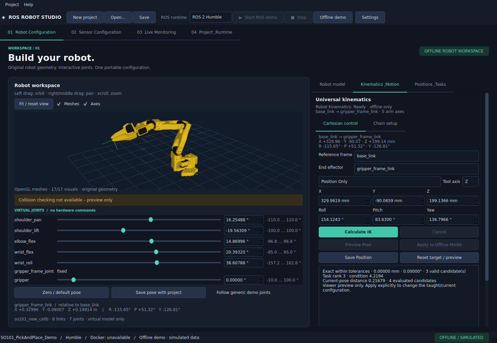
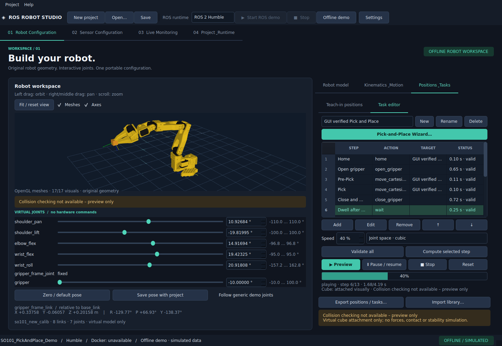
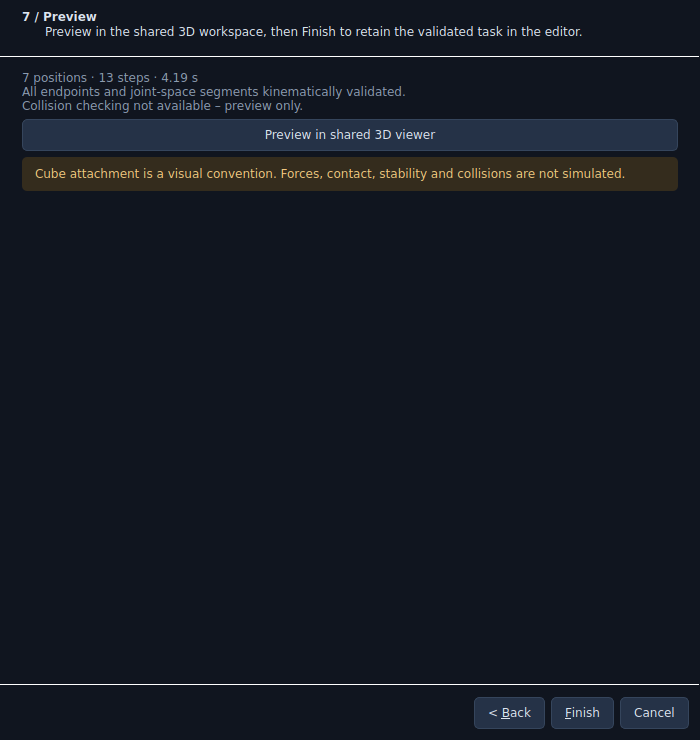

# Abschlussbericht: Universal Kinematics & Pick-and-Place

Stand: 8. November 2026 · Ubuntu 22.04 amd64 · Python 3.10.12 · PySide6 6.8.3.
Implementiert im bestehenden Repository und dessen Robot Configuration; keine separate Anwendung.

## Ergebnis

Universelle URDF-FK/IK, kartesische Offline-Steuerung, Teach-in, sequentieller Taskeditor,
siebenstufiger Pick-and-Place-Wizard und zeitbasierte Offline-Wiedergabe funktionieren.
Die SO-101-Integration war bei Arbeitsbeginn bereits vorhanden: geprüfte Original-URDF,
13 STLs, 17 Visuals, Model Manager, FK, Gelenkregler und Projektformat v2. Diese Komponenten
wurden wiederverwendet. Vor Arbeitsbeginn war der Git-Arbeitsbaum sauber.

Die Engine enthält keine SO-spezifische IK und benötigt keine Meshes, ROS-Distribution,
Docker-, rclpy-, Isaac- oder Hardwarebibliothek. Die SO-Demo enthält modellbezogene
Teach-in-Beispieldaten, die gegen das Originalmodell erneut per FK/IK geprüft werden.

## Implementierte Funktionen

- URDF-basierte Ketten, Base/Tool-Auswahl, Arm-/Greifertrennung; revolute, continuous,
  prismatic, fixed und linear gekoppelte mimic-Joints mit effektiven Treibergrenzen.
  Auch die Defaultpose berücksichtigt versetzte Mimic-Grenzen. Velocity/Effort und
  optionale Acceleration-Erweiterungen werden eingelesen.
- Ein gemeinsamer FK-Pfad für alle Link-/Toolposen, Jacobidiagnostik, Viewer und Solver.
  Numerische maximale Ränge aus 13 deterministischen Modellstellungen und lokale Kondition.
- Optionaler SciPy-1.15.3-Solver, reproduzierbare Mehrfachstarts, aktuelle Pose als erster
  Seed, Bounds, Gewichtung, Abbruch-/Zeit-/Evaluationslimits und nachgelagerte FK-Validierung.
  Position Only, Position+Toolachse sowie Full Pose bei geeignetem Kettenrang.
- Kartesische mm/Grad-Eingaben, Live-FK, getrennte Preview/Apply-Aktionen, Restfehler,
  eindeutige Fehlerfälle und getrennte virtuelle Greiferwerte. Qt bleibt bei Suchläufen bedienbar.
- Benannte editierbare Joint-/Cartesische Positionen, Duplizieren, Referenzschutz beim
  Löschen, Modellbindung, Reachability-Prüfung und Import/Export einer YAML-Bibliothek.
- Taskeditor mit sieben Aktionstypen, Sortieren, Einzel-/Gesamtvalidierung und sichtbarem
  ersten fehlerhaften Schritt. Kein Abspielen unvollständig validierter Teilprogramme.
- Wizard mit aktuellen/gespeicherten/kartesischen/Joint-Zielen, bestätigten URDF-Greiferwerten,
  geframten Abstand-/Richtungsangaben und IK-Prüfung aller erzeugten Wegpunkte. Seite 7
  kann im gemeinsamen Viewer vorspielen; Finish übernimmt das Programm atomar.
- Kubische synchronisierte Gelenkraumkurven, analytische Velocity-/Acceleration-Peaks
  einschließlich Mimic, Sample-/Limitprüfungen, Speed, Pause/Resume/Stop/Reset.
- Vereinfachte visuelle Würfelaufnahme/-ablage. Kein Kontakt-, Kraft- oder Stabilitätsmodell.
- Projektformat v3 mit nachvollziehbarer v1/v2-Migration; originale Dateien bleiben beim
  Laden erhalten. Modellsignatur, Solver-/Frame-/Jointzuordnung, Posen, Tasks und Motion-
  Parameter sind distributionsneutral. Portable Beispiele enthalten keine Benutzerpfade.
- Erweiterungsverträge für Solver, Kollisionen, Ausführung und Posequellen; nur Offline,
  ManualPoseProvider und SavedPoseProvider sind tatsächlich implementiert.

## Solverentscheidung

**SciPy 1.15.3 `least_squares`, Trust Region Reflective mit Bounds** verwendet den vorhandenen
URDF-/FK-Pfad. Die konkrete Python-3.10-Version ist lokal installiert und getestet; weder
NumPy noch Host-ROS wurden ersetzt. SciPy bleibt ein optionaler Lock/Extra und ist über den
bestehenden Setup-Assistenten nachinstallierbar. Start ohne SciPy ist automatisiert geprüft.

IKPy und Pinocchio wurden anhand ihrer primären Dokumentation bewertet; sie wurden nicht
als funktionsfähige Backends ausgegeben. Auswahlbegründung und verlinkte Dokumentation
stehen in [KINEMATICS.md](KINEMATICS.md#solverentscheidung-und-grenzen).

## Robotertests

Alle Ziele stammen aus tatsächlicher FK der jeweiligen URDF. Der Solver startet bei einer
anderen Konfiguration; Ergebnisse werden über dieselbe FK und URDF-Grenzen überprüft.
Maschinenlesbare Werte: [kinematics-verification.json](kinematics-verification.json).

| Modell | Armachsen | geprüfter Modus | maximaler Pose-Rang | XYZ-Restfehler dieses Laufs |
| --- | ---: | --- | ---: | ---: |
| Original SO-101 new_calib follower | 5 + separater Greifer | Position Only; Full Pose korrekt gesperrt | 5 | 2,78 × 10⁻¹⁰ m |
| Eigener generischer Lineararm | 3 + separater Greifer | Position Only, Axis | 3 | 2,53 × 10⁻¹⁰ m |
| Eigener serieller 6R-Testarm | 6 | Axis, Full Pose | 6 | 7,56 × 10⁻¹⁶ m |

Der Full-Pose-Orientierungsfehler des 6R-Beispiellaufs beträgt 3,67 × 10⁻¹⁶ rad.
Diese kleinen Residuen sind Werte synthetischer FK/IK-Tests, keine reale Robotergenauigkeit.
Ein echter Ufactory xArm 6 wurde nicht importiert oder getestet. Der zusätzliche originale
6R-Testarm weist unterschiedliche Kinematik/Gelenkanzahl ohne externe Modelllizenzabhängigkeit nach.

SO-101-Quelle: [offizielles SO-ARM100-Repository](https://github.com/TheRobotStudio/SO-ARM100),
feste Revision `a758567c3978dfeefe282ede0500085a48fe8f78`. Fünf Arm-Joints ohne `gripper`;
Full Pose wird aufgrund des analysierten Rangs deaktiviert. Die 13-schrittige SO-Demo ist
hier etwa 4,27 s lang, die 13-schrittige generische Demo etwa 22,29 s bei 40 % Preview-Speed.
Die Zeiten ergeben sich aus den konkreten Modellgrenzen; keine Hardwarefreigaben.

## Automatisierte Prüfungen

Endgültiger Lauf:

```bash
env -u PYTHONPATH QT_QPA_PLATFORM=offscreen .venv/bin/python -m pytest -q \
  --run-model-download --run-docker -ra
```

**104 bestanden, 3 übersprungen**, 16,10 s. Die drei Docker-Integrationstests wurden wegen
`PermissionError(13)` am Daemon übersprungen. Keine erfolgreichen ROS-Containerläufe
werden behauptet. Der Loopback-/Reconnect-Protokolltest sowie der echte Originalmodell-
Download mit Integritäts-/Reparaturprüfung sind in diesem Lauf bestanden.

Enthalten sind sämtliche vorherigen Regressionstests für URDF, Viewer, Projekte, Sensoren,
Runtime und Transport. Neu geprüft: erreichbare/unerreichbare Ziele, Axis/Full Pose,
Konvergenzfehler, Mehrfachstarts, Singularität, Frames, Mimic, Continuous, echte Limits,
fehlende/Null-Dynamiklimits, Teach-in, Migration, Würfelbindung, Fehlerschritt, Task-Abbruch,
GUI-Assistent und Start ohne SciPy. Zusätzlich bestanden:

- `ruff check src tests scripts`.
- `ruff format --check src tests scripts` (72 Dateien).
- `git diff --check`.
- `.venv/bin/python -m pip check`: keine beschädigten Abhängigkeiten.

## Native GUI-Abnahme

`scripts/verify_motion_gui.py` wurde unter **xcb mit echtem OpenGL** erfolgreich ausgeführt,
nicht nur im Offscreen-Fallback. Originalmodell und alle 17 Meshvisuals wurden angezeigt.
Der Test bedient echte Qt-Controls und prüft:

1. Kartesische IK, reine Viewer-Vorschau und ausdrückliche Übernahme.
2. Unerreichbares Ziel ohne Apply-Möglichkeit oder Änderung der aktuellen Pose.
3. Alle sieben Wizardseiten, bestätigte Greiferwerte, validierte Wegpunkte und temporäre Preview.
4. Übernahme in den Taskeditor; Playback, Pause/Resume, visuelle Aufnahme/Ablage, Stop/Reset.
5. Reihenfolge ändern/zurückstellen und einen einzelnen Schritt berechnen.
6. Projekt speichern, neue Projektkonfiguration laden, gespeichertes Projekt öffnen und erneut abspielen.

[GUI-Prüfprotokoll](motion-gui-verification.json).
Die Screenshots wurden anschließend visuell geprüft; der Kollisionshinweis bleibt auch
beim Scrollen des kartesischen Bereichs im gemeinsamen Viewer sichtbar.





## Bewusste Grenzen

**Collision checking not available – preview only.** Keine Selbst-/Umgebungskollisionen,
keine reale Hardwarebewegung, keine Kalibrierung, kein ros2_control-/FollowJointTrajectory-
Controller und keine Isaac-Anbindung. Kollision/ROS/Isaac sind vorbereitete Verträge.
`hardware_ready` bleibt false. Software-Stop ist kein physischer Not-Halt.

Move Cartesian/Relative planen IK-Endpunkte mit anschließender Gelenkraumkurve. Gerade
kartesische Bahnen, Zwischenpunkt-IK und Transformations-Gizmo fehlen. Fehlende dynamische
Limits werden als Demo-Fallback bzw. nicht geprüft gemeldet. URDFs mit geschlossenen/
parallelen Mechanismen und floating/planar IK werden abgewiesen. Numerische Suche ist
lokal, hat keine globale Erreichbarkeitsgarantie und approximative Ergebnisse werden
nicht als exakt übernehmbar dargestellt. Ranganalyse ist endlich abgetastet.

Die GUI wählt aktuell eine unabhängige Greiferachse; die Kern-API kann mehrere zuordnen.
Kamera-/TF-Lokalisierung, Sensortrigger, Schleifen und Bedingungen sind nicht implementiert.
Die ersten drei Originalmodelle/Fixtures wurden geprüft; daraus folgt keine universelle
Garantie für jede beliebige externe URDF oder deren reale mechanische Richtigkeit.

## Git und Start

Lokale Commits dieses Auftrags, kein Remote-Push:

- `ccddcfd` — Universal URDF kinematics and validated offline motion programs.
- `f668ebc` — Cartesian teaching, Pick-and-Place Wizard and shared 3D preview.
- Dokumentationscommit **Document kinematics workflow and verified offline acceptance**
  enthält diesen Bericht, Anleitungen, Prüfdaten und Screenshots (Hash über `git log`).

Exakter normaler Einstieg:

```bash
cd $HOME/Desktop/ROS_APP/ros-robot-studio
./start.sh --pick-place-demo
```

Im Editor **Preview** wählen. Für eigene Ziele **Kinematics & Motion** öffnen.
Vollständige Bedienung und Einschränkungen: [KINEMATICS.md](KINEMATICS.md).
