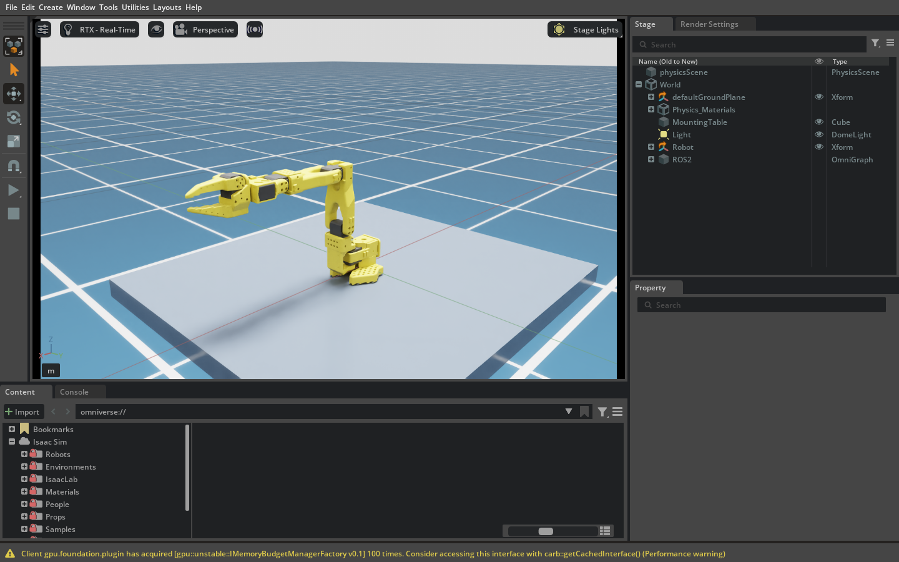
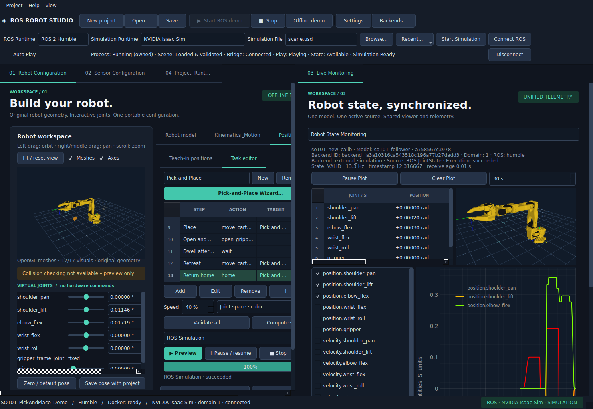

# Systemabnahme vor der Kameraintegration

12. November 2026 · Ausgangsstand `78d145c` · geprüfter Quellstand
`3b789e309b066b0af2256c24b7dc0583a42211b1`.

**Software-Abnahme bestanden.** 232 Tests bestanden in 782,11 s. Fehlgeschlagen 0, Fehler 0, übersprungen 0. Ruff Lint, Ruff Format, `pip check` und `git diff --check` bestanden. Der SHA-256-Vergleich bestätigte 190 unveränderte Eingabedateien.

## Host und reproduzierbare Umgebung

| Komponente | Geprüfter Stand |
|---|---|
| Host | Ubuntu 22.04.5 LTS, Kernel 6.8.0-138-generic, x86_64, aktive X11-Sitzung |
| Desktop | Python 3.10.12, Studio 0.1.0, PySide6/Qt/Shiboken 6.9.3, PyQtGraph 0.13.7, PyOpenGL 3.1.9 |
| Numerik und Tests | NumPy 2.2.6, SciPy 1.15.3, Pytest 8.3.5, pytest-qt 4.4.0, Ruff 0.11.13 |
| Docker | Engine und Client 29.9.3, API 1.56, Python-SDK 7.1.0 |
| Grafik | NVIDIA GeForce RTX 4070 Ti, Treiber 580.178.04, native Qt-Plattform xcb |
| Isaac Sim | 5.1.0-rc.19+release.26219.9c81211b.gl, lokal unter `$HOME/isaacsim`, geprüft mit Humble |
| SO‑101 | Originaler Follower `new_calib`, Modellversion 1.0.0, Revision `a758567c3978dfeefe282ede0500085a48fe8f78` |

Die drei lokalen Studio-Images tragen Tag `0.1.0`. Die installierte native Host-ROS-Distribution
ist Humble. Studio isoliert sein Desktop-Python vom geerbten ROS-`PYTHONPATH`.

| Image | Basis und Python | rosbridge / rosapi | SHA-256-Präfix |
|---|---|---|---|
| Humble | Ubuntu 22.04.5, Python 3.10.12 | 2.0.8 | `c29d54b68012` |
| Jazzy | Ubuntu 24.04.5, Python 3.12.3 | 2.7.1 | `de067eed8369` |
| Lyrical | Ubuntu 26.04.1, Python 3.14.4 | 4.2.1 | `37df51cd93c5` |

Der Beginncheck umfasste Status, zehn Commits, unstaged und staged Diff. Der einzige
vorhandene lokale Inhalt außerhalb von Git war `simulation_scenes/IsaacSim/So-101_demo/`.
Der Ordner bleibt erhalten. Ein auf diesen Ordner begrenzter Eintrag in
`.git/info/exclude` hält die lokalen USD-Assets aus dem Git-Status und aus den Commits.

## Host-Absturz und Wiederaufnahme

Am 12. November um 01:18:22 CET meldete der Kernel `Watchdog detected hard LOCKUP on cpu 8`.
CPU 8 ist der SMT-Geschwisterthread von CPU 0 auf dem Ryzen 7 5800X. Das Journal
endet unmittelbar nach der Liste der geladenen Module. Ein Kernel-Stack oder
persistierter Crashdump liegt nicht vor. Die Meldung belegt ausgebliebene
Interrupt-Heartbeats auf diesem logischen Prozessor. Der Auslöser bleibt offen.
Mehrere Diagnose- und Abnahmeprozesse überlappten zu diesem Zeitpunkt. Aus der
zeitlichen Nähe lässt sich kein bestimmter Prozess als Ursache ableiten.
Die früheren Offscreen-SIGSEGVs wurden als separate Prozessfehler erfasst.
[Linux-Watchdog-Dokumentation](https://docs.kernel.org/admin-guide/lockup-watchdogs.html)

Nach dem Neustart war der Git-Index mit Nullen beschädigt. Der Originalindex
wurde lokal gesichert, aus `HEAD` atomar wiederhergestellt und mit
`git fsck --full` geprüft. Der SHA-256-Vergleich aller 190 Eingaben des
unterbrochenen Softwarestands bestand. Die Arbeitsdateien und Commit-Historie
blieben erhalten. Der identifizierte beendete Humble-Testcontainer wurde entfernt.
Das Systemlaufwerk Apacer AS350 meldete per SMART keinen vorhergesagten Ausfall
und null fehlerhafte Sektoren. Das Journal enthielt zum Lockup weder einen
protokollierten Machine Check noch einen NVIDIA-Xid oder OOM.

Memtester 4.5.1 prüfte 256 MiB in einem vollständigen Durchlauf ohne Fehler. Die 1-GiB-Variante endete am gesetzten Zeitlimit, ohne Fehler in den abgeschlossenen Prüfschritten. Die Stichproben ersetzen keinen vollständigen RAM-Test. Nach dem Neustart bestanden 211 gezielte GUI-/Unit-Tests unter GDB. Die verbleibende Abnahme lief seriell mit einem BLAS-Thread pro Desktop-Testprozess. Der Linux-Boot blieb dabei derselbe.

Der laufende Kernel ist `6.8.0-138-generic`. Ubuntu bietet
`6.8.0-149-generic` über das vorhandene HWE-Metapaket an. Die simulierte
Installation behält die vorhandenen Kernelpakete. Der Änderungsverlauf enthält
keine anhand des vorliegenden Logs eindeutig zuordenbare Korrektur. BIOS,
Bootparameter und Watchdog-Konfiguration sind für die Abnahme unangetastet.
Ein Kernelwechsel mit anschließendem kontrolliertem Vergleich ist ein
Diagnoseschritt. [Ubuntu-Kernel-Änderungsverlauf](https://changelogs.ubuntu.com/changelogs/pool/main/l/linux-hwe-6.8/linux-hwe-6.8_6.8.0-149.149~22.04.1/changelog)

## Docker und regulärer Desktop-Start

`local-user`, der aktive X11-Desktop und der tatsächlich über `start.sh` gestartete
Studio-Python-Prozess besaßen Docker-GID 999 effektiv. Der native Studioprozess meldete
`running (API verified)` über den Default-Context `unix:///var/run/docker.sock`. Der
Socket gehörte `root:docker` mit Modus `0660` und regulären Eigentümer-/Gruppen-ACLs.
Der normale Benutzerstart funktionierte direkt. Der eingeschränkte Agentprozess
hatte einen separaten Gruppenkontext. Für die Desktop-Abnahme galt der beobachtete
Benutzerprozess. Beide tatsächlich gestarteten Studio-Runtimes verwendeten diesen
Zugriff. Die Socketrechte, ACL und Gruppenmitgliedschaften wurden für diese Abnahme
nicht geändert.

## Native GUI, Docking und Ressourcen

**8 native Bedienzyklen und 20 zusätzliche SO‑101-Lebensdauerzyklen** liefen in X11/xcb durch. 17 echte Qt-Dateidialog-Paare prüften Auswahl und Abbruch. Es blieben keine unerwarteten Studio-Widgets, doppelten Listener, doppelten Subscriptions, aktiven Studiotimer oder Worker zurück. Qt besaß höchstens eine pro QApplication erwartete Desktop-Hilfe mit stabiler Identität. [Qt-Ownership](QT_WIDGET_INVESTIGATION.md)

In der nativen Bedienserie wurden Robot Configuration und Live Monitoring per
Mausdrag nebeneinander und übereinander angeordnet, Splitter bewegt, Gruppen
zusammengeführt und beim nächsten Fenster wiederhergestellt. Beide OpenGL-Viewer
zeigten die Original-STLs und reagierten auf Gelenkwerte, Kameradrehung und Zoom.
Die Serie prüfte den Backend Connection Manager und das gemeinsame Profil im
Runtime-Banner, Dateiauswahl und Abbruch, MRU nach Neustart sowie die Anzeigen für
vorbereitete Adapter und Real Robot Read Only.

Der Taskeditor wurde für alle sieben Aktionen mit Qt-Maus- und Tastaturereignissen
bedient, gespeichert, erneut geöffnet, validiert und im Projekt erneut geladen.
Geprüft wurden direkte XYZ-/RPY-Ziele, Einheiten mm/Grad zu m/rad, Referenzframe,
IK-Modus und Modellbindung. Relative Eingaben decken alle sechs Komponenten und den
Bezugsframe ab. Eine Orientierungsänderung im relativen Schritt verlangt derzeit
`full_pose` und wird auf der fünfachsigen SO‑101-Kette entsprechend abgewiesen.
Greiferaktionen speichern explizite Gelenkwerte im Modellbereich sowie die Flags für
virtuelles Anheften und Freigeben. [Bedienvertrag](TASK_EDITOR_GUI.md)

## Originalmodell, Kinematik und Offline-Task

Die 17 Original-Visuals wurden aus dem gepinnten URDF und den STL-Dateien geladen.
Die FK läuft vom `base_link` zum `gripper_frame_link`. Alle sechs unabhängigen Gelenke
sind revolut. Die fünf Armachsen und der separate Greifer wurden im URDF, in Studio
und in der geladenen USD-Szene abgeglichen.

| Gelenk | Untergrenze (rad) | Obergrenze (rad) |
|---|---:|---:|
| shoulder_pan | −1,91986 | 1,91986 |
| shoulder_lift | −1,74533 | 1,74533 |
| elbow_flex | −1,69 | 1,69 |
| wrist_flex | −1,65806 | 1,65806 |
| wrist_roll | −2,74385 | 2,84121 |
| gripper | −0,174533 | 1,74533 |

Am Originalmodell konvergierte das erreichbare FK-Ziel im Positionsmodus mit
`3,754 × 10⁻¹⁰ m` Positionsfehler. Der Achsenmodus erreichte `7,703 × 10⁻¹² m`
und `3,942 × 10⁻⁸ rad` Achsfehler. Ein um 5 m verschobenes Ziel lieferte `not_reached`.
Eine beliebige vollständige 6D-Pose überschreitet die fünf unabhängig steuerbaren
Dimensionen und führt zu `unsupported`. Automatic und SciPy bounded IK wurden
aktiviert. MoveIt 2, KDL, TRAC-IK, Pinocchio und IKPy lassen sich ansehen und bleiben
als nicht integriert gekennzeichnet. Die fehlende optionale SciPy-Abhängigkeit und
der Erhalt eines funktionierenden aktiven Solvers sind durch Tests abgedeckt.
[Kinematik](KINEMATICS.md)

Der vorhandene Offline-Task absolvierte alle 13 Schritte in 4,267 s
Trajektorienzeit. 88 Stichproben verglichen `CompiledTask.sample()`, Robot State,
Robot Configuration 3D und Live Monitoring 3D. Die größte Positionsdifferenz
betrug 0 rad bei einer Prüftoleranz von `10⁻¹⁰ rad`. Die Monitorwerte folgten den
analytischen Trajektoriengeschwindigkeiten (bis 3,999 rad/s) und der aktualisierten
FK-Pose. Die Datenquelle war `offline trajectory`. Pause, Resume, Stop, Reset,
100 % Fortschritt, Greiferbewegung und virtuelle Objektaufnahme/-freigabe wurden
im selben Projekt beobachtet. Die Objektanimation modelliert keine Greifkräfte
oder Kontakte.

## ROS-Runtime und Domain-Isolation

| Distribution | Original-SO‑101-Task | JointState-Samples im ROS-Task- und Cancel-Test | Cancel und Rückkehr zu Offline |
|---|---:|---:|---|
| Humble | 13 Schritte | 760 | bestanden |
| Jazzy | 13 Schritte | 779 | bestanden |
| Lyrical | 13 Schritte | 786 | bestanden |

Containerstart, echte Node- und Topic-Discovery über rosapi, Publisher/Subscriber,
JointStates, native `FollowJointTrajectory`-Action, Controller-Rückmeldung, Cancel
und kontrolliertes Beenden sind Teil der Distributionstests. Der Versionswechsel
lief in einem Studio-Fenster und einem Projekt. Die ursprüngliche Roboterbindung,
Taskdefinition und Projekt-Default-Distribution blieben erhalten.

Drei unabhängige DDS-Fixtures auf demselben Host-Loopback verwendeten identische
Topicnamen in Domains 1, 2 und 0. Graphen, Positionswerte, Subscriptions und Ports
blieben getrennt. Der Real-Robot-Pfad war Read Only und die drei Kommandozähler
standen bei null. Zwei weitere gleichzeitig aktive ROS-Demo-Sitzungen in Domains
10/11 prüften aktives Routing, Wechsel und unveränderten inaktiven State. Die
Vorschläge für Real Robot, Isaac, MuJoCo, Gazebo und Demo sind 0/1/2/3/10. Sie
bleiben editierbar. Der Portabilitätstest speicherte und öffnete ein Profil mit
Domain 19. [Domain-Architektur](ROS_MULTI_DOMAIN.md)

## Isaac Sim im sichtbaren Desktop-Betrieb

Die lokale Szene `simulation_scenes/IsaacSim/So-101_demo/scene.usd` wurde über
den nativen Qt-Dateidialog im Runtime-Banner gewählt. Die sechs USD-Eingabedateien
blieben per SHA-256 unverändert. Studio und die sichtbare Isaac-5.1-Anwendung
liefen in getrennten Prozessen. Die USD-Prüfung verglich Articulation, Einheiten,
Achsen, Grenzen und Linkframes mit dem Originalmodell. Der neutrale Linkfehler
betrug etwa `7,57 × 10⁻⁸ m`. Der neue ROS-Graph lief in einer abgeleiteten Szene.
Domain 1 und Humble waren aktiv, mit identischem Mapping der sechs Gelenknamen.

Nach `Start Simulation` waren Szene und Bridge verbunden, die Timeline aber
pausiert. Der Banner zeigte `Paused / waiting` ohne Ausführungsfreigabe und
ohne Clock. Manuelles Play über die Isaac-Oberfläche aktivierte den Publisher.
Die beobachtete Simulationszeit stieg von 0,283 s auf 12,317 s. Studio empfing
typisierte JointStates und `/clock`, schaltete erst mit gültigem State,
Controller und fortschreitender Zeit auf `Simulation Ready` und aktualisierte
FK, Monitoring und beide Viewer. [Isaac-Oberfläche und Play](https://docs.isaacsim.omniverse.nvidia.com/5.1.0/introduction/quickstart_isaacsim.html)

| Sichtbarer Lauf | Gesendete / bestätigte Ziele | Empf. JointStates in Messphase | Action-Feedback | Max. Zielabweichung |
|---|---:|---:|---:|---:|
| Einzelbewegung Schulter-Pan +0,10 rad | 1 / 1 | 30 | 71 | 0,00030 rad |
| Vorhandener 13-Schritt-Task | 11 / 11 | 130 | 320 | 0,00030 rad |

Die Zielgrenze war 0,002 rad. Der Adapter verlangte mindestens fünf neue Samples
in mindestens 0,2 s innerhalb der Positionsgrenze. Die tatsächlichen Ziele
hatten jeweils 11–12 Samples über 0,2006–0,2190 s. Der Desktop verglich die
Zielposition separat mit der zuletzt empfangenen Rückmeldung. An den
Erfolgsmeldungen betrug das größte beobachtete `|v|` der jeweils letzten
JointState-Nachricht 0,0364 rad/s. Das Kommando am Ziel war 0 rad/s. Das
Erfolgskriterium des Adapters prüft Positionskonvergenz. Die unmittelbar
vorherigen Desktop-Samples enthalten teils noch Bewegung und belegen keine
durchgehende Geschwindigkeitsgrenze. Der Bericht enthält Position, Geschwindigkeit
und Zeitstempel pro Ziel. Eine zusätzliche Einzelbewegung hielt das Ziel über 0,400 s mit 9 Samples. Die größte Positionsabweichung betrug 0,00030 rad und die größte Schwankungsbreite einer Gelenkgeschwindigkeit 0,0000 rad/s. Die größte gemessene Geschwindigkeit blieb bei 0,0364 rad/s. Der erneute sichtbare 13-Schritt-Lauf empfing 132 JointStates. In den beiden Erfolgsphasen traten keine Timeouts,
Abbrüche oder Actionfehler auf.

Die explizite Auto-Play-Checkbox startete im separaten automatischen Banner-Test dieselbe SO‑101-Szene ohne manuelle Bridge-Konfiguration. Der vollständige Task lief mit 656 echten JointState-Samples durch. Der Test erzeugte seinen unabhängigen USD-Prüfeingang erneut aus dem Original-URDF. Eine zusätzliche sichtbare Prüfung aktivierte danach Auto Play mit exakt derselben lokalen Quelldatei wie im manuellen Lauf. Der Task bestätigte sich mit 139 JointState-Nachrichten ohne manuelle Timeline-Eingabe.

Nach dem Task gelang der Wechsel zurück zum ROS-Demo-Controller in Domain 10
und anschließend Offline. Beim Schließen wurden Sessions, Simulatorprozesse
und Studiotimer beendet. Die Prüfung berührte keinen realen Roboter.




## Störungen und Befunde

| Fall | Prüfmethode und Ergebnis |
|---|---|
| Bridge fehlt oder antwortet verspätet | Echter Humble-Endpunkt mit verspätetem Start und vorherigem `Connection refused`. rosapi antwortete nach 7,3 s. Backoff, Timer-Stop und Portfreigabe bestätigt. |
| Bridge beendet sich | Reale Kindprozessabbrüche in eigenen Humble-, Jazzy- und Lyrical-Containern. Zwei erfolgreiche Wiederanläufe je Runtime, Ende beim dritten Ausfall. |
| Verbindungsverlust während Bewegung | Gezielt beendete Bridge während echter SO‑101-Ausführung in jeder Distribution. Ungültiger State, Fehlermeldung, keine alte Taskfortsetzung und keine Ziele an das inaktive Backend. |
| Backend trennen | Realer Isaac-Adapter wurde getrennt und explizit wieder verbunden. Der Simulator lief weiter. Die alte State-Lease wurde abgewiesen. |
| Simulator pausieren | Pause während einer echten Isaac-Bewegung entzog das Feedback. Adapter meldete `External feedback stale; command stream stopped`. Monitoring markierte die Daten als ungültig. Erneutes Play löste kein weiteres Ziel aus. |
| Simulationszeit springt zurück | Typisierte `/clock`-Nachricht mit früherem Zeitstempel aus dem eigenen Humble-Container bei pausierter Timeline. Studio meldete Clock-Reset und verlangte Neuverbindung und erneute Planung. Ein Fixture prüfte die Isolation gegenüber einer zweiten Domain. |
| Controller antwortet nicht | Deterministischer Ausführungstest mit ausbleibendem Action-Feedback und abgelaufener Deadline. Timeout, Cancel, ungültiger State. |
| JointStates fehlen oder sind alt | Echte pausierte Szene und Tests mit verspäteten, fehlenden oder falsch gemappten Nachrichten. Fehlende Werte werden als solche angezeigt. |

Der sichtbare Pausenlauf deckte einen Bannerfehler auf. Nach erneuter
Clock- und State-Lieferung erschien `Simulation Ready`, obwohl die
Ausführung eine Neuverbindung verlangte. Der Banner fragt jetzt die tatsächliche
Ausführungsbereitschaft ab und zeigt bei gesperrter Session `Reconnect required`.
Der Regressionstest hält Clock und gültigen State während des Fehlers verfügbar.
Der Auto-Play-Test wartet innerhalb derselben Frist auf den dargestellten
Bereitschaftsstatus und damit auch auf eine fortschreitende Clock.

Der erste Lauf auf `78d145c` markierte den Isaac-Banner-Test als fehlgeschlagen und brach später mit einem nativen SIGSEGV im Qt-Eventloop während des Aufbaus eines Offscreen-Testfensters ab. Der isolierte ursprüngliche Banner-Test bestand danach. Die 66 gezielten GUI-/Worker-Tests unter GDB bestanden ebenfalls. Ein späterer GDB-Lauf reproduzierte den Fehler bei der Zustellung eines Qt-Timerereignisses über `QApplication::notify` und `QMetaObject::cast`. Für den fehlerhaften Empfänger liegt keine bestätigte Ursache vor. Der gezielte Bannertest reproduzierte den falschen Ready-Status mit der alten Implementierung und bestand mit der Korrektur. Der native Dateidialog-Test meldet fehlende Bestätigung und falsche Dateipfade außerhalb des Qt-Slots als Testfehler. Die endgültige Bestätigung nutzt die Tastatur. Der abschließende Gesamtlauf enthält sämtliche Tests und wurde ohne Quelländerung durchgeführt. Der Faulthandler gab nach 180 s einen Stack des wartenden SO‑101-Lebensdauertests aus. Der Subprozess beendete sich innerhalb seines bestehenden Limits mit Erfolg.

## Portabilität

Das SO‑101-Projekt wurde mit einer Kopie des Modellcaches unter alternativen
XDG-Pfaden gespeichert, in ein anderes Projektverzeichnis verschoben und in
Studio erneut geöffnet. Taskdefinition, `model://`-Referenz, 17 Visuals und
Backend-Domain blieben erhalten. Lokale absolute Simulator-/Szenenpfade lagen
in Settings. Die portable YAML enthielt logische Referenzen. Eigene URDF-Assets werden mit Save As neben dem Projekt gebündelt. Ein eigener Xacro-Quellpfad kann als absolute Provenienz erhalten bleiben. Ein neuer lokaler
Installationspfad ließ sich zuordnen, ein fehlender Pfad wurde diagnostiziert.

Bei einem unerreichbaren Unix-Docker-Endpoint lief der 13-Schritt-Task ebenfalls
vollständig offline. Der Desktop importierte dabei weder rclpy noch
Isaac-/Omniverse-/USD-SDK-Module. MuJoCo und Gazebo sind optionale,
vorbereitete Adapter. Die Portabilitätsprüfung bezieht sich auf Linux mit den
getesteten Pfaden und Abhängigkeiten. Weitere Betriebssysteme und
Simulatorversionen wurden nicht abgenommen.

## Vision Readiness Audit

### Vorhanden

- Typisierte Topic- und Node-Discovery per rosapi je Backend, inklusive
  Publisher-/Subscriber-Abfrage. Die installierten `sensor_msgs` enthalten
  `Image`, `CompressedImage`, `CameraInfo` und `PointCloud2`.
  Der Backend-Manager erkennt `Image` als Kamerahinweis. Die anderen Typen
  erscheinen grundsätzlich in der generischen Graphliste. Die vorhandene
  Text-WebSocket-Verbindung liefert typisierte ROS-Nachrichten als Dictionaries
  und begrenzt die Zahl wartender Samples. [ROS-Nachrichten](https://github.com/ros2/common_interfaces/tree/humble/sensor_msgs/msg)
- Gemeinsamer Robot State mit Modellbindung, Backend-/Domain-ID,
  monotonem Empfangszeitpunkt, optionalem ROS-Quellzeitstempel und FK
  im Modellframe. Ausführung und Anzeige behandeln fehlendes Feedback,
  Pause und Clock-Reset. Die Monitorhistorie vermeidet gemischte Zeitbasen.
- URDF-Links, FK und modellbekannte Referenzframes sowie ein validierter
  TaskCompiler für gespeicherte und direkte kartesische Ziele. Beide Wege
  können ein bereits validiertes Ziel im Roboterbasisframe an dieselbe
  Taskengine übergeben.

### Vorbereitet

- RGB-/Depth-Kamera als Sensorkonfiguration mit Topic, Parent-Frame und
  gespeichertem Offset. Die Felder sind ein Konfigurationsschema.
  Es fehlt die Laufzeitverbindung zu einer kalibrierten Kamera.
- `PoseProvider` definiert den Abruf einer kartesischen Pose. Manual und Saved
  sind implementiert. TFFrame und Vision sind Platzhalter. Der TaskCompiler
  liest heute direkte Posen oder gespeicherte Positionen. Für einen
  dynamischen Pick kann eine vorgelagerte Zielauflösung eine Pose aus dem
  Provider erfassen, ins Basisframe transformieren und als übliches
  Taskziel validieren. Das bestehende Provider-Interface trägt noch keinen
  Zeitstempel, keine Qualitätsangabe und keinen Backendkontext.
- Backend-Konfiguration und Transport kennen `/tf` und `TFMessage`.
  Der Container enthält TF2-Bibliotheken. Studio besitzt noch keinen
  Transform-Buffer und macht keine zeitabhängigen Transform-Lookups.
  Der sichtbare Graph-Eintrag alleine belegt keinen TF-Publisher.

### Fehlende Komponenten für den ersten Kameraprototyp

1. Eine typisierte Kameraquelle im gewählten Backend mit Image-Decoding,
   `CameraInfo`-Zuordnung und validiertem `header.stamp` sowie `frame_id`.
   `CompressedImage` benötigt die Decodierung des angegebenen Formats.
   `PointCloud2` benötigt ein eigenes binäres Schema für Felder, Stride und
   Endianness und ist bei RGB mit anderer Tiefenquelle optional.
2. Ein Sensorpfad mit gemessener Latenz, Datenrate und vereinbarten
   DDS-QoS-Einstellungen. Studio empfängt aktuell nur WebSocket-Text,
   begrenzt Eingaben auf 1.000.000 Bytes und behält pro regulärem Topic das
   neueste Paket bei 50-ms-Flush. Das Abonnement setzt heute kein eigenes
   QoS-Profil. Publisher- und Subscriber-QoS müssen im gewählten ROS-Image
   zusammenpassen, insbesondere bei Best-Effort-Sensordaten. Unkomprimiertes
   RGB8 in 1280×720 benötigt bei 30 Hz rechnerisch rund 83 MB/s Nutzlast und
   überschreitet schon pro Bild das Studio-Limit. Das ist eine
   Größenabschätzung. Gemessene Kamerabandbreite liegt noch nicht vor.
   Native ROS-Sensorverarbeitung im Adapter oder ein geprüfter komprimierter
   bzw. binärer Kanal sind mögliche Transportwege. Versionsabhängige
   rosbridge-Optionen müssen gegen die konkret installierte Bridge geprüft
   werden. [ROS-QoS](https://github.com/ros2/ros2_documentation/blob/humble/source/Concepts/Intermediate/About-Quality-of-Service-Settings.rst),
   [rosbridge-Protokoll](https://github.com/RobotWebTools/rosbridge_suite/blob/ros2/ROSBRIDGE_PROTOCOL.md)
3. Ein pro Backend und Zeitbasis geführter TF2-Buffer mit `/tf` und
   `/tf_static` mit passender Transient-Local-Durability, publizierten Roboterframes und gemessener Kameraextrinsik.
   Die benötigte Kette verbindet `world → robot_base → robot_links →
   end_effector` sowie die Kamera über eine kalibrierte Transformation.
   Die erkannte Objektpose und die Greifpose müssen zum Aufnahmezeitpunkt
   ins Roboterbasisframe auflösbar sein. Fehlende, veraltete oder
   extrapolierte Transformationen brauchen einen definierten Ablehnungspfad.
   [TF2-Buffer](https://github.com/ros2/geometry2/blob/humble/tf2_ros_py/tf2_ros/buffer.py)
4. Begrenzte Historie und Synchronisierung von Bild, Kalibrierung,
   JointState und TF nach Quellzeitstempel. Bei `use_sim_time` müssen alle
   beteiligten Quellen dieselbe Clock-Epoche verwenden. Pause und Zeitreset
   müssen Bild-/Pose-Puffer und noch nicht ausgeführte Pick-Ziele ungültig
   machen. Empfangszeit dient weiter zur Frischeprüfung. Vorhandene
   Monitorpuffer sind auf Anzeige ausgelegt. [Message Filters](https://github.com/ros2/message_filters/blob/humble/doc/index.rst),
   [ROS-Zeitmodell](https://design.ros2.org/articles/clock_and_time.html)
5. Eine 3D-Lokalisierung und ein konkreter PoseProvider mit geprüfter
   Tiefe beziehungsweise Geometrie, Frische und Qualitätskriterien.
   Die Auflösung muss Backend, Frame und Messzeit prüfen und das Ziel
   anschließend als vorhandenen Taskschritt vom Compiler auf Erreichbarkeit
   und Gelenkgrenzen prüfen lassen. Ein 2D-Detektionsrechteck liefert für
   sich keine räumliche Greifpose.

Für spätere Ausbaustufen bleiben Mehrkamera-Synchronisierung, dynamische
Extrinsik bei bewegter Kamera, Punktwolkenfusion, Tracking,
Bahn-/Kollisionsprüfung sowie physikalische Greifvalidierung. Die
heutigen kartesischen Ziele verwenden Endpunkt-IK mit
Gelenkrauminterpolation. Reale Hardware bleibt Read Only.

## Wiederholen und Nachweise

Studio lässt sich aus der aktiven Desktop-Sitzung direkt starten.

```bash
cd $HOME/Desktop/ROS_APP/ros-robot-studio
./start.sh --pick-place-demo
```

Für die vollständige Suite ist eine berechtigte X11-Sitzung mit den drei
installierten Images, dem originalen SO‑101-Modell und Isaac 5.1 erforderlich.
Der Release-Runner führt Pytest mit `--run-docker --run-model-download --run-isaac`,
acht native Bedienzyklen und zwanzig zusätzliche native Lebensdauerzyklen aus.
Der Versionszyklus ist zusätzlich ausführbar.

```bash
OPENBLAS_NUM_THREADS=1 OMP_NUM_THREADS=1 ./scripts/verify_usability_release.sh
env -u PYTHONPATH QT_QPA_PLATFORM=xcb \
  LD_LIBRARY_PATH="$PWD/.venv/native/usr/lib/x86_64-linux-gnu${LD_LIBRARY_PATH:+:$LD_LIBRARY_PATH}" \
  .venv/bin/python scripts/verify_ros_versions.py
```

[Maschinenlesbare Abnahme](pre-vision-system-verification.json) ·
[SHA-256-Manifest](pre-vision-source-manifest.json).

Der Ressourcencheck nach dem Gesamtlauf fand keine verwalteten Container oder Netze und keine Studio-Isaac-Prozesse. Docker-Socket und ACL entsprachen dem Startcheck. Die drei Images bleiben verfügbar. Die Änderung und der Abnahmenachweis sind lokal versioniert.

Die lokalen Quellcommits sind `e4f33a3` für den Bannerfehler, `c9bb070` für die
Fehlerweitergabe des Dateidialog-Tests und `3b789e3` für die Tastaturbestätigung
im nativen Test. Der Bericht und seine Nachweise sind separat versioniert.
