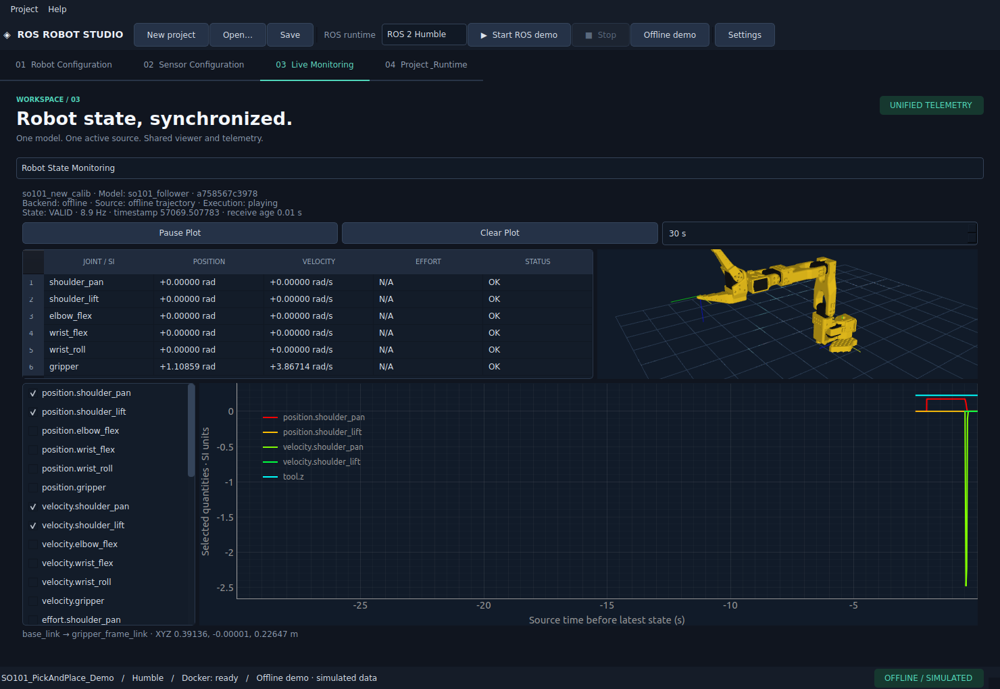
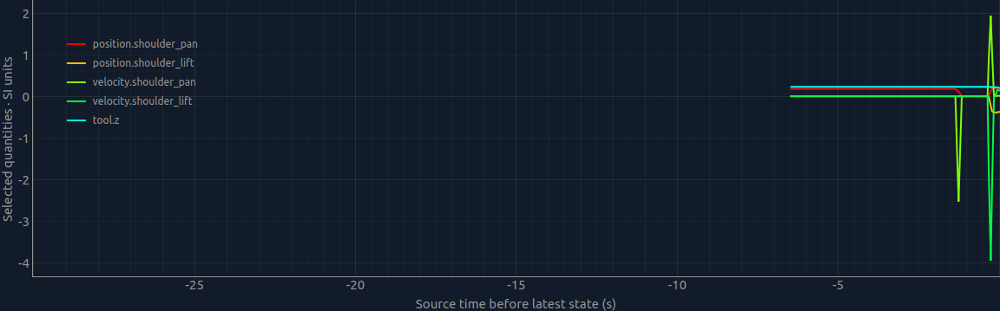
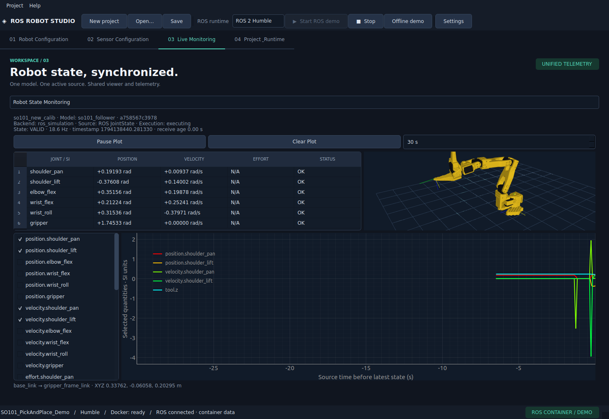
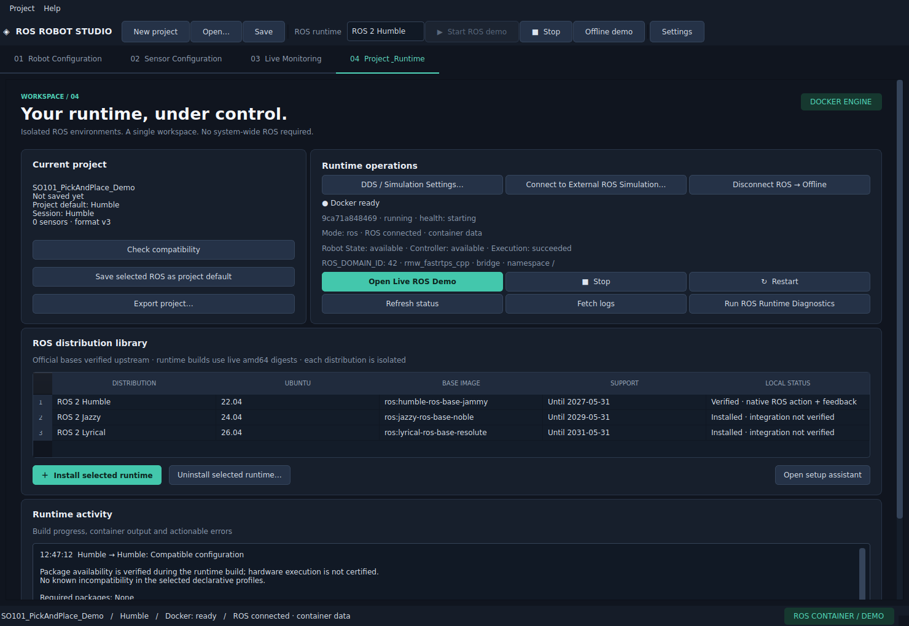
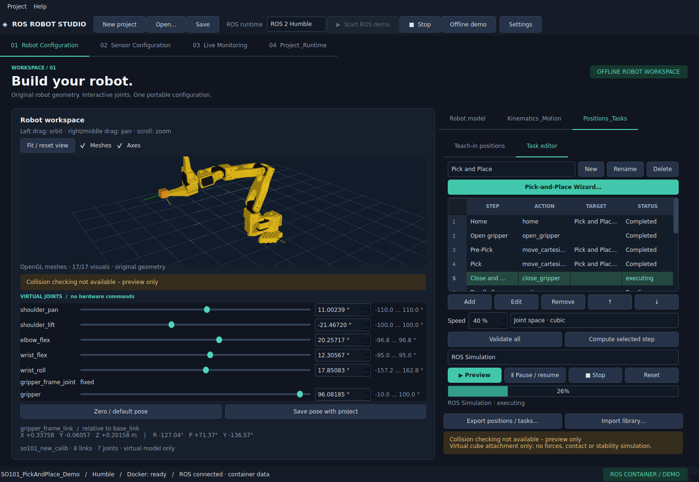

# Abschlussbericht: ROS Runtime, Unified Robot State und Live Monitoring

> Spätere Multi-Domain-/Isaac-Fortsetzung: [aktueller Integrationsbericht](BACKEND_VERIFICATION.md). Die Zahlen und Isaac-Einschränkungen dieses älteren Berichts beziehen sich auf seinen damaligen Prüfstand.

Stand: 8. November 2026 · Ubuntu 22.04 amd64 · Desktop Python 3.10/PySide6 6.9.3.
Die bestehende Anwendung wurde erweitert. Git war zu Beginn sauber; kein Remote-Push.

## Ergebnis und Bedienung

Robot Configuration, FK, beide 3D-Ansichten, Taskeditor und Monitoring verwenden den
neuen gemeinsamen `RobotStateManager`. Regler-/IK-Übernahmen und Offline-Cubic-Trajektorien
liefern echte virtuelle Gelenkwerte statt unabhängiger Robotersinusschwingungen.
Geschwindigkeiten/Beschleunigungen stammen analytisch aus den vorhandenen Kurven;
manuell nicht bekannte Größen und Efforts bleiben N/A.

Die bisherige rosbridge-/Dockerarchitektur wurde vervollständigt. **Humble, Jazzy und
Lyrical sind gebaut und tatsächlich getestet**: native rclpy-FollowJointTrajectory-Actions,
generischer URDF-Controller, originale SO-101-JointStates, 13 Pick-and-Place-Schritte,
Greifer, Wait, Feedback, beobachteter Endzustand und kontrollierter Abbruch.
Im ROS-Modus läuft keine lokale Ersatzanimation. Viewer und Monitoring folgen ausschließlich
den empfangenen Zuständen. Der vorhandene Demo/ROS-Wechsel ändert Datenquelle, Leases,
Subscriptions, Backend und eigene Container wirklich.

```bash
cd $HOME/Desktop/ROS_APP/ros-robot-studio
./start.sh --pick-place-demo
```

Für Offline: Taskeditor → **Offline Preview → Preview**. Für echte ROS-Simulation:
Humble wählen und **Open Live ROS Demo** bzw. den bestehenden Toolbar-Start verwenden,
danach Taskeditor → **ROS Simulation → Preview**. **Offline demo** trennt kontrolliert.
**Run ROS Runtime Diagnostics** prüft einen kleinen Hin-/Rückweg über die echte Action
und vergleicht beobachtete Endwerte. Verified wird nur für die tatsächlich geprüfte Image-ID gespeichert.

## Architektur und Datenkonsistenz

- `core.robot_state`: unveränderliche Snapshots, RLock, Sequenznummern und Modell-/Quellen-Leases.
- Validierung von Namen, Mapping, Arrays, endlichen Werten, Gelenkgrenzen, Mimic und Zeitstempeln.
- Ungültige/unvollständige Zustände bleiben als solche sichtbar; alte Quellen und verspätete
  Stamps überschreiben keine neueren Daten. Qt-Widgets werden ausschließlich im GUI-Thread aktualisiert.
- Monitoring standardmäßig Robot State; synthetische Signale und generische ROS-Inspektion sind
  eine ausdrücklich getrennte zweite Ansicht. Maximal 6.000 Samples und acht Kurven.
- `TrajectoryToROSConverter` verwendet die vorhandene Planung mit analytischen Ableitungen.
  Der Container validiert Namen/Start/Zeit/Limits und Hermite-Extrema, interpoliert aber plant nicht neu.
- `ROS2ExecutionBackend` prüft Controller, frische Daten, Goal Acceptance, Feedback/Result und
  beobachtete Zielwerte. Timeout/Disconnect/Fehler stoppen die Ausgabe; keine automatische Fortsetzung.
- Pro Bridge-Runtime ein eigenes gekennzeichnetes Docker-Netz. Ein tatsächlicher Paralleltest
  mit zwei Robotermodellen und identischer Domain-ID prüft, dass Zustände/Sessionereignisse getrennt bleiben.
- Projektformat weiterhin v3 mit optionalen Runtime-/Execution-/Monitoring-Verträgen und Defaults;
  v1/v2/v3-Dateien bleiben lesbar. Bestehende Modell-, Positions- und Taskdaten werden erhalten.

Detailverträge: [Robot State Manager](ROBOT_STATE_MANAGER.md), [Monitoring](LIVE_MONITORING.md),
[Runtime](ROS_RUNTIME.md), [Execution](ROS_EXECUTION.md).

## Dockerzugriff und tatsächliche Images

Docker Engine **29.9.3** war installiert und aktiv. Anfangs fehlte `local-user` die Dockergruppe.
Nach ausdrücklicher Zustimmung führte der Benutzer die Gruppenaufnahme selbst durch.
Der Agent konnte PolicyKit/sudo wegen `NoNewPrivs` nicht verwenden. Eine vom Benutzer
vorübergehend eingerichtete **benutzerspezifische ACL** ermöglichte die Tests in der alten
Sitzung; der Socket wurde niemals weltweit beschreibbar gemacht.

Nach Abschluss der Tests entfernte der Benutzer die temporäre ACL im normalen Terminal
mit `sudo setfacl -x u:local-user /var/run/docker.sock`. Die anschließende Host-Prüfung bestätigte:
kein zusätzlicher `user:local-user`-Eintrag, Eigentümer `root:docker`, Modus **0660**.
Der Agentversuch war zuvor an `NoNewPrivs` gescheitert. Die Bereinigung ist abgeschlossen.
Für die dauerhafte Dockergruppen-Freigabe in der Desktop-Sitzung ist eine neue Anmeldung nötig.

| Runtime | Basisdigest (amd64) | Erweiterungsimage |
| --- | --- | --- |
| Humble / Jammy | `a3f4de78e42cca693a543ece5798aedcf1cae0171fe71c334a047332cc72ef93` | `ros-robot-studio/humble:0.1.0` |
| Jazzy / Noble | `c26c86a28e1addf9d10a81232869791974a3f7907943d5634742b58b2f26e1a3` | `ros-robot-studio/jazzy:0.1.0` |
| Lyrical / Resolute | `4e129b13f5c72d1630b03513af404353b44b30c793fd6d99b362f29ca7a15f50` | `ros-robot-studio/lyrical:0.1.0` |

Exakte gebaute Image-IDs, Größen, Quellfingerabdrücke und tatsächlich installierte
rclpy-/control_msgs-/rosbridge-Versionen: [ros-runtime-images.json](ros-runtime-images.json).
Die rosbridge-Versionen sind 2.0.8 (Humble), 2.7.1 (Jazzy), 4.2.1 (Lyrical).
Alle verwendeten Pakete waren in den echten Builds verfügbar. Keine neue native ROS-Installation,
keine Vermischung der Python-Umgebungen, keine Host-/USB-/Docker-Socket-Mounts.
Container laufen unprivilegiert und ressourcenbegrenzt. Fremde Container wurden nicht verändert. Der Abschlusscheck ergab **0 verbliebene
Testcontainer und 0 Testnetze**. Ein verwaister, eindeutig gekennzeichneter Jazzy-
Integrationstestcontainer des abgebrochenen Zwischenlaufs wurde regulär entfernt.

## Tatsächlich ausgeführte End-to-End-Prüfungen

Für **jede** der drei Distributionen wurde die gleiche SO-101-Teststrecke ausgeführt:

1. Originalmodell laden; Regler und Offline-Monitoring vergleichen, Cubic-Geschwindigkeit prüfen.
2. Eigenen Container starten; ROS-Graph, Node-Liste, State-Feedback und Controller erkennen.
3. Vollständigen 13-Schritt-Task über native Actions ausführen, einschließlich Greifer und Wait.
4. Empfangene Positionen/Geschwindigkeiten, Viewer, Tabelle und Endzustand vergleichen.
5. Lokalen Player als ROS-Bewegungsquelle ausschließen.
6. Erneute Ausführung abbrechen; zweimal ROS→Offline→ROS prüfen und alte Lease ablehnen.
7. Benutzerseitige Runtime-Diagnose mit echtem Hin-/Rückweg durchführen.

Prüfprotokolle: [Humble](ros-humble-verification.json), [Jazzy](ros-jazzy-verification.json),
[Lyrical](ros-lyrical-verification.json). Samples sind tatsächliche Empfangswerte, keine
fest codierten Beispielwinkel. Es wurden keine realen Roboter bewegt.

Zusätzlich bestand **Humble → Jazzy → Lyrical → Humble in einer einzigen Projektsitzung**,
mit erhaltenen Tasks und unverändertem `default_ros`: [Versionszyklus](ros-version-cycle-verification.json).
Der Setup-Assistent bestand eine eigene echte Humble-Action-/Feedbackdiagnose.
Ein echter Container prüft den Healthcheck auch bei abweichendem internem Port.

Ein anfänglicher nativer Start deckte einen rclpy-Node-Namenskonflikt auf; er wurde behoben.
Ein unvollständiger Lyrical-Lauf vor fertigem Image wurde verworfen und erfolgreich wiederholt.
Parallele Prüfungen führten zur zusätzlichen Netzisolation; die alte Graphprüfung wartet
nun auf tatsächliche asynchrone DDS-Discovery statt einen ersten Snapshot als vollständig anzunehmen.
Diese Zwischenstände werden nicht als erfolgreiche Abnahmen gezählt.

## Qt-Stabilisierung

Der sporadische Qt-Absturz wurde mit gdb untersucht. Geschlossene Fenster weisen
verspätete Nachrichten/Timercallbacks ab, der ROS-Startup-Timer wird gestoppt, und
abgetrennte PyQtGraph-Objekte werden im GUI-Thread tatsächlich gelöscht. Die native
Wiederholungsprüfung fand und korrigierte außerdem einen globalen Shadercache, der
Programm-IDs aus zerstörten OpenGL-Kontexten wiederverwendete. Alle Qt-Pakete sind
konsistent auf 6.9.3 gepinnt; PyQtGraph bleibt 0.13.7 und NumPy 2.2.6.

Details, Abgrenzung zur vermuteten Upstream-Ursache und reproduzierbare Tests:
[GUI_STABILITY_REPORT.md](GUI_STABILITY_REPORT.md).
20 native SO-101-Zyklen mit tatsächlicher Widgetzerstörung und validen OpenGL-Programmen
bestanden: [Lebensdauerprotokoll](gui-lifecycle-verification.json).

## Testlauf und native GUI

Vollständiger Abschlusslauf:

```bash
env -u PYTHONPATH QT_QPA_PLATFORM=offscreen .venv/bin/pytest -q \
  --run-docker --run-model-download -ra
```

**137 bestanden, 0 Fehler, 0 übersprungen · 367,32 s (6:07).**
Maschinenlesbares Ergebnis mit Paketversionen und geprüftem Source-Commit:
[regression-verification.json](regression-verification.json).
Zusätzlich bestanden 20 native SO-101/OpenGL-Fensterzyklen, 20 SO-101- und
12 generische Offscreen-Fensterzyklen (52 insgesamt), die aktuelle native
Humble-/Screenshot-Abnahme und der erneute Versionszyklus.
Ein früherer Stresstest mit zu kurzer 150-s-Gesamtfrist wurde nicht als bestanden
gezählt; die vollständige Wiederholung nutzt eine Frist passend zur Zykluszahl.
Zusätzlich bestehen Ruff, Formatprüfung, `git diff --check` und `pip check`.
Vorhandene URDF-/SO-101-/FK-/IK-/Teach-in-/Projekt-/Sensor-/Transport-/Runtime-Regressionen
sind enthalten. Neue Fälle prüfen unter anderem Quellenwechsel, fehlende/veraltete Daten,
Threadzustellung, analytische Ableitungen, Stempelbasis, Action-Ablehnung/Timeout/Startfehler,
Konvertierungsfehler, Netzwerk-Cleanup und echte parallele Sitzungsisolation.

Die native **xcb/OpenGL**-Abnahme verwendet dieselbe Anwendung und originale 17 SO-101-
Visuals. Die Screenshots wurden visuell geprüft; überlappende alte Monitoring-Layouts,
komprimierte Buttons und Thumbnail-Kamera wurden korrigiert.







Reproduktion: `scripts/verify_ros_runtime.py --distro humble --screenshots` in der
nativen Umgebung wie in [DEVELOPMENT.md](../DEVELOPMENT.md) beschrieben.

## Isaac Sim und verbleibende Grenzen

Isaac Sim **5.1.0-rc.19** ist im Dateisystem vorhanden. Eine konfigurierte SO-101-USD-Szene
bzw. ein zugeordnetes Asset ist nicht nachgewiesen. Die echte Isaac-SO-101-Abnahme ist
**NICHT GETESTET**. Es wurde keine Szene erfunden oder verändert.

Der standardisierte JointState-Kommandopfad wurde gegen einen isolierten ROS-Szenenemulator
mit beobachtetem Zielzustand bestanden; das ist kein Isaac-Szenenbeweis:
[Adapterprotokoll](external-adapter-verification.json). Versionierte NVIDIA-Quellen,
Action-Graph-Beispiel, Fast DDS/UDP, Domain, Topics, Mapping und Clock:
[ISAAC_SIM_ROS_SETUP.md](ISAAC_SIM_ROS_SETUP.md). Lyrical/Isaac bleibt unbestätigt.

Keine Kollisionsprüfung, Hardwarefreigabe oder kalibrierte Sim-to-Real-Abbildung.
`hardware_ready` und `hardware_execution_enabled` bleiben false. ROS-Cancel ist kein
physischer Not-Halt. Gerade kartesische Bahnen und Kontakt-/Kraft-/Stabilitätsphysik fehlen.
ROS-Action-Pause/Resume ist ausdrücklich nicht verfügbar; Offline-Pause bleibt erhalten.
Externe Hardware wird auch bei sichtbaren Topics nicht automatisch als Simulation freigegeben.
Sehr lange Segmente können die bewusst begrenzte ROS-Punktanzahl überschreiten und werden
sauber als Konvertierungsfehler abgewiesen. Remote-/Hardwarebetrieb benötigt weitere Schutzkonzepte.

## Lokale Commits

- `7294200` — Shared Robot State und analytische Offline-Telemetrie.
- `890cdf7` — Isolierte Docker-ROS-Runtime und native Trajektorien-Actions.
- `ccd3850` — Monitoring, Moduswechsel und Taskausführung in der vorhandenen Desktop-GUI.
- `3931272` — Sauberer Fehlerstatus bei abgewiesener Trajektorienkonvertierung.
- `1a1b4d3` — Einheitliche gültige Zeitbasis für Monitoring-Samples.
- `a02e8e6` — Exakte Image-ID in Abnahmeprotokollen.
- `a59c031` — Konsistente Qt-6.9.3-Pakete, QObject-/Timer-/Plot-Freigabe,
  Shader pro Viewer und gezielte Lebensdauerregression.
- Dokumentationscommit „Document verified ROS runtimes, shared state and simulation setup“
  enthält diesen Bericht, Anleitungen, Screenshots und Prüfdaten; Hash siehe `git log`.

Keine Images, Modellpakete, Installationsdaten oder Laufzeitlogs wurden in Git aufgenommen.

## Spätere Stabilisierung der ROS-Kindprozesse

Bridge und Discovery besitzen inzwischen eine auf zwei Versuche pro Kindprozess begrenzte Wiederanlaufüberwachung. Ein Bewegungsabbruch bleibt bis zur ausdrücklichen Neuverbindung gesperrt. Die ursprüngliche native SIGSEGV-Ursache ist nicht abschließend bewiesen; Paket-, Bootstrap-, Kernel- und wiederholte DDS-Prüfungen sind im [Stabilitätsbericht](ROS_BRIDGE_STABILITY.md) dokumentiert. Maßgebliche finale Gesamtzahlen: [Integrationsbericht](BACKEND_VERIFICATION.md).
