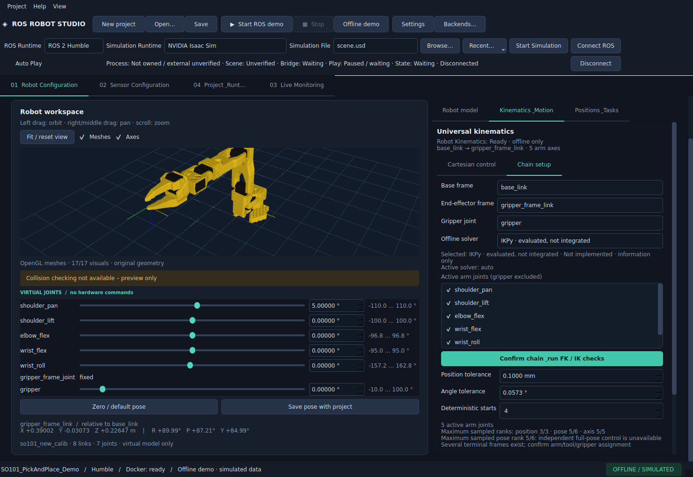

# Runtime-Banner und Szenendateien

Oben stehen **ROS Runtime**, **Simulation Runtime**, **Simulation File**, **Browse…**,
**Start Simulation**, **Connect ROS** und **Disconnect**. Die bisherige ROS-Auswahl ist
weiterhin dasselbe Steuerelement. Das Banner verwendet den bestehenden ROSBackendManager,
BackendWorkspace und IsaacSimProcessManager, keinen zweiten Backendzustand.

Offline Demo arbeitet ohne Docker. ROS Demo nutzt den vorhandenen Controller. Isaac Sim
nutzt die vorhandene externe SDK-Integration. MuJoCo/Gazebo können als Profile und mit
Dateizuweisung ausgewählt werden; ihre Adapter sind **nicht implementiert**, Start ist dort
gesperrt. Real Robot zeigt **Hardware Profile** und **Execution: Read Only**; seine Auswahl
sendet keine Bewegung. Unkonfigurierte Optionen öffnen den bestehenden Profil-Editor.
Domains kommen aus den zentralen Defaults beziehungsweise dem gewählten Profil und bleiben
editierbar. Das Backendmodell und Joint Mapping müssen zum geladenen Roboter passen.

Die Auswahl wird im zentralen Manager geführt. Verbundene, frische und modellpassende
Quellen können aktiviert werden; eine bloß ausgewählte unverbundene Quelle wird nicht als
aktiv oder bereit ausgegeben. Der Connection Manager folgt einer geänderten zentralen
Auswahl. Sein Tabellenfokus erlaubt weiterhin das Untersuchen anderer Verbindungen;
**Set Active** schaltet die tatsächliche Quelle und aktualisiert das Banner.

## Dateien

| Simulator | Typen |
|---|---|
| Isaac Sim | `.usd`, `.usda`, `.usdc` |
| MuJoCo | `.xml`, `.mjcf` |
| Gazebo | `.sdf`, `.world` |

Browse prüft Typ und Existenz. Bis zu zwölf letzte Dateien pro Simulatortyp liegen in
lokalen Settings, ebenso der aktuell gewählte Pfad pro Profil. Im Dateidropdown sind
fehlende Einträge ausdrücklich markiert. **Recent…** entfernt einzelne Einträge oder den
Verlauf; keine Quelldatei wird dadurch gelöscht. Nach einem Rechnerwechsel lässt sich eine
andere lokale Datei zuweisen, ohne Roboter- und Taskdaten zu ersetzen. Absolute Dateipfade
wandern nicht in portable Backendprofile/Projekte. Der Dateifilter beweist keine gültige
Simulatorszene; die eigentliche USD-/Articulation-Prüfung erfolgt beim Isaac-Start.

Ein Szenenwechsel bei aktiver Bewegung, bestehender Verbindung oder eigenem Simulator
fragt vor Abbruch und Änderung nach. Eigene Ressourcen werden kontrolliert beendet;
fremde Simulatorinstanzen werden weder beendet noch mit einer anderen Szene überschrieben.

## Isaac-Start

Ein lokales Isaac-Profil benötigt eine kompatible optionale 5.1-Installation, bestätigte
Netzwerk-/Simulationskonfiguration, passendes Modell/Mapping, verfügbare ROS-Runtime und
eine vorhandene USD-Datei. **Start Simulation** erstellt über den vorhandenen SceneManager
einen neuen Request in einem separaten lokalen Arbeitsverzeichnis. Quelldateien werden
gehasht und nicht überschrieben. Die vorhandene USD-Prüfung kontrolliert Articulation,
Gelenknamen/-typen/-achsen/-limits, Linkframes, Einheit, Ausrichtung und Modellprovenienz.
Der eigene Prozess und die ROS-Verbindung werden über die bestehenden Manager gestartet.

Ein bereits eigener passender Prozess wird wiederverwendet. Bei einer erkannten fremden
Instanz bietet Studio **Connect existing ROS**, ausdrücklich **Start another instance**
oder Abbrechen. Eine vorhandene fremde Szene bleibt unbestätigt, bis ihre tatsächlichen
ROS-Schnittstellen und modellpassenden Rückmeldungen geprüft sind. Es gibt keinen
Prozessnamen-Kill und keinen impliziten Schreibzugriff auf fremde USD-Dateien.

**Standard: manuelles Play im Isaac-Fenster.** Die vorbereitete Szene wird pausiert
geöffnet. **Auto Play** ist ein lokales, ausdrücklich wählbares Opt-in ausschließlich für
die eigene Simulation. Der automatische Akzeptanzlauf setzt dieses Opt-in bewusst.
Startender Prozess, validierte Szene, verbundene Bridge, frischer Clock/Play-Zustand,
JointState und Simulation Ready werden getrennt angezeigt. Eine pausierte Szene wird
nicht allein wegen ihres Prozesses als bereit bezeichnet. Nach Stop/Clockreset/Quellenwechsel
wird eine alte Bewegung nicht automatisch fortgesetzt.

Es werden keine Isaac-Module im Desktop-Python importiert. Auf Rechnern ohne Simulator
bleiben Offline, Tasks, Projektdateien und die vorbereiteten Profile verfügbar.

Vor dem SDK-Reset wird ein mitgelieferter alter Studio-ROS-Graph aus der Arbeitskopie
entfernt. Erst nach der Geometrie-/Gelenkprüfung wird die pausierte Szene mit dem aktuellen
Profilgraph versehen. Dadurch sendet eine wiedergeöffnete Szene beim manuellen Start
keinen Clock-/JointState-Datenstrom aus der alten Sitzung. Getrennte Tests öffnen eine
echte bestehende SO-101-USD über den Banner-Startknopf, prüfen die Pause ohne Clock und
führen nach ausdrücklichem Checkbox-Opt-in denselben 13-Schritt-Task aus.
