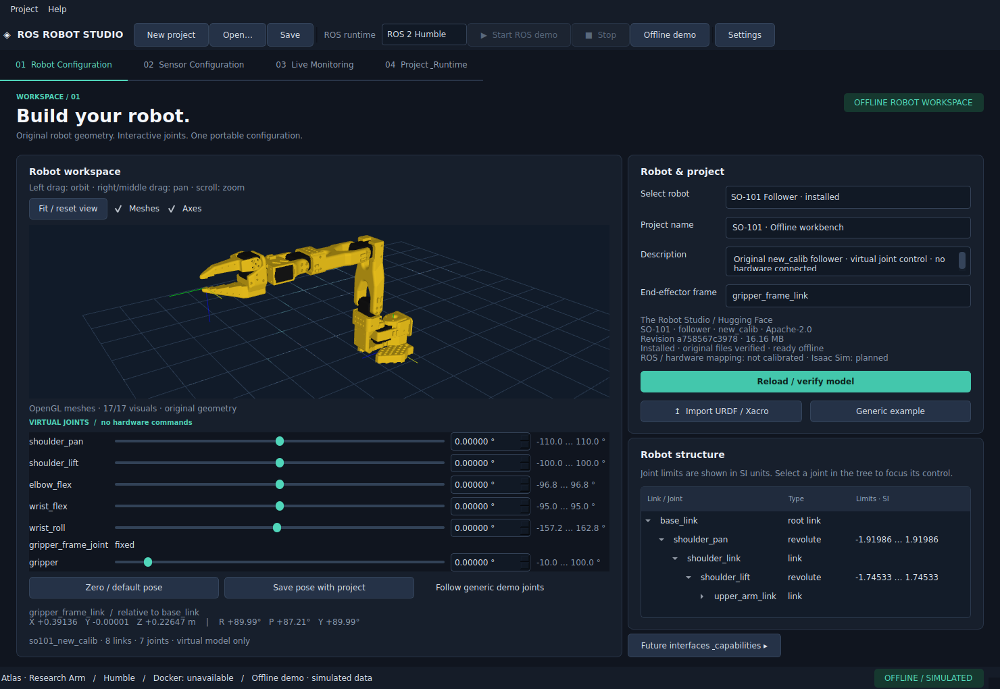
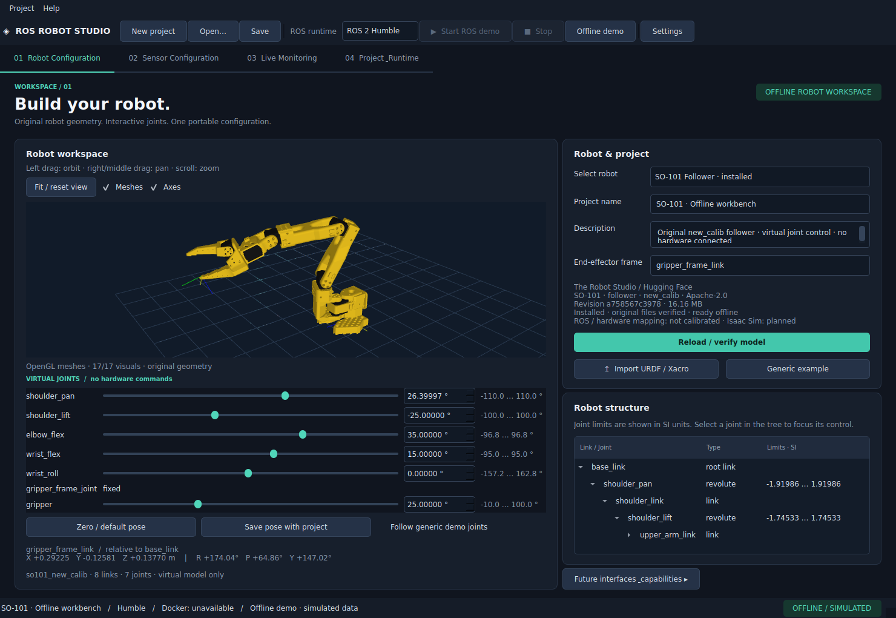

# SO-101 Follower – Offline-Integration

Stand: 8. November 2026. Die Integration verwendet die tatsächliche Follower-Geometrie
und funktioniert ohne Docker, Host-ROS, LeRobot, Isaac Sim oder Roboteranschluss.




## Modellquelle, Revision und Lizenz

- Projekt: [The Robot Studio / SO-ARM100](https://github.com/TheRobotStudio/SO-ARM100).
- Festgelegte Revision: [`a758567c3978dfeefe282ede0500085a48fe8f78`](https://github.com/TheRobotStudio/SO-ARM100/tree/a758567c3978dfeefe282ede0500085a48fe8f78/Simulation/SO101).
- Original-URDF: `Simulation/SO101/so101_new_calib.urdf`.
- Original-Meshes: die 13 von dieser URDF referenzierten STL-Dateien in `Simulation/SO101/assets/`.
- Variante: **Follower**, Kalibrierkonvention: **new_calib**.
- Umfang: 16 Dateien, insgesamt **16.159.288 Bytes** einschließlich URDF, Lizenz und Quellhinweisen.
- Struktur: **8 Links, 7 Joints, 6 bewegliche Gelenke, 17 Visual-Geometrien**.
- Lizenz laut [unveränderter Quelllizenz](https://github.com/TheRobotStudio/SO-ARM100/blob/a758567c3978dfeefe282ede0500085a48fe8f78/LICENSE): **Apache-2.0**.

Die Modellversion `1.0.0` bezeichnet die interne Studio-Katalogversion dieses Snapshots,
keinen behaupteten Firmware- oder Hardwarestand. Alle URDF-/STL-Bytes bleiben unverändert. Der Installer übernimmt `LICENSE` und die
Originalhinweise aus `Simulation/SO101/README.md` als `SOURCE_README.md`. Darin bleiben
auch die Onshape-/onshape-to-robot- und Open-Duck-Mini-Verweise erhalten. Ein zusätzliches
NOTICE-Dokument ist in dieser Quellrevision nicht vorhanden.

Der überprüfte Quell-Lock liegt in `src/ros_robot_studio/data/robot_models/so101_follower.json`.
Er enthält jede Originaldatei mit Quellpfad, exakter Größe und SHA-256. Der Installer
benötigt keinen kompletten Git-Clone und installiert weder LeRobot noch huggingface_hub.
Die offizielle GitHub-Quelle wurde direkt erfolgreich getestet. Ein Hugging-Face-Bucket
wird nicht benötigt; die gewählte Git-Revision ermöglicht die ausdrückliche Fixierung
der Quelle statt eines veränderlichen Bucket-Stands.

## Bedienung

1. `./start.sh` ausführen und bei Bedarf **Open offline demo** wählen.
2. **Robot Configuration → Select robot → SO-101 Follower** auswählen.
3. Bei fehlendem Modell **Install Robot Model** anklicken und den angezeigten Download
   bestätigen. Fortschrittsdialog, Prüfsummenprüfung und Meshvalidierung abwarten.
4. Nach erfolgreichem Laden werden ausschließlich die SO-101-Originalteile gezeigt.
   Bei einer noch nicht installierten Auswahl bleibt das vorherige Modell ausdrücklich
   als solches beschriftet; es wird nicht als SO-101 ausgegeben.
5. Gelenkregler bewegen oder Gradwerte numerisch eingeben. Intern werden Radiant bzw.
   bei prismatic joints Meter gespeichert. Grenzen stammen ausschließlich aus der URDF.
6. **Zero / default pose** setzt die definierte URDF-Nullkonfiguration zurück. Für andere
   Modelle, deren Nullwert außerhalb eines Limits liegt, wird der nächste erlaubte
   Grenzwert verwendet; es werden keine Hardware-Homewerte erfunden.
7. Unter **End-effector frame** einen Link auswählen. XYZ in Metern und RPY in Grad
   erscheinen live unter dem Viewer; der Tooltip enthält die unveränderten SI-Werte.
8. Über **Save pose with project** oder **Save** das Projekt sichern. Mit **Open…**
   werden dieselbe Modellrevision, Gelenkwerte und Endeffektorwahl wiederhergestellt.

Direktstart, wenn das Modell bereits installiert ist:

```bash
./start.sh --demo --robot so101_follower
```

Oder das kleine Projekt ohne eingebettete Meshes öffnen:

```bash
./start.sh --demo --project examples/so101/so101.studio.yaml
```

Beim ersten Laden eines gespeicherten Katalogprojekts ohne intakte Modelldateien bietet
Studio eine Installation/Reparatur exakt der gespeicherten Revision an. Eine unbekannte
Revision wird nicht still durch eine neuere ersetzt. Die bisher geöffnete Konfiguration
bleibt bei einem Abbruch oder Downloadfehler bestehen.

## Kamera und Visualisierung

Linke Maustaste: drehen. Rechte oder mittlere Maustaste: schwenken. Mausrad: zoomen.
**Fit / reset view** oder Doppelklick: Modell neu zentrieren und vollständig einpassen.
**Axes** schaltet Root- und Endeffektorachsen um. **Meshes** wechselt zwischen tatsächlicher
Geometrie und der bereits vorhandenen kinematischen Strukturansicht.

Die Meshdarstellung verwendet PyQtGraph OpenGL in der vorhandenen RobotView-Komponente.
STL-Dateien werden mit trimesh ohne Reparatur, Vereinfachung oder Einheitenkonvertierung
gelesen. Die Verkettung lautet:

```text
T_world_visual = T_world_link @ T_link_visual_origin @ S_mesh
T_world_child  = T_world_parent @ T_joint_origin @ T_joint_motion
```

URDF-Materialfarben und Visual-Offsets werden berücksichtigt. Der OpenGL-Backend verwendet
dieselben homogenen Link-Transformationen wie die Poseanzeige. Die Kamerabeleuchtung
verändert ausschließlich die Darstellung, keine Originaldateien. Beim nativen Abnahmetest
wurde eine GL-Mesh-Transformation numerisch mit der FK-Transformation verglichen.

OpenGL 2.1 mit Compatibility-Funktionen ist erforderlich. Ohne verfügbaren Kontext,
insbesondere beim Qt-Offscreen-Plugin, bleibt die Strukturansicht nutzbar und wird
explizit als solche beschriftet. Dieser Fallback ist keine Meshdarstellung.

## Tatsächliche Gelenke

| Gelenk | URDF-Typ | Untergrenze · rad | Obergrenze · rad |
| --- | --- | ---: | ---: |
| shoulder_pan | revolute | -1.91986 | 1.91986 |
| shoulder_lift | revolute | -1.74533 | 1.74533 |
| elbow_flex | revolute | -1.69 | 1.69 |
| wrist_flex | revolute | -1.65806 | 1.65806 |
| wrist_roll | revolute | -2.74385 | 2.84121 |
| gripper | revolute | -0.174533 | 1.74533 |

`gripper_frame_joint` ist ein fester Joint. Sein in der Originaldatei enthaltener
Nullachsenvektor wird korrekt als unbenutzte Achse eines festen Joints behandelt.
Die Standard-Endeffektorwahl ist der tatsächlich vorhandene `gripper_frame_link`.
Dieser Frame ist am Greiferkörper befestigt: Greiferöffnung verändert die Position
des beweglichen Backenlinks, nicht den festen Greiferframe. Für dessen Pose kann
`moving_jaw_so101_v1_link` als Endeffektor ausgewählt werden.

Das [Quell-README](https://github.com/TheRobotStudio/SO-ARM100/blob/a758567c3978dfeefe282ede0500085a48fe8f78/Simulation/SO101/README.md)
weist ausdrücklich darauf hin, dass LeRobots normierter Greiferbereich 0–100 noch nicht
in URDF/MJCF abgebildet ist. **URDF-Winkel sind keine normierten Hardwarewerte.**
`JointMappingAdapter` bereitet ROS-/Hardware-/URDF-Abbildungen vor;
`UncalibratedJointMapping` verweigert jede solche Umrechnung. Kalibrierparameter werden
nicht erfunden. Alle Schieberegler steuern nur das virtuelle Modell. Auch generische
`/joint_states`-Demo-Nachrichten überschreiben die manuelle SO-101-Konfiguration nicht.

## Modellcache und Installation

Standard: `${XDG_DATA_HOME:-~/.local/share}/ros-robot-studio/robots/so101_follower/<revision>/`.
Der Pfad stammt aus der zentralen XDG-Pfadverwaltung, nicht aus einem Benutzerpfad im Code.

```text
so101_follower/
├── .installation.lock
└── a758567c3978dfeefe282ede0500085a48fe8f78/
    ├── so101_new_calib.urdf
    ├── assets/                  # 13 unveränderte Original-STLs
    ├── LICENSE
    ├── SOURCE_README.md
    └── installation.json        # Quelle, Revision, Größen, SHA-256, Zeitpunkt
```

Intakte Dateien werden wiederverwendet. Fehlende oder beschädigte Dateien werden gezielt
neu geladen. Neue Dateien liegen zuerst in einem temporären Geschwisterverzeichnis.
Erst nach Prüfung aller Dateien, Referenzen und STL-Geometrien wird der Baum aktiviert;
eine fehlgeschlagene Reparatur ersetzt den bisherigen Baum nicht. Ein File-Lock schützt
vor konkurrierenden Installationen. Es werden keine Archive entpackt; absolute Pfade,
Traversal, unerwartete URI-Schemata und ausbrechende Symlinks werden abgewehrt.

## Projektformat und Backends

Projektformat **v2** ergänzt Modell-ID, Modellversion, Quellrevision, `model://`-Referenz,
Gelenkpositionen in SI und vorbereitete Backend-/Mappingzustände. v1-Projekte werden beim
Laden im Speicher auf v2 angehoben; die Quelldatei wird erst bei bewusstem Speichern verändert.
Katalogmodelle kopieren keine großen Meshes in das Projekt. Beispiel:

```yaml
robot:
  profile: so101
  model_id: so101_follower
  model_version: 1.0.0
  source_revision: a758567c3978dfeefe282ede0500085a48fe8f78
  urdf: model://so101_follower/a758567c3978dfeefe282ede0500085a48fe8f78/so101_new_calib.urdf
  joint_positions: {shoulder_pan: 0.0, shoulder_lift: 0.0, elbow_flex: 0.0, wrist_flex: 0.0, wrist_roll: 0.0, gripper: 0.0}
  end_effector: gripper_frame_link
  joint_mapping_status: not_calibrated
  simulation:
    backend: isaac_sim
    status: planned
    asset: {format: usd, path: null}
    joint_mapping: not_configured
```

Nur `offline_viewer` ist unterstützt. ROS-2-Humble/Jazzy/Lyrical sind für dieses Modell
`not_configured`; Hardware und Isaac Sim sind `planned`. Es gibt keine behaupteten
Hardwaretreiber oder verifizierten ROS-Versionen. Das ROS-Dropdown verändert weder
Modellrevision noch Pose und startet beim Offlinebetrieb keine ROS-Runtime.

## Prüfung und bekannte Grenzen

Die vollständige Suite einschließlich Originaldownload und selektiver Reparatur wurde
mit **73 bestandenen Tests** ausgeführt. Drei ROS-Container-Tests waren aufgrund fehlender
Docker-Zugriffsrechte nicht ausführbar. Der native GUI-Test hat Auswahl, sechs Regler,
FK-/Mesh-Abgleich, Kameraaktionen, Achsen-/Meshumschaltung sowie Speichern und erneutes
Laden bestanden. Maschinenlesbarer Nachweis: `so101-gui-verification.json`.

Nicht implementiert: Hardware-/LeRobot-Ansteuerung, ROS-2-Control-/MoveIt-Anbindung,
kalibrierte Sim-to-Real-/Greifermappings, IK, Kollisionsprüfung/Physik, Isaac-Sim-/USD-
Steuerung und Kameraintegration. Benutzerimport unterstützt STL sowie Box/Sphere/Cylinder-
Visuals. `package://`-Meshes benötigen einen expliziten Paketwurzel-Resolver im API;
dessen grafische Auswahl und weitere Meshformate sind noch offen. Floating-/Planar-
Joints bleiben bei Nullpose; gekoppelte Joints werden über URDF-mimic ausgewertet.
Der Modellkatalog enthält momentan nur die überprüfte SO-101-Revision; weitere Modelle
benötigen ein überprüftes Manifest und keine neue Kinematik-/Viewerimplementierung.
