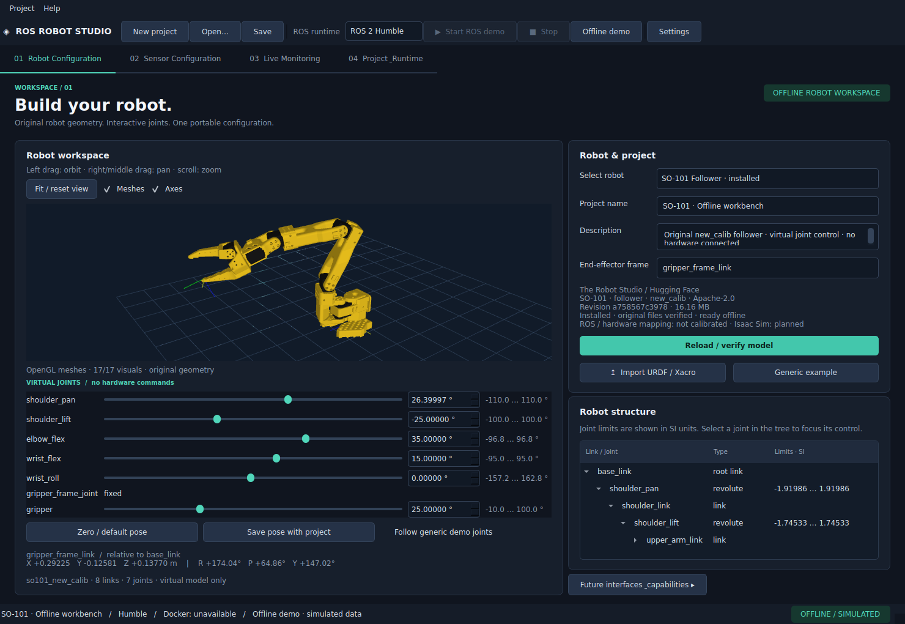

# Abschlussbericht – SO-101-Integration

**8. November 2026 · bestehendes ROS Robot Studio erweitert, keine neue Anwendung.**

## Ergebnis

Der SO-101 Follower ist installiert und im normalen Robot Configuration-Tab auswählbar.
Die Anwendung zeigt seine tatsächliche Originalgeometrie, bietet sechs virtuelle
Gelenkregler mit numerischer Eingabe und Quelllimits, berechnet die ausgewählte
Endeffektorpose und stellt die gesamte Konfiguration nach Speichern/Laden wieder her.
Alles funktioniert ohne ROS-Runtime oder Roboteranschluss.



## Implementierte Funktionen

- Wiederverwendbarer Robot Model Manager mit validierten Manifesten, festen Revisionen,
  Größen und SHA-256 je Originaldatei, Installationsstatus und Backendmetadaten.
- Bestätigter gezielter Download, nicht blockierender Fortschrittsdialog, vollständige
  URDF-/STL-Validierung, File-Lock und Aktivierung erst nach erfolgreicher Staging-Prüfung.
- Wiederverwendung intakter Dateien und gezielte Reparatur beschädigter/fehlender Assets.
  Traversal, absolute Dateireferenzen, unerlaubte URIs und Symlink-Ausbrüche werden abgewehrt.
- Vorhandenen Viewer um OpenGL-Meshdarstellung erweitert; Software-Strukturansicht bleibt
  ausdrücklich gekennzeichneter Fallback. Kein Austausch der Anwendung oder zweite FK.
- Originale Visual-Origins, Materialfarben, Mesh-Skalen und Linkhierarchie; Orbit, Pan,
  Zoom, vollständiges Einpassen, Achsen und Geometrie-/Strukturumschaltung.
- Vollständige homogene Linktransformationen, numerische XYZ/RPY-Pose, Grenzprüfung,
  Null-/Defaultpose, Fixed- und mimic-Joints; SI intern, Grad in Rotationsreglern.
- Projektformat v2 mit Modell-ID, Version, Revision, portabler Referenz, Gelenkpositionen
  und Endeffektor. v1 wird im Speicher angehoben. Fehlende Modelldateien eines Projekts
  können nach Bestätigung exakt nachinstalliert werden.
- `JointMappingAdapter` und bewusst verweigernde unkalibrierte Implementierung;
  deklaratives Isaac-Sim-/USD-Mapping ohne SDK-Installation oder Steuerungsbehauptung.
- Generische Demo-Nachrichten überschreiben keine manuell editierte SO-101-Pose.
  Kein Senden von Motor-/Roboterbefehlen, keine Installation von LeRobot oder Isaac Sim.

## Quelle, Lizenz und Installation

Original: [TheRobotStudio/SO-ARM100, Revision a758567c3978dfeefe282ede0500085a48fe8f78](https://github.com/TheRobotStudio/SO-ARM100/tree/a758567c3978dfeefe282ede0500085a48fe8f78/Simulation/SO101).

Die **Follower-new_calib-URDF**, **13 referenzierte STL-Dateien**, Original-Lizenz und
Quell-README wurden erfolgreich heruntergeladen und verifiziert: **16.159.288 Bytes**,
**8 Links, 7 Joints, 6 bewegliche Gelenke, 17 Visuals**. Der Code ändert keine Original-
URDF oder Geometriedaten. Lizenz: **Apache-2.0**, mit Original-Lizenz und Quellhinweisen
in der Installation. Die SHA-256-Liste wird im Repository als Modellmanifest verwaltet.

Der normale Cache ist bereits installiert:
`${XDG_DATA_HOME:-~/.local/share}/ros-robot-studio/robots/so101_follower/<revision>/`.
`installation.json` enthält Quellrevision und Dateiprüfsummen. Große Assets bleiben
außerhalb Git; Modellmanifest, Beispiel-YAML und eigener Code sind versioniert.

## Tests und GUI-Abnahme

Die vollständige Suite mit `--run-docker --run-model-download` bestand mit
**73 Tests bestanden, 3 übersprungen**. Der Originaldownload-Test installierte sämtliche
Dateien in einen eigenen temporären Cache, prüfte Struktur, Namen, Limits und FK,
verwendete die Installation ohne Netz wieder und reparierte anschließend genau eine
bewusst beschädigte Test-Meshdatei durch einen einzigen erneuten Download.

Die drei Docker-Integrationstests wurden wegen fehlenden Daemon-Zugriffsrechten
(`PermissionError: Permission denied`) vor dem Start von Containern ausgelassen.
Es wurden keine fremden oder bestehenden Container geändert. Diese ROS-Prüfungen
sind für die abgeschlossene Offline-SO-101-Funktion nicht erforderlich.

Der zusätzliche **native OpenGL-Abnahmetest** bestand:

1. SO-101 über den normalen Modellselektor laden und 17 GL-Visuals feststellen.
2. Orbit, Rechts-Pan, Mausrad-Zoom, Mesh-/Achsenumschaltung auslösen.
3. Tatsächlichen Slider und numerische Qt-Eingaben für mehrere Gelenke verändern.
4. Veränderung von Endeffektorposition/-orientierung und identische GL-/FK-Matrix prüfen.
5. Projekt speichern, auf generischen Roboter wechseln, gespeichertes Projekt erneut öffnen.
6. Modellrevision, alle SI-Gelenkwerte und dieselbe Endeffektortransformation wiederherstellen.
7. Original- und veränderte Pose fotografieren.

Nachweis: [so101-gui-verification.json](so101-gui-verification.json),
[Nullpose](so101.png), [wiederhergestellte veränderte Pose](so101-pose.png).
Lint, Formatter, Shellsyntax, Dependency-Check und Git-Diff-Prüfung wurden ausgeführt.

## Wichtige Dateien und Struktur

```text
src/ros_robot_studio/
├── core/paths.py                    # gemeinsame XDG-Pfade inkl. persistenten Daten
├── core/models.py                   # v2-Projekt, Modellreferenz, SI-Pose, Backendplanung
├── data/robot_models/so101_follower.json
├── data/plugins/so101.yaml           # Offline-Fähigkeiten; ROS/Hardware unkonfiguriert
├── robots/model_manager.py          # Katalog, Installer, Integrität und Cache
├── robots/geometry.py               # sicherer Resolver, unveränderter STL-Import
├── robots/urdf.py                   # gemeinsame volle FK, Visuals und mimic
├── robots/joint_mapping.py          # unkalibrierter zukünftiger Mappingvertrag
├── gui/joint_controls.py            # virtuelle, URDF-begrenzte Gelenkeingabe
├── gui/robot_view.py                # erweiterter bestehender Mesh-/Strukturviewer
├── gui/panels.py                    # Roboterauswahl, Status, Pose und Controls
└── projects/store.py                # v1-Laden/v2-Speichern und portable Referenzen
examples/so101/so101.studio.yaml      # direkt öffnungsfähiges kleines Beispiel
scripts/verify_so101_gui.py          # wiederholbarer nativer GUI-Abnahmetest
scripts/pin_so101_model.py           # ausdrückliche Maintainer-Quellfixierung
```

Neu verwendete Python-Pakete: trimesh **4.6.8**, PyOpenGL **3.1.9**, filelock **3.18.0**.
PySide6 **6.8.3**, PyQtGraph **0.13.7** und NumPy **2.2.6** bleiben erhalten.
Alle direkten/neuen Abhängigkeiten sind lokal gepinnt und in `.venv` installiert.

## Nicht implementiert und bekannte Grenzen

Hardwaretreiber, LeRobot-Steuerung, kalibrierte Greifer-/Sim-to-Real-Mappings, ROS-2-Control,
MoveIt/IK, Isaac-Sim-/USD-Import/-Steuerung, Kameraintegration und Kollisionsphysik sind
nicht implementiert. Die Modell-Backends zeigen diese Grenzen ausdrücklich an.
Der Greifer-URDF-Winkel ist nicht mit LeRobots normiertem 0–100-Bereich gleichzusetzen.

Ohne kompatiblen OpenGL-Kontext bleibt nur die klar beschriftete Strukturansicht.
STL und einfache URDF-Primitive sind unterstützt; weitere Meshformate und die grafische
Zuordnung von `package://`-Wurzeln fehlen. Floating-/Planar-Gelenke bleiben Nullpose.
Der Katalog enthält zurzeit eine überprüfte SO-101-Revision. Nicht bekannte Revisionen
werden abgewiesen statt automatisch aktualisiert. Modell-Downloads besitzen noch keine
Abbruchfunktion; Fehler können mit Wiederverwendung intakter Dateien wiederholt werden.

## Git und Start

Die vorhandene Historie bleibt erhalten. Funktionscommits:

- `c88e8c5` – Modellverwaltung, Original-SO-101-Lock, gemeinsame visuelle Kinematik und Tests.
- `a875b86` – OpenGL-/Strukturviewer, Gelenkeingabe, Projektwiederherstellung und native GUI-Abnahme.
- Abschließender Dokumentationscommit mit Quellen, Beispielen, Screenshots und diesem Bericht.

`git log --oneline` zeigt die finalen Commit-IDs. Kein Remote angelegt und nichts gepusht.

```bash
./start.sh
```

Sofort zum installierten SO-101:

```bash
./start.sh --demo --project examples/so101/so101.studio.yaml
```

Weitere Details und Lizenz-/Bedienhinweise: [SO101.md](SO101.md).
