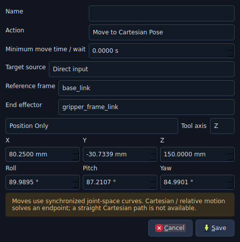
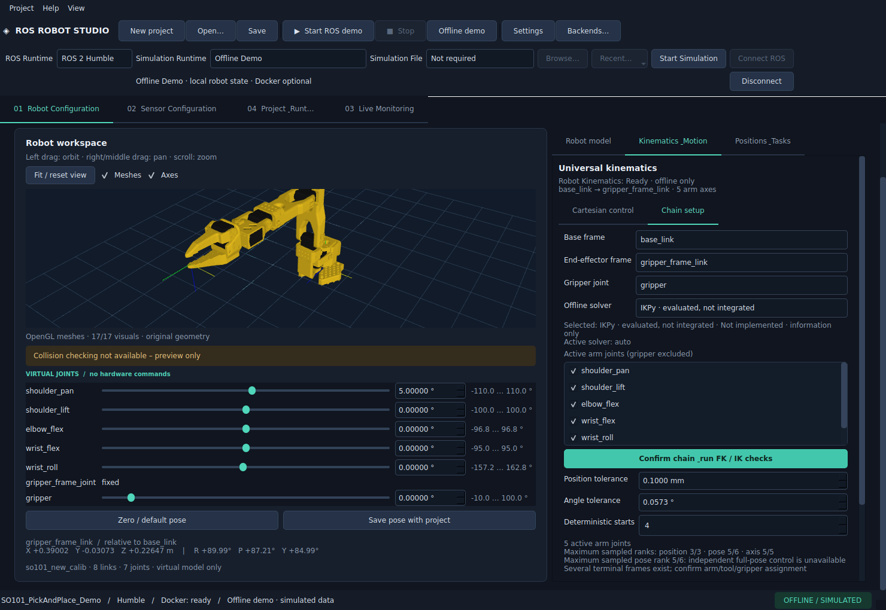

# Taskeditor und Solver-Auswahl

Unter **Robot Configuration → Positions & Tasks** einen Taskschritt hinzufügen oder
bearbeiten. **Configure task step** zeigt nur die zur Aktion gehörenden Eingaben.
Die Zielquelle kann eine passende gespeicherte Position oder direkte Eingabe sein.

| Aktion | Eingaben |
|---|---|
| Move to Joint Position | Direkt editierbare URDF-Gelenkwerte oder gespeicherte Jointposition, Mindestdauer |
| Move to Cartesian Pose | Direkt XYZ, Posemodus, gegebenenfalls RPY/Achse, Referenzframe und Endeffektor oder gespeicherte Pose |
| Move Relative | dX/dY/dZ und dRoll/dPitch/dYaw, Referenzframe, Mindestdauer |
| Open / Close Gripper | Bestätigte Greifergelenke und Dauer; virtuelle Freigabe beziehungsweise Anheftung |
| Wait | Wartezeit |
| Home | Virtuelle Standardpose oder explizit gespeicherte Jointposition, Mindestdauer |

Translationen im Taskdialog sind **mm**, Winkel **Grad**. Posen und Schritte speichern
**Meter/Radiant**. Direkte Jointziele tragen dieselbe Modellsignatur wie gespeicherte
Jointpositionen. Bei einem anderen Robotermodell muss der Nutzer diese Ziele neu lehren;
ein fremdes Jointziel wird bei der Taskvalidierung abgewiesen. Alte Tasks mit
`position_id` bleiben kompatibel. Neue optionale `target_pose`, `joint_values` und
`model_signature` werden normal im vorhandenen Projektformat gespeichert.

Beim Aktionswechsel bleiben die zuletzt gewählten passenden Zielquellen und noch offene
Eingaben innerhalb des Dialogs erhalten. Gespeichert wird nur der Payload der aktuellen
Aktion. Relative oder kartesische Ziele nutzen weiterhin die vorhandene bounded IK und
den vorhandenen TaskCompiler. **Es gibt keine geradlinige kartesische Bahn:** IK bestimmt
den Endpunkt, die Bewegung interpoliert im Gelenkraum. Collision Checking bleibt offen;
virtuelle Objektanheftung ist keine physikalische Griffvalidierung.

## Offline solver

Unter **Kinematics & Motion → Chain setup** sind alle Listeneinträge per Maus und
Tastatur erreichbar. Die Informationszeile unterscheidet **Selected** und **Active solver**.
Die Auswahl eines geplanten Solvers ersetzt keine funktionierende Kinematik und markiert
kein Plugin als initialisiert. Erst **Confirm chain & run FK / IK checks** aktiviert einen
implementierten, installierten und erfolgreich geprüften Kandidaten.

SciPy bounded least squares ist implementiert; Automatic verwendet SciPy. Ohne SciPy
zeigt die Oberfläche die fehlende Abhängigkeit und den vorhandenen Einrichtungsweg
**Install Universal Kinematics Support**. MoveIt 2, KDL, TRAC-IK, Pinocchio und IKPy sind
als noch nicht integrierte Kandidaten auswählbar, aber nicht ausführbar. Der jeweilige
Roboterrang begrenzt zusätzlich die Posemodi: ein 5-Achsen-Arm erhält dadurch keine 6D-IK.

Die Regression klickt Popupzeilen an, tippt Zahlen in die Spinboxen, speichert, öffnet den
Dialog erneut, kompiliert jeden Aktionstyp und prüft YAML-Speichern/-Laden. Die native
Prüfung wiederholt Maus-/Tastaturauswahl bei sichtbarem X11/OpenGL-Fenster.

