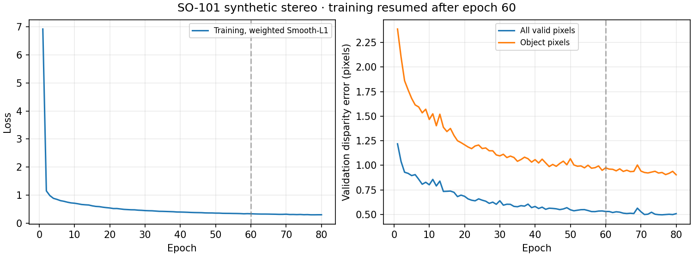
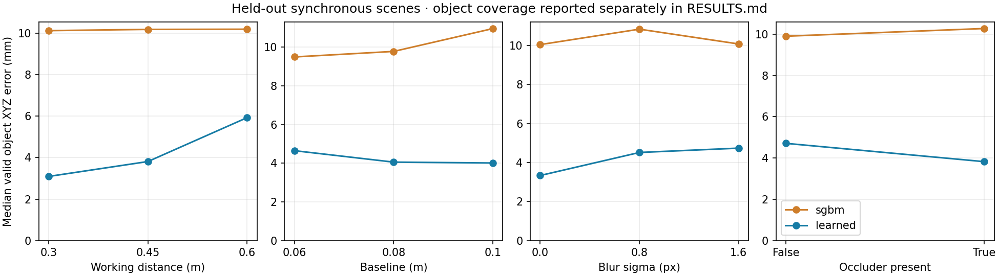
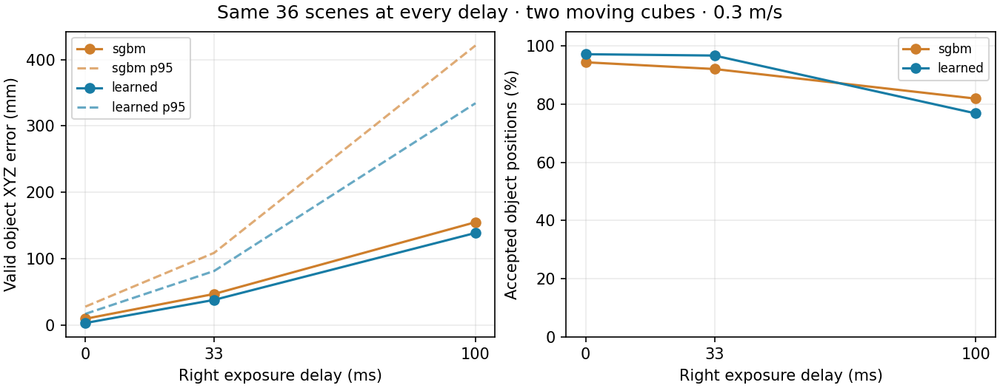
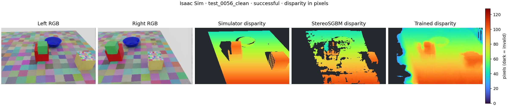
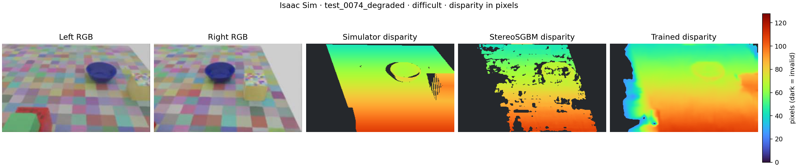
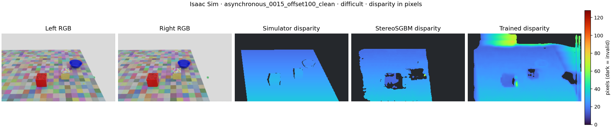

# Ausgeführter Stereo-Benchmark · 20.11.2026

Alle Angaben sind **Simulationsergebnisse**. Der endgültige Lauf enthält 1.326 Bildpaare aus 591 getrennten Szenen. Trainiert wurde auf 720 Paaren aus 360 Szenen, validiert auf 120 Paaren. Die übrigen Gruppen wurden zurückgehalten. Einrichtung und Startbefehle stehen in der [Trainingsdokumentation](../STEREO_DEPTH_TRAINING.md); vollständige Zahlen und Artefaktprüfsummen in [verification.json](verification.json).

## Tatsächlich trainierter Stand

Vier-Paar-Kapazitätsprüfung, 180 Epochen und 6,78 s. Der EPE sank von 14,20 auf 0,81 Pixel. Anschließend 80 Epochen mit Batch 8, also 7.200 Optimizerschritte und 57.600 Paar-Präsentationen. Nach Epoche 60 wurde der Prozess beendet und aus `last.pt` bis 80 fortgesetzt. Die Trainingsschleifen dauerten zusammen 240,16 s, ohne Datengenerierung und Datenladen. Ausgewählt wurde Epoche 76 mit Validierungs-EPE 0,50 Pixel. Dies ist ein lokal trainierter synthetischer Prototyp, kein langer Realwelt-Trainingslauf.

Modell `checkpoints/so101-compact-stereo/best.pt`, SHA-256 `792fa8af6fac4ca6b5a85f5867d4e1c5ca321697ed7faccb750b50f6b3423709`. Fortsetzung `last.pt`, ONNX `compact-stereo.onnx`, jeweils im gleichen lokalen Ordner. Datensatz-Fingerprint `ce07ab20b86a433cb6b1b77c558413b78f0ca62f468a25eb77c2d6719a29f7f8`. Die absoluten Rechnerpfade stehen außerhalb von Git in `training-runs/so101/local-paths.txt`.

## Synchroner Testsatz · 180 Paare

Tiefenfehler sind absolute optische Z-Fehler auf den jeweils akzeptierten Referenzpixeln. XYZ-Fehler sind euklidische Abstände zum definierten sichtbaren Oberflächenpunkt. Alle drei Objektregionen pro Paar werden gezählt, einschließlich Ablehnungen. Median und p95 werden über Pixel bzw. Objektmessungen gepoolt, nicht über Szenenmittelwerte. Qualitätsvarianten einer Szene sind korreliert; die effektive Szenenanzahl beträgt hier 90.

| Verfahren | Z Median / p95 mm | Objekt-XYZ Median / p95 mm | Gültige Objekte | Gültige Referenzpixel |
| --- | ---: | ---: | ---: | ---: |
| sgbm | 3,60 / 22,68 | 10,18 / 30,60 | 499/540 | 71,12 % |
| learned | 2,29 / 15,52 | 4,12 / 17,41 | 530/540 | 99,98 % |

Auf der **identischen gemeinsamen gültigen Pixelmenge** (4,799,633 Pixel) betragen Median/p95 3,60/22,68 mm für SGBM und 2,31/14,96 mm für das Modell. Die Verbesserung entsteht damit auch auf gleicher Unterstützung. Auf Objektpixeln allein sind es 4,57/36,41 gegenüber 3,82/22,81 mm.

SGBM verwirft 41 Objektmessungen, davon 40 wegen unzureichender Unterstützung und eine wegen Z-Streuung. Das Modell verwirft zehn, davon zwei wegen Unterstützung und acht wegen Z-Streuung. Eine gültige Position bedeutet nur, dass die festgelegten Filter bestanden wurden; sie garantiert keinen kleinen Positionsfehler. Der unkalibrierte Modellscore kann auch verdeckte Flächen plausibel auffüllen. Dichte Abdeckung wird nur relativ zur gültigen Simulatorreferenz angegeben.

| Objekt | SGBM XYZ Median / p95 mm; gültig | Modell XYZ Median / p95 mm; gültig |
| --- | ---: | ---: |
| red_cube | 5,55 / 24,87; 163/180 | 3,84 / 14,79; 172/180 |
| blue_bowl | 18,11 / 36,51; 172/180 | 5,07 / 23,09; 178/180 |
| reference | 8,36 / 21,32; 164/180 | 3,74 / 11,31; 180/180 |

## Getrennte Einflussgruppen im synchronen Test

Die folgenden Gruppen verwenden dieselbe Auswertung. Unschärfegruppen enthalten weiterhin die separat zufällig gewählten Kontrast-/JPEG-Einflüsse; sie sind keine Messung einer vollkommen isolierten optischen Unschärfe. Verdeckung bezeichnet den eingeblendeten grünen Verdeckungswürfel und ist unabhängig vom Basis-/Abstandsprofil.

| Gruppe | SGBM Z Median / p95 mm | Modell Z Median / p95 mm | SGBM XYZ Median / p95 mm; gültig | Modell XYZ Median / p95 mm; gültig |
| --- | ---: | ---: | ---: | ---: |
| Abstand m 0.3 | 2,30/19,61 | 1,72/12,96 | 10,12/33,05; 151/180 | 3,10/11,60; 170/180 |
| Abstand m 0.45 | 3,70/21,02 | 2,27/14,05 | 10,18/29,61; 170/180 | 3,81/17,23; 180/180 |
| Abstand m 0.6 | 5,16/25,98 | 3,27/19,23 | 10,19/29,80; 178/180 | 5,93/22,50; 180/180 |
| Basis m 0.06 | 4,39/25,70 | 2,78/17,93 | 9,50/33,82; 164/180 | 4,65/18,25; 178/180 |
| Basis m 0.08 | 3,58/22,53 | 2,23/15,22 | 9,79/29,86; 168/180 | 4,06/17,39; 180/180 |
| Basis m 0.1 | 2,93/19,02 | 1,93/12,78 | 10,97/28,98; 167/180 | 4,02/15,68; 172/180 |
| Unschärfe σ 0.0 | 3,26/20,37 | 2,10/14,24 | 10,05/29,15; 249/270 | 3,34/15,43; 265/270 |
| Unschärfe σ 0.8 | 4,21/24,94 | 2,62/17,40 | 10,84/29,55; 118/129 | 4,52/20,86; 127/129 |
| Unschärfe σ 1.6 | 3,79/24,77 | 2,38/16,18 | 10,08/33,30; 132/141 | 4,74/17,39; 138/141 |
| Verdeckung False | 3,60/22,48 | 2,28/15,22 | 9,90/32,10; 250/270 | 4,71/16,29; 270/270 |
| Verdeckung True | 3,60/22,87 | 2,30/15,82 | 10,28/28,96; 249/270 | 3,83/18,48; 260/270 |
| Würfeltextur False | 3,78/23,34 | 2,33/15,83 | 11,86/32,86; 130/138 | 4,13/15,55; 134/138 |
| Würfeltextur True | 3,53/22,47 | 2,28/15,41 | 10,05/29,51; 369/402 | 4,12/17,49; 396/402 |

## Ungesehene Kameras und bekannte Referenzpunkte

90 Paare aus 45 neuen Szenen mit 120 mm Basis, 72° Sichtfeld und 33/57 cm Arbeitsabstand. Zwei Objektgelegenheiten sind im linken Bild unsichtbar und bleiben als Ablehnungen im Nenner.

| Verfahren | Z Median / p95 mm | Objekt-XYZ Median / p95 mm | Gültige Objekte | Gültige Referenzpixel |
| --- | ---: | ---: | ---: | ---: |
| sgbm | 2,69 / 17,91 | 10,85 / 29,68 | 263/270 | 75,05 % |
| learned | 1,74 / 12,90 | 4,15 / 18,32 | 264/270 | 100,00 % |

Zusätzliche Punkttriangulation auf dem synchronen Testsatz liefert 516 gültige Messungen von 720 möglichen Marker-Gelegenheiten, Median 1,64 mm und p95 7,64 mm zum bekannten Kugelzentrum. Pixelkoordinaten stammen aus tatsächlichen linken/rechten Maskenmittelpunkten, die Zuordnung aus Simulator-IDs. Dies ist eine Geometrie-Plausibilisierung mit bekannter Identität, kein Nachweis eines realen Marker-Matchers.

Audit beider Kameraprojektionen über alle sauberen Varianten: links Median/p95 0,15/0,36 Pixel, rechts 0,16/0,36 Pixel. Sichtbare Teilmasken erzeugen Maxima von 3,54/3,57 Pixel. Die ersten zwölf Szenen bestehen links/rechts die 2,5-Pixel-Grenze. Der größte szenenweise Medianfehler der analytischen Tisch-Z-Prüfung beträgt 0.000951 mm. Q-, Einheiten-, Masken- und Referenzframe-Audits bestehen für sämtliche 1.326 Paare.

## Zeitversatz mit tatsächlich bewegter Szene

Jeder Versatz verwendet dieselben 36 Szenen und Kamerakonfigurationen, jeweils sauber und degradiert. Pro Zeile gibt es 216 Objektgelegenheiten einschließlich der unbewegten Schale. Im Offline-Benchmark wird die Paarungsgrenze absichtlich umgangen, um das Fehlerverhalten zu messen.

| Versatz | SGBM XYZ Median / p95 mm; gültig | Modell XYZ Median / p95 mm; gültig |
| --- | ---: | ---: |
| 0 ms | 9,64/27,92; 204/216 | 3,28/17,04; 210/216 |
| 33 ms | 47,01/108,95; 199/216 | 38,08/81,60; 209/216 |
| 100 ms | 155,14/421,28; 177/216 | 138,96/334,35; 166/216 |

Beide Verfahren scheitern bei großem Versatz trotz vieler formal akzeptierter Positionen. Der Modellscore erkennt dies nicht zuverlässig. Der Adapter weist >25 ms gemeldeten Zeitversatz ab; das wurde mit einem echten geladenen Checkpoint geprüft. Unbekannte USB- oder Treiberlatenz lässt sich damit allein nicht erkennen.

## Laufzeit und Speicher

Gemessen nach drei Warm-up-Aufrufen, Batch 1, 320×192. SGBM läuft auf der CPU mit einem OpenCV-Thread, das Modell auf der RTX 4070 Ti. Modellzeit enthält Resize/Normalisierung und CPU↔GPU-Transfer mit CUDA-Synchronisation. Die Nachverarbeitung enthält Q-Rekonstruktion, Tiefenfilter und Objektmediane. Für beide Verfahren wurden echte OpenCV-Remaps ausgeführt, obwohl die synthetische Kalibrierung geometrisch bereits rektifiziert ist. Maps werden nach Intrinsics zwischengespeichert. Die mediane warme Rektifizierungszeit ist deshalb keine Messung einer erstmaligen Kalibrierung. Bildaufnahme, NPZ-/PNG-Laden, ROS-Transport und Objektdetektion sind ausgenommen.

| Verfahren | Rektifizierung ms | Schätzer ms | Geometrie/Objekte ms |
| --- | ---: | ---: | ---: |
| sgbm | 0,41 | 18,12 | 3,48 |
| learned | 0,41 | 4,28 | 2,86 |

Der separate CPU-Test des Modells mit zwei Threads auf dem gespeicherten Paar ergibt Median 94,05 ms, p95 96,43 ms über 30 Aufrufe. Für diesen Rechner ist SGBM deshalb die schnellere CPU-Option. Der GPU-Vergleich ist kein Vergleich gleicher Rechenressourcen.

Training: maximal 381,72 MiB von Torch belegt, 598,00 MiB reserviert. GPU-Inferenz: 31,45 MiB belegt und 42,00 MiB reserviert. `nvidia-smi` meldet am Ende des isolierten Inferenzprozesses 270,00 MiB einschließlich Kontext. Dieser letzte Wert ist eine Stichprobe, kein gemessener Treiber-Spitzenwert. Andere Desktop-Prozesse sind nicht enthalten.

## Sichtprüfung und Grenzen

Automatisch ausgewählt nach mittlerem Modell-Objektfehler, mit Strafe für abgelehnte Objekte. Die Beispiele stammen vom endgültigen Checkpoint. Alle Disparitätsbilder verwenden denselben Maßstab 0–128 Pixel, dunkle Flächen sind ungültig.

`test_0056_clean` zeigt auch einen teilweise verdeckten Würfel. Das Modell liefert dort brauchbare Oberflächenmediane, glättet jedoch Konturen.

`test_0074_degraded` enthält ein angeschnittenes, verdecktes rotes Objekt und eine glatte Schale. SGBM verliert Unterstützung, das Modell glättet die Schalenkontur und verdeckte Grenzen. Ein plausibel aussehendes dichtes Bild ersetzt keine Fehlerprüfung.

Bei 100 ms sind die bewegten Objekte zwischen den Kamerabildern sichtbar versetzt. Die Fehler sind für präzises Greifen ungeeignet. Im separaten 0-ms-Kontrollsatz ist der dichte p95-Tiefenfehler von SGBM mit 30,49 mm sogar kleiner als der des Modells mit 61,33 mm, obwohl das Modell bessere Objektmediane hat. Dieser Ausreißer und die CPU-Laufzeit sprechen gegen eine pauschale Ablösung von SGBM.

ONNX und PyTorch wurden auf vier gespeicherten Paaren aus Test, degradiertem Test, ungesehener Kamera und 100-ms-Fall verglichen. Die größte absolute Abweichung beträgt 0.00022125 Pixel. Die NPZ-Inferenz stimmt ebenfalls mit direktem Python-Aufruf überein. Acht neue Stereo-Tests, 27 bestehende Vision-Tests und Ruff bestehen. Der Adapter liefert Objekt-ID, XYZ, Referenzframe, Zeitstempel und Gültigkeit über echte CameraInfo-/TF2-Eingaben. Die prozedurale Farbtextur erzeugt beim bestehenden HSV-Detektor zusätzliche farbige Komponenten; der Adaptertest bestätigt den Datenvertrag und ist keine Detektor-Abnahme.

Es fehlen Realaufnahmen der AMDIS01B, reale Stereo-/Linsenkalibrierung, verifizierte Aufnahmezeitstempel und gemessene Objekt-/Abstandsreferenzen. Der Datensatz umfasst nur eine einfache Workcell-Geometrie mit drei Objekttypen und idealer Optik. Realtest, zuverlässige Unsicherheitskalibrierung und eine reale Greifabnahme bleiben getrennte nächste Schritte. Die gemessenen Millimeterwerte dürfen nicht als reale Roboterpräzision übernommen werden.
