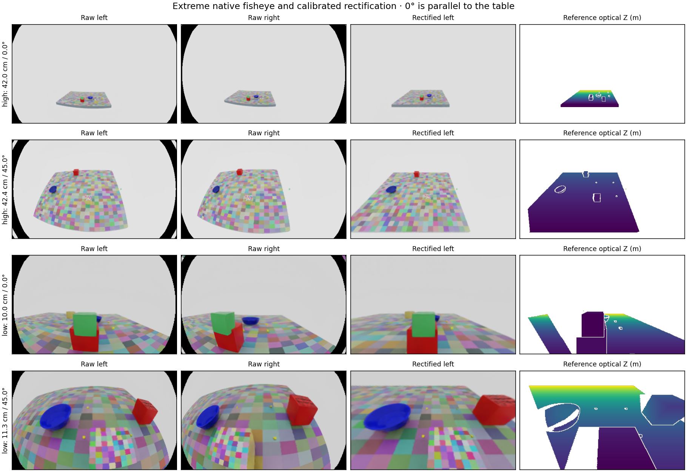
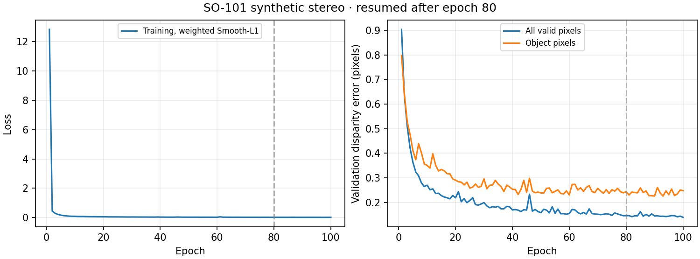
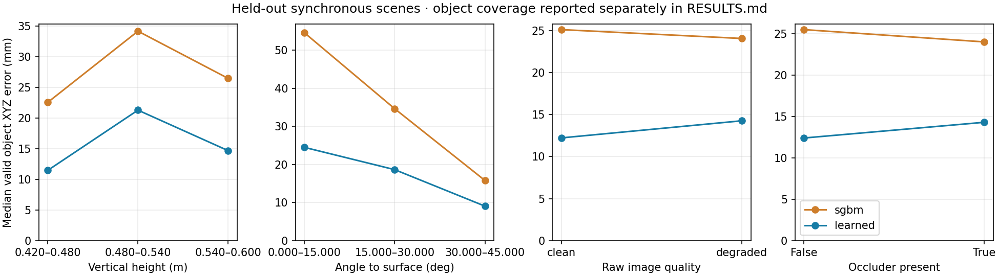
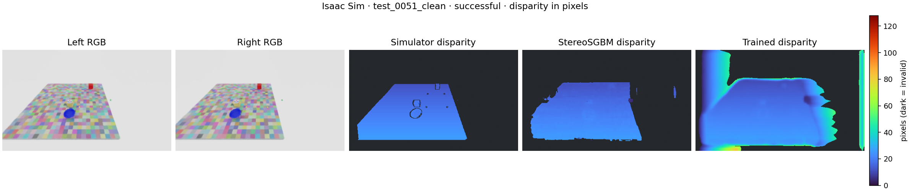
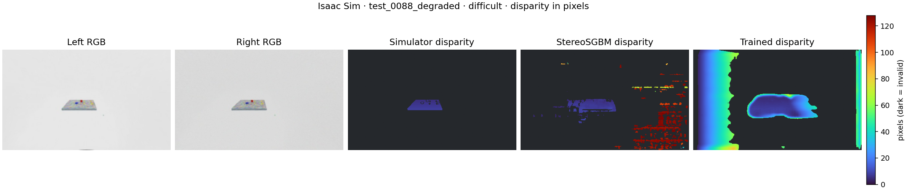
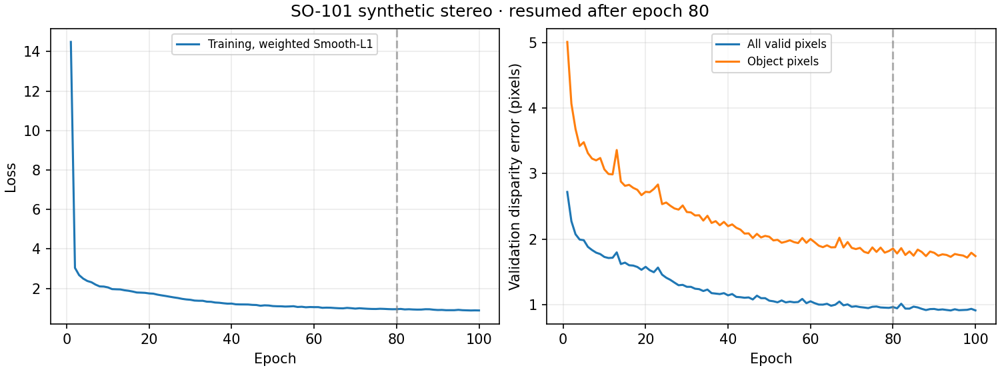
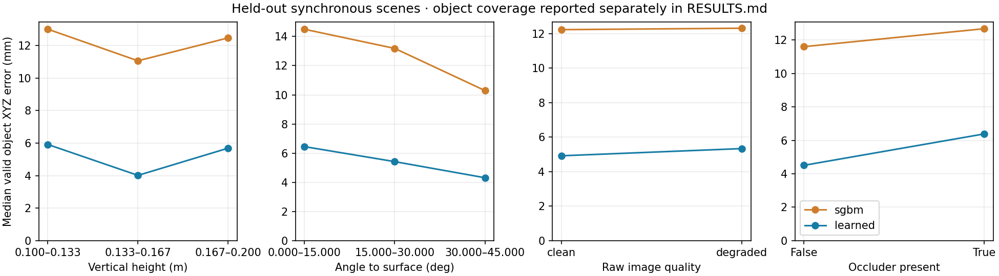
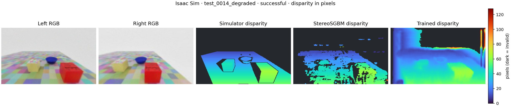
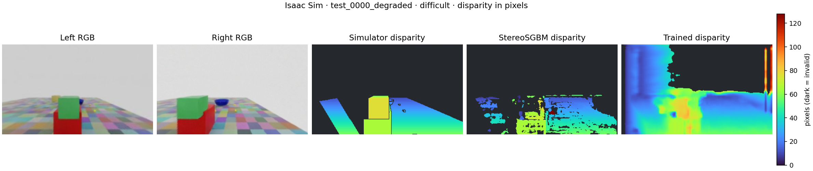

# Zwei neue Höhen-/Fisheye-Modelle · ausgeführte Abnahme

Zwei unabhängig von Grund auf trainierte CompactStereo-Modelle, jeweils 100 Epochen, 10.500 Optimizerschritte und 84.000 Paar-Präsentationen. Beide verwenden exakt 60 mm Basis und identische Kamerarotationen in allen drei Achsen. **Alle Genauigkeiten sind Simulationsergebnisse.** [Konfiguration und Startbefehle](../../STEREO_HEIGHT_FISHEYE.md).

**Winkelbezug:** 0–45° gegen die Tischfläche. 0° bezeichnet eine waagerechte Blickachse; der Arbeitsbereich liegt dann unterhalb der Bildmitte. Senkrechte Draufsicht wäre 90° zur Tischfläche. Höhe und Schrägentfernung sind unterschiedliche Größen.

| Modell | Senkrechte Höhe | RGB-Auflösung | Beste Validation EPE px | Trainingsschleifen s |
| --- | --- | --- | ---: | ---: |
| high | 42–60 cm | 480×288 | 0,14 | 576,23 |
| low | 10–20 cm | 320×192 | 0,91 | 575,32 |

Je Modell: 420 Trainingsszenen / 840 Paare, 60 Validierungsszenen / 120 Paare, 90 Testszenen / 180 Paare und 45 ungesehene Szenen / 90 Paare. Alle Varianten einer Szene bleiben im selben Split. Seed High=3101, Low=3102. Der Checkpoint wurde ausschließlich nach Validation ausgewählt. Nach Epoche 80 wurde der Prozess beendet und aus dem gespeicherten Zustand bis Epoche 100 fortgesetzt. Trainings-Forward: BF16; Validation, Inferenz und ONNX: Float32. Gewichte: Float32.

## Synchroner Test

Optische Z-Fehler werden auf den gültigen, jeweils akzeptierten Referenzpixeln gemessen. XYZ-Fehler beziehen sich auf denselben erodierten sichtbaren Oberflächenmedian für beide Verfahren. Pro Modell gibt es 540 Objektgelegenheiten aus drei Objektarten und jeweils zwei Qualitätsvarianten. Unsichtbare oder zu kleine Referenzregionen bleiben im Nenner. Die Simulator-Masken bewerten den Tiefenschätzer; eine reale Objektdetektion ist damit nicht abgenommen.

| Modell / Verfahren | Z Median / p95 mm | Objekt-XYZ Median / p95 mm | Gültige Objekte | Gültige Referenzpixel |
| --- | ---: | ---: | ---: | ---: |
| high / sgbm | 10,88/75,28 | 24,64/126,19 | 384/540 | 94.57 % |
| high / learned | 4,79/35,94 | 13,32/58,29 | 469/540 | 100.00 % |
| low / sgbm | 2,86/29,32 | 12,30/43,10 | 509/540 | 81.97 % |
| low / learned | 2,23/20,99 | 5,10/30,48 | 525/540 | 100.00 % |

SGBM verwendet eine beidseitige Auffüllung des Suchbereichs und eine Links-Rechts-Prüfung. Der neue Regressionstest prüft ausdrücklich den Fall Suchbereich = Bildbreite. Ein nur links aufgefülltes Bild würde beim Rückwärtsmatcher sämtliche gültigen Regionen verlieren.

## Höhe und Blickwinkel

| Profil / Gruppe | Verfahren | Z Median / p95 mm | XYZ Median / p95 mm | Gültige Objekte |
| --- | --- | ---: | ---: | ---: |
| high / Höhe m 0.420–0.480 | sgbm | 8,59/57,05 | 22,54/103,45 | 187/234 |
| high / Höhe m 0.420–0.480 | learned | 3,68/27,59 | 11,46/48,77 | 228/234 |
| high / Höhe m 0.480–0.540 | sgbm | 20,62/120,79 | 34,15/151,79 | 70/114 |
| high / Höhe m 0.480–0.540 | learned | 8,99/49,68 | 21,27/79,08 | 90/114 |
| high / Höhe m 0.540–0.600 | sgbm | 15,03/89,28 | 26,45/115,79 | 127/192 |
| high / Höhe m 0.540–0.600 | learned | 7,14/45,56 | 14,67/58,21 | 151/192 |
| high / Winkel zur Fläche ° 0.000–15.000 | sgbm | 39,25/174,68 | 54,57/167,15 | 100/192 |
| high / Winkel zur Fläche ° 0.000–15.000 | learned | 17,63/65,59 | 24,49/81,66 | 145/192 |
| high / Winkel zur Fläche ° 15.000–30.000 | sgbm | 24,98/129,67 | 34,64/133,47 | 67/120 |
| high / Winkel zur Fläche ° 15.000–30.000 | learned | 11,06/53,24 | 18,65/63,56 | 96/120 |
| high / Winkel zur Fläche ° 30.000–45.000 | sgbm | 8,74/42,09 | 15,82/55,57 | 217/228 |
| high / Winkel zur Fläche ° 30.000–45.000 | learned | 3,76/21,61 | 9,07/28,69 | 228/228 |
| low / Höhe m 0.100–0.133 | sgbm | 2,05/27,98 | 13,00/35,96 | 171/186 |
| low / Höhe m 0.100–0.133 | learned | 1,87/18,67 | 5,91/25,28 | 176/186 |
| low / Höhe m 0.133–0.167 | sgbm | 2,92/29,23 | 11,06/34,23 | 153/156 |
| low / Höhe m 0.133–0.167 | learned | 2,18/19,66 | 4,01/22,11 | 154/156 |
| low / Höhe m 0.167–0.200 | sgbm | 3,65/30,52 | 12,47/52,14 | 185/198 |
| low / Höhe m 0.167–0.200 | learned | 2,78/24,61 | 5,69/36,76 | 195/198 |
| low / Winkel zur Fläche ° 0.000–15.000 | sgbm | 4,49/39,10 | 14,49/45,12 | 173/192 |
| low / Winkel zur Fläche ° 0.000–15.000 | learned | 3,22/31,55 | 6,45/37,49 | 185/192 |
| low / Winkel zur Fläche ° 15.000–30.000 | sgbm | 2,89/33,81 | 13,18/50,52 | 126/132 |
| low / Winkel zur Fläche ° 15.000–30.000 | learned | 2,19/22,42 | 5,42/33,61 | 130/132 |
| low / Winkel zur Fläche ° 30.000–45.000 | sgbm | 2,24/21,98 | 10,29/31,75 | 210/216 |
| low / Winkel zur Fläche ° 30.000–45.000 | learned | 1,90/15,61 | 4,31/15,46 | 210/216 |

## Ungesehene starke Linsenparameter

Die Bildpaare stammen aus anderen Szenen und stärkeren k₁-Werten (−0,13 bis −0,09 statt −0,08 bis −0,02 im Training). Die Kalibrierung ist für die Entzerrung bekannt. Dies testet ungewohnte Randauflösung/Interpolation, nicht einen unbekannten Kalibrierfehler.

| Modell / Verfahren | Z Median / p95 mm | XYZ Median / p95 mm | Gültige Objekte |
| --- | ---: | ---: | ---: |
| high / sgbm | 12,72/88,58 | 29,70/128,06 | 186/270 |
| high / learned | 5,49/41,59 | 17,41/66,86 | 246/270 |
| low / sgbm | 3,33/31,15 | 13,33/56,69 | 252/270 |
| low / learned | 2,48/21,87 | 6,02/27,34 | 260/270 |

## Geometrie, Speicher und Inferenz

RTX 4070 Ti mit 12.282 MiB, Ryzen 7 5800X, 32 GB RAM, Isaac Sim 5.1, PyTorch 2.6.0+cu124. Beide Datensätze bestehen Q-/Einheiten-/Frame-/Split- und Tischprüfungen. Die niedrigere Testgruppe wurde vor Training mit eindeutig getrennten Tisch-/Verdeckungslabels korrigiert. Die vier-Paar-Kapazitätsprüfungen erreichten folgende EPEs.

| Profil | Overfit EPE px | Native Randverschiebung px | Belegte / reservierte Trainings-MiB |
| --- | ---: | --- | ---: |
| high | 0,37 | 94,14–106,56 | 729,15/1040,00 |
| low | 0,74 | 62,83–71,00 | 647,84/1288,00 |

Das niedrige Modell benötigt bis 320 Pixel Suche: Die Referenzdaten enthalten tatsächlich gültige Disparitäten bis rund 316,5 Pixel. Die gemeinsame physische Kamerarotation ist 0°; die relative Orientierung wurde für alle Aufnahmen aus den gespeicherten Matrizen geprüft. Rohbild-Fisheye und rektifiziertes Bild haben unterschiedliche Intrinsics. Bereiche außerhalb der fotografischen Unterstützung sind nicht Teil der Referenz.

| Profil / Verfahren | Entzerrung inkl. Maps ms | Warme Anwendung ohne Mapaufbau ms | Schätzer ms | Geometrie ms |
| --- | ---: | ---: | ---: | ---: |
| high / sgbm | 6,68 | 2,23 | 49,24 | 8,02 |
| high / learned | 6,68 | 2,23 | 5,35 | 7,16 |
| low / sgbm | 2,16 | 0,96 | 75,09 | 3,65 |
| low / learned | 2,16 | 0,96 | 8,92 | 3,13 |

Die Rohkalibrierung wechselt im Benchmark von Szene zu Szene. Mapaufbau und eigentliche Remap-Anwendung sind deshalb getrennt erfasst. SGBM läuft auf der CPU, das Modell auf der GPU; Modellzeiten schließen Normalisierung/Resize und Transfers ein. Der Kamerasimulator selbst sowie Laden/Transport sind ausgenommen. Torch-Belegung und Reservierung enthalten nicht den kompletten Treiberkontext.

high: GPU-Inferenz 71,09 MiB belegt, 90,00 MiB reserviert; Treiber-Stichprobe am Prozessende 318,00 MiB.
low: GPU-Inferenz 75,62 MiB belegt, 106,00 MiB reserviert; Treiber-Stichprobe am Prozessende 334,00 MiB.

## Projektions- und Markerprüfung

| Profil | Reprojektion p95 links/rechts px | Größter Tisch-Medianfehler mm | Marker-XYZ Median/p95 mm; gültig |
| --- | ---: | ---: | ---: |
| high | 0,62/0,61 | 0.001297 | 11,71/70,83; 696 |
| low | 0,66/0,66 | 0.001327 | 2,93/13,17; 558 |

Marker werden über Simulator-IDs zugeordnet und mit ihren tatsächlichen Bildmittelpunkten trianguliert. Das ist eine geometrische Plausibilisierung mit bekannter Identität, keine Abnahme eines realen Marker-Matchers.

## Artefakte und Prüfungen

Roh-Fisheye- und bereits entzerrte Inferenz liefern bitgleiche Disparität und Scores. ONNX und PyTorch wurden je Modell an drei Paaren aus Test, degradiertem Test und ungesehenem Optiksatz geprüft. Die App-Schnittstelle übernimmt die modellabhängigen Tiefengrenzen; nahe Punkte unter 20 cm werden akzeptiert. Ein 100-ms-Versatz wird weiterhin über das 25-ms-Pairinglimit abgelehnt. **46 relevante Tests bestehen.**

- high: `checkpoints/so101-high-height-fisheye/best.pt`, ONNX-Abweichung maximal 0.00043488 Pixel. SHA-256 `4d1a14e0fdb6f83804366bc5104b50314ceba2794919e9eefcd182d2b5977f88`.
- low: `checkpoints/so101-low-height-fisheye/best.pt`, ONNX-Abweichung maximal 0.00084686 Pixel. SHA-256 `8b8935917e3f4a05f13de04311d21d953b9b55b6248663d7cc71941f9059a1a5`.

Die absoluten lokalen Pfade stehen außerhalb von Git in `training-runs/height-fisheye/local-paths.txt`. Die portablen Modellmanifeste liegen unter `configs/stereo/high-height-model-manifest.json` und `low-height-model-manifest.json`. Beide geprüften PyTorch-Gewichte und ONNX-Exporte sind mit kalibrierten Rohbildbeispielen im Repository enthalten und ersetzen das frühere Modell. Datensätze, fortsetzbare Trainingsstände und Trainingslogs bleiben lokale Artefakte. [Vollständige Zahlen und Quellprüfsummen](verification.json).

## Sichtprüfung

### high

### low

## Grenzen

Sehr flache Blickachsen erzeugen trotz geringer Montagehöhe größere optische Entfernungen und kleine Objektregionen. Das hohe Modell erreicht deshalb keine durchgängige Millimeterpräzision. Auch beim niedrigen Modell sind die Fehler im oberen Perzentil deutlich größer als der Median. Eine gültige Ausgabe garantiert keine kleine Abweichung. Der Score ist weiterhin nicht als Fehlerwahrscheinlichkeit kalibriert. Die Referenzen bewerten sichtbare Oberflächen statt Objektmittelpunkten. Außerhalb der gültigen Simulatorreferenz wird keine Genauigkeit behauptet. Es wurden einfache Workcell-Geometrie und drei Objektarten verwendet; echte Kameras, echte Linsenkalibrierung und unabhängige Messabstände fehlen. Keine der Zahlen ist ein Nachweis realer Greifgenauigkeit.
