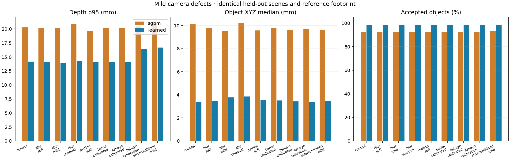
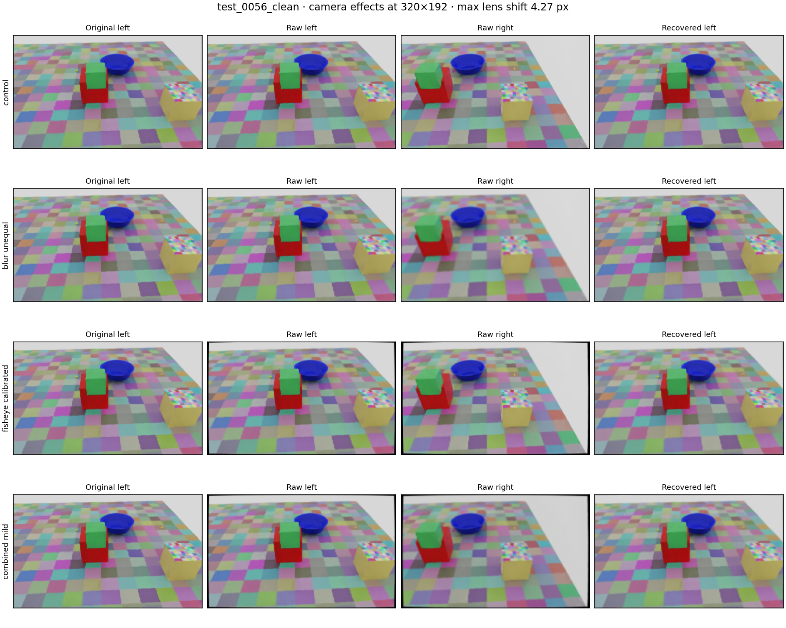

# Milde Kameraabweichungen im Stereo-Test

Bestehender Modellstand, **90 saubere Bildpaare je Profil**, 9 Profile, 270 Objektgelegenheiten pro Profil. Nur zurückgehaltene Isaac-Szenen; Gewichte und Trainingsdaten wurden nicht verändert.

Die Bedingungen verwenden exakt dieselben Quellbilder, Posen, ideale Ausgangskalibrierung und Objektreferenzpunkte. Eine gemeinsame fotografisch verfügbare Bildregion wird aus sämtlichen Profilen bestimmt. Alle Tiefen- und Objektmetriken verwenden diese gemeinsame Region. Das verhindert einen scheinbaren Genauigkeitsgewinn durch unterschiedlich beschnittene Bildränder. Die Zahlen sind deshalb nicht unmittelbar mit dem älteren Benchmark auf sauber/degradiert gemischten Bildern vergleichbar.

| Profil | SGBM Z Median/p95 mm | Modell Z Median/p95 mm | SGBM XYZ Median/p95 mm; gültig | Modell XYZ Median/p95 mm; gültig |
| --- | ---: | ---: | ---: | ---: |
| control | 3.25/20.25 | 2.10/14.16 | 10.11/29.44; 250/270 | 3.40/15.59; 266/270 |
| blur_soft | 3.23/20.14 | 2.09/14.10 | 9.76/28.88; 250/270 | 3.46/15.97; 266/270 |
| blur_mild | 3.11/20.15 | 2.03/13.93 | 9.50/29.91; 250/270 | 3.77/16.52; 266/270 |
| blur_unequal | 3.47/20.80 | 2.09/14.31 | 10.22/29.30; 250/270 | 3.85/16.53; 266/270 |
| motion_soft | 3.07/19.56 | 2.05/14.09 | 9.57/29.14; 250/270 | 3.57/16.07; 266/270 |
| barrel_calibrated | 3.27/20.21 | 2.08/14.09 | 9.78/29.64; 250/270 | 3.50/15.76; 266/270 |
| fisheye_calibrated | 3.27/20.18 | 2.08/14.08 | 9.61/29.36; 250/270 | 3.44/15.64; 266/270 |
| fisheye_calibration_error | 3.09/20.53 | 2.68/16.40 | 9.68/29.36; 250/270 | 3.42/17.86; 266/270 |
| combined_mild | 3.34/21.05 | 2.74/16.66 | 9.62/28.71; 251/270 | 3.50/17.18; 266/270 |

Bei korrekter Linsenentzerrung bleiben die Modellfehler nahe am Kontrollfall. Der gezielte Kalibrierfehler erhöht den medianen Tiefenfehler von 2,10 auf 2,68 mm und den p95 von 14,16 auf 16,40 mm. Im kombinierten Fall liegen diese Werte bei 2,74/16,66 mm. Die Objektabdeckung bleibt bei 266/270; ein gültiger Score garantiert damit weiterhin keine bestimmte Genauigkeit. Symmetrische leichte Glättung verschlechtert hier den dichten Tiefenfehler nicht durchgehend.

## Tatsächlich angewandte Stärken

Die Standardkonfiguration verwendet Blur mit Gauß-σ 0,4/0,8 Pixel, asymmetrisch 0,35/0,9 Pixel. Bewegungsunschärfe: horizontaler 3-Pixel-Kernel. Linsen: Brown-Conrady-Tonnenverzeichnung und separat OpenCVs echtes Fisheye-θ-Modell. Die Fisheye-Koeffizienten kompensieren einen Großteil des Unterschieds zur Pinhole-Projektion bei diesem Sichtfeld. Deshalb ist die geometrische Verschiebung klein. Nullkoeffizienten würden im Fisheye-Modell dagegen keine Pinhole-Identität ergeben.

| Profil | Größte Rohbildverschiebung px | Größter geometrischer Restfehler rechts px |
| --- | ---: | ---: |
| control | 0.000 | 0.000 |
| blur_soft | 0.000 | 0.000 |
| blur_mild | 0.000 | 0.000 |
| blur_unequal | 0.000 | 0.000 |
| motion_soft | 0.000 | 0.000 |
| barrel_calibrated | 2.267 | 0.000 |
| fisheye_calibrated | 4.265 | 0.000 |
| fisheye_calibration_error | 4.265 | 1.068 |
| combined_mild | 4.265 | 1.068 |

Die Standard-Kalibrierfehlervariante verändert nur rechts k₁ von tatsächlich 0,300 auf angenommen 0,285. Die linke Kamera wird geometrisch korrekt entzerrt. Ihre ursprüngliche Tiefenreferenz und Q bleiben dadurch gültig. Die rechte Kamera ist dann nur näherungsweise rektifiziert: genau diese kleine Fehlanpassung wird getestet. Beidseitige unbekannte Kalibrierfehler wurden hier nicht simuliert.

Im Standard-Kombinationsprofil kommen σ=0,4/0,65 Pixel, Rauschen σ=1/255 und 3 % weniger Helligkeit rechts hinzu. Dies ist ein gemeinsamer Stressfall und isoliert die Einzelursachen nicht. Alle Parameter stehen in `configs/stereo/robustness-mild.yaml`. Die Stärken gelten bei 320×192 Pixeln.

Die Rohbilder werden zuerst mit dem jeweiligen Linsenmodell abgebildet, dann unscharf/verrauscht und anschließend mit der bekannten bzw. leicht fehlerhaften Kalibrierung entzerrt. Ein bloßes Verbiegen rektifizierter RGB-Bilder bei unveränderten falschen Tiefenlabels wird vermieden. Numerische Tests prüfen Projektionsinversion, erhaltene Disparität einer bekannten Ebene, gemeinsame Referenzunterstützung und reproduzierbare Störungen.

Kalibrierungskarten werden zwischengespeichert. Die Rektifizierungszeit im JSON enthält die tatsächliche Linsenkorrektur sowie die bestehende Stereo-Remap-Stufe. Das synthetische Erzeugen der Rohkameradefekte wird nicht als Inferenzzeit gezählt. Details einschließlich Abdeckung, Ablehnungsgründen und getrennten Laufzeiten stehen in `robustness.json` und in den pro Profil gespeicherten Berichten.

Dies erweitert die Offline-Tests. Es ist kein zusätzliches Fisheye-Live-Backend in der GUI und kein auf diesen Testdaten nachtrainiertes Modell. Die angenommenen Linsenparameter sind synthetisch und keine Messung der AMDIS01B. Reale Kalibrierung und unabhängige Realtests bleiben erforderlich.

Primärquellen: [OpenCV Fisheye-Modell](https://docs.opencv.org/4.x/db/d58/group__calib3d__fisheye.html), [OpenCV Pinhole-/Verzeichnungsmodell](https://docs.opencv.org/4.x/d9/d0c/group__calib3d.html).

## Parameter dieses Laufs

| Profil | Parameter |
| --- | --- |
| control | `{"blur_sigma": [0.0, 0.0]}` |
| blur_soft | `{"blur_sigma": [0.4, 0.4]}` |
| blur_mild | `{"blur_sigma": [0.8, 0.8]}` |
| blur_unequal | `{"blur_sigma": [0.35, 0.9]}` |
| motion_soft | `{"motion_pixels": [3, 3]}` |
| barrel_calibrated | `{"lens_model": "plumb_bob", "distortion_left": [-0.02, 0.005, 0.0, 0.0, 0.0], "distortion_right": [-0.025, 0.005, 0.0, 0.0, 0.0]}` |
| fisheye_calibrated | `{"lens_model": "fisheye", "distortion_left": [0.31, 0.085, 0.0, 0.0], "distortion_right": [0.3, 0.08, 0.0, 0.0]}` |
| fisheye_calibration_error | `{"lens_model": "fisheye", "distortion_left": [0.31, 0.085, 0.0, 0.0], "distortion_right": [0.3, 0.08, 0.0, 0.0], "assumed_distortion_right": [0.285, 0.08, 0.0, 0.0]}` |
| combined_mild | `{"lens_model": "fisheye", "distortion_left": [0.31, 0.085, 0.0, 0.0], "distortion_right": [0.3, 0.08, 0.0, 0.0], "assumed_distortion_right": [0.285, 0.08, 0.0, 0.0], "blur_sigma": [0.4, 0.65], "noise_sigma_dn": [1.0, 1.0], "gain": [1.0, 0.97]}` |

13 Stereo-Tests und 27 bestehende Vision-Tests bestehen. Ein zusätzlicher GPU-Regressionstest auf den ursprünglichen 90 sauberen Bildern bestätigt unveränderte Ausgangsmetriken und Messungszahlen ohne Effektvorverarbeitung. Vollständige Messdaten, Einzelgruppen, Laufzeiten und Prüfsummen stehen in [robustness.json](robustness.json). Die bisherigen Trainingsberichte beziehen sich auf den früheren Commit `4b0d3d3`; ihre historischen Quellprüfsummen werden durch diese Erweiterung nicht umgeschrieben.
